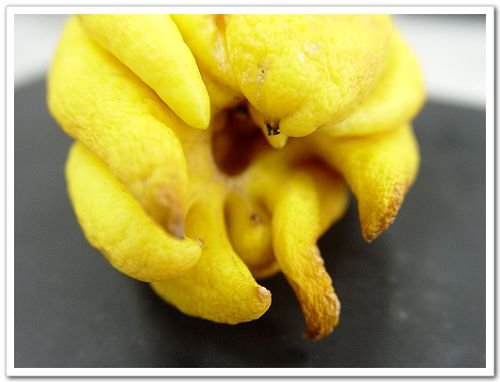

# 扯淡

女人被歧视得究其自身原因，我从小喜与男生打交道不无道理。受不了猪脑，更受不了脂粉糜俗，谈一化妆品能谈出十个所以然来。职业妇女中少有成绩，工作做的漂亮的，被人闲话也不会少。这闲话也是猪脑抖落出来自己却沉浸在混沌中的一类。工作无高低贵贱之分，对小事能尽心尽责会赢得尊敬。份内事不负责，唧唧歪歪，整个儿唬弄过去了事。不参与以为经验丰富、勤奋负责，了解后就两字儿概括“扯淡”！  
  
前阵子题图上有句话：尴尬是一种可贵的能力。  
脑子不够使不是问题，不做份内事还理直气壮闲话一箩筐，没有一丝尴尬，不知可以用什么来形容，男人若此...更鄙视。仔细想想，某些寡言薄语条理清楚不大废话的才是智慧之人。  
  
   
新鲜饱满的怫手在办公室放了两周成了脱水蔬菜，人亦如此。

---

## 评论（3）

**youzi** · 2007-02-07

要看在那里了，在美国一定是能说会道的人吃的开，美国人还没开始做PROJECT的时候就吹牛，做的过程中更是大书特书，PROJECT完成以后能吹上天，美国人往往会做一个很大的计划，最好把所有的人都包括进去，等PROJECT完成了，大部分CREDIT就是他的了，中国人就是蒙头死干活的主，活干多，职位最低，钱挣的最少。美国教育中“说”是很重要的能力，小学生就是做PRESENTATION，中学就开PUBLIC SPEECH 课。美国很多著名的SPEECH 象 I HAVE A DREAM 能够影响几代人，“能说”是一种LEADSHIP，一点不比“能干” 对一个人的发展影响小。

**Blue Simon** · 2007-02-08

恩，同意，作为一个半导体行业从业者来说  
一个善于做Presentation的技术型销售可能是公司最渴望的人才，当然，RD始终是命脉，不过在中国现在浮躁的大环境下面，还是善于表达自己的人容易出头些  
不过这些好像有些离题……  
但是我还是相信天道酬勤

**Michael** · 2007-02-09

同意

