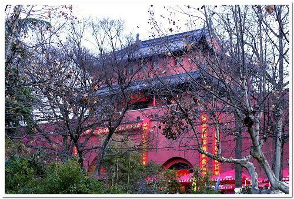
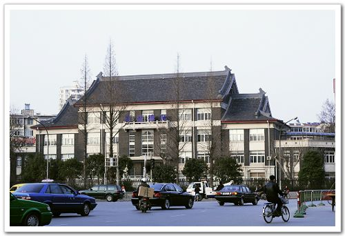
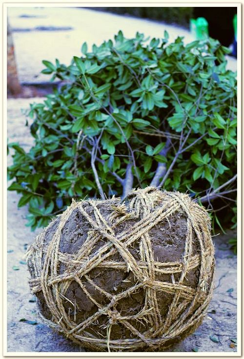
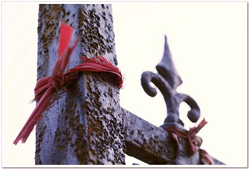
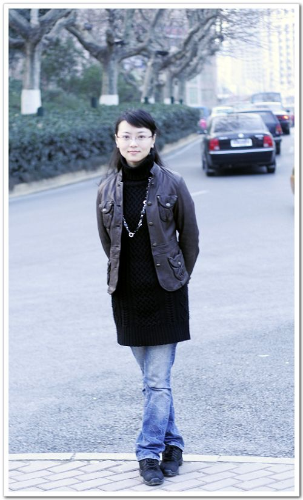

# 冷调鼓楼

夜里忘记关窗户，难得感冒的我终于患了重感冒。想来有点窝囊。  
曾经许诺去拍鼓楼的黄昏，周末特地在17点左右赶到鼓楼，黄昏的太阳不知在什么地方，设想中的构图无法如愿。周末这组照片的色彩不大喜欢，自己未能沉浸下去做这件事，想想很多事情皆如此，一个人做自己喜欢的事，不被打搅，不去打搅。  
  
偶有冷漠情绪，想到“冷眼看人生”五个字，如冷调的周末。尚未看穿全局，片段中的线条却已勾勒出图象。接受现实倒是容易快乐些。  
  
   
   
   
   

---

## 评论（7）

**Blue Simon** · 2007-02-12

大一大二的时候都是在鼓楼旁边坐鼓扬线回浦口校区，离开南京前的一个月经常在这里送家住大厂的女友回家，在南京的最后两年就住在丹凤街，说来鼓楼真的在我8年南京生涯里面占了相当的分量

还记得以前常去OCC地下的原色PUB，现在不知还在不在

又跟着你的blog神游了一下南京，真好

**Christina** · 2007-02-12

还在的.

**backhand** · 2007-02-12

那张鼓楼的红墙照片，凌乱，飞线太多

**[atbyin](http://www.atbyin.com)** · 2007-02-12

飞线多也是一种感觉

**[andy](http://elfix.spaces.live.com/)** · 2007-02-13

曾经特地去天津的五大道拍旧时租界的风景，结果出来的片子不尽人意，和想象中差的很远。

反而有时候匆忙用手机拍下的图片，用软件处理过后，竟然会得到非常有感觉得效果。

**jiajialing** · 2007-02-13

又见精彩，good pics：）

**[proke](http://hi.baidu.com/prince)** · 2007-02-13

我在市区没看过黄昏的太阳，最近的一次好像是在江宁开发区那的一块工地上。

