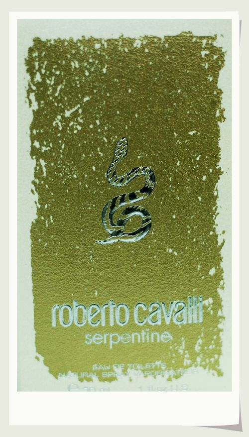

# 情人节.国际消费节

收拾完三箱样品，浑身是汗，累坏了。  
听好些人不约而同的用“精干干”形容过我，刚在走廊遇见的同事才说了这个词。其实我懈了哐啷，还驼着个背走路，身体缺陷是可以隐藏的，就好象今儿早晨窗外阳光给人温暖的错觉，出门才知道衣服穿少了。  
  
上天挺厚道，连下几天雨，情人节这天放晴。不太喜欢情人节，一年中更喜欢过生日、纪念日。只属于自己的特别日子，情人节几乎就是全球消费节，人云亦云的方式内容让人腻得慌，毫无意外惊喜与感动。相信今晚即使平时人烟稀少的餐厅也会跟着貌似快乐的人们火爆一把。偶惦记着那些新出来的DVD，指望每晚满足过五官神经然后心满意足地入眠。《血钻石》、《麦迪逊》之后准备在今天晚上感受一下《德州电锯杀人狂-前传》的刺激。巩俐新作《沉默羔羊前传》北美是否上映？到这里估计要三个月才能出D9版本的DVD，期盼ing~~  
  
自购新香水一瓶，只关心芬芳，不懂品牌。  
品牌名称：Roberto Cavalli  
创建地：意大利  

---

## 评论（4）

**youzi** · 2007-02-14

这两天我也是忙昏了，因为要搬家，现在工作的地方离我新买房子的地方50 MILES，还是希望在家附近工作，星期一去INTERVIEW，今天还要去INTERVIEW，星期一去INTERVIEW的是一个天主教SISTERS办的有500个床位医院，工资和福利都特好，昨天已经给了OFFER，今天还要去INTERVIEW，也是一个很大的医院，看来人还是要经常动一动，新的工作对自己也是一个挑战。

**jiajialing** · 2007-02-14

包装挺漂亮的，是条蛇？

**[农妇](http://adelinelv.spaces.live.com)** · 2007-02-15

中文题目叫《沉默羔羊前传》啊？马上会去看，意大利二月九号出来的。  
很奇怪啊，不论什么大片，一般国内的碟都会先出来的。现在买不到盗版了吗？

**[afan](http://blog.wenxuecity.com/myindex.php?blogID=22490)** · 2007-02-15

“Hannibal Rising” ?  
Already in cinema in Australia.  
Didn’t go watch this one though.

http://hoyts.ninemsn.com.au/movie/2179.asp

