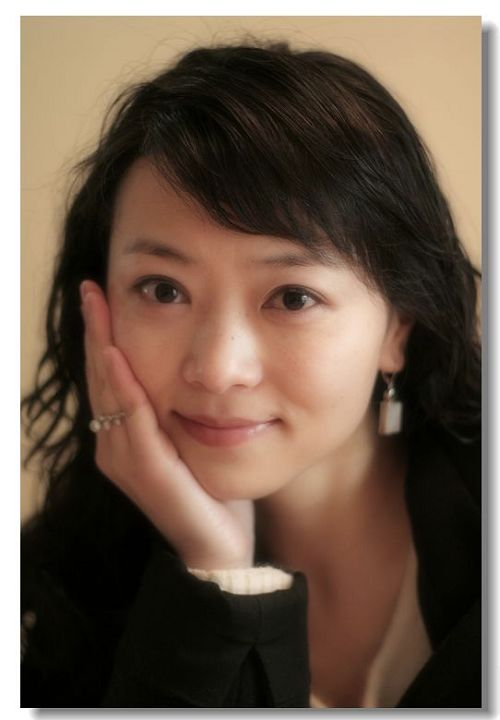

# 挥之不去

早晨出门前[**拍下的一组照片**](http://photo.lifetea.org/v/Its+me/070216/)，衰老真的挥之不去了......  

---

## 评论（11）

**jiajialing** · 2007-02-16

谁不会老呢,你看上去还好了,就是有点眼袋,这些天忙累了吧:)好好休息......

**看了又如何** · 2007-02-16

真正的美女是内在散发的一种魅力，这种魅力不会随时间而流逝．．．

**[andy](http://elfix.spaces.live.com/)** · 2007-02-16

外表的衰老并不可怕，重要的是要有一颗年轻的心

**[tumi](http://www.blogcn.com/user17/tumiyoyo/index.html)** · 2007-02-16

从高二的时候第一次在你这里接触BLOG,到现在我大二了,你看起来依然很美丽,比起你在威尼斯的照片,现在脸上的岁月痕迹反而增添的更成熟的韵味.  
新年快乐!

**CAICAI** · 2007-02-16

主要是眼中的一股忧郁。似乎还是因为惧怕衰老。  
不怕不怕，相信自己。你的任何时候都有爱你的人，喜欢你的人，不老的是老妖精。。。

**joanna** · 2007-02-17

chiritina现在是成熟风韵的时候，很有味道的说。眼袋有点显，眼角细纹可能需深层补水。不过气质弥补一切啦……  
看了同志们的留言，道理都容易说，自己也明白，可看镜中脸庞，还是带着忧虑想着如何能更年轻。

**[爽客甲](http://issomebody.spaces.live.com/)** · 2007-02-17

我怎么觉得Chris MM越来越漂亮涅。。。

新年到，要辞旧迎新（好心情）～

**Jonathan** · 2007-02-17

Actually you look great indeed. Happy new year of pig.

**[afan](http://blog.wenxuecity.com/myindex.php?blogID=22490)** · 2007-02-19

We will be 33 this year, bloody hell

**Anyayaya** · 2007-02-21

不要老戴隐形，眼袋有一半都是这么拉出来的。。。

**单旋~舞** · 2007-02-21

5层抢了我的台词。。。T\_T

其实呢，我也惧怕长大。。。

