# 年夜饭:)

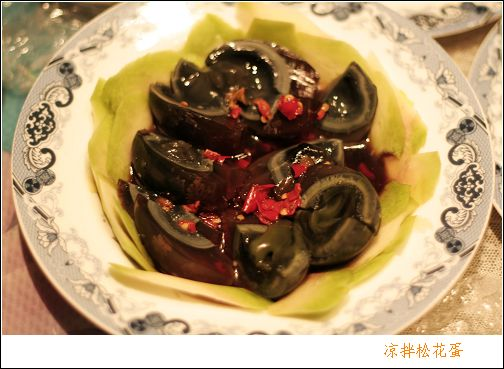   
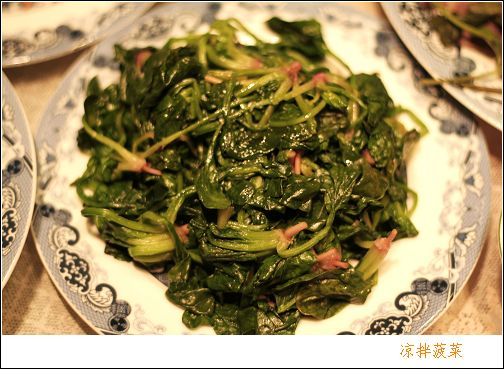   
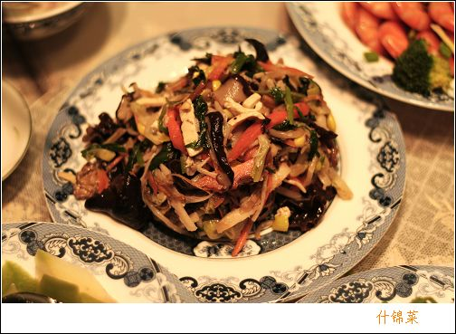   
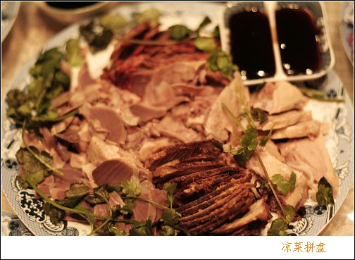   
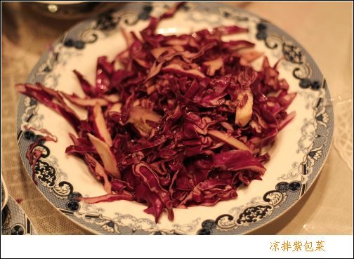   
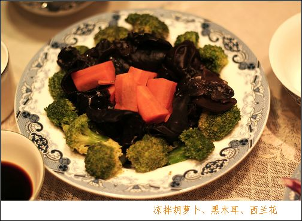   
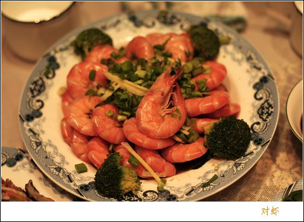   
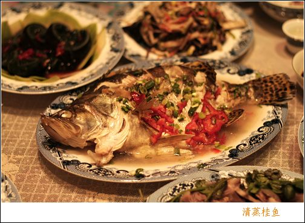   
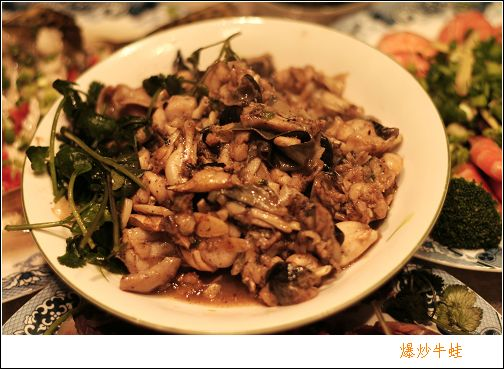   
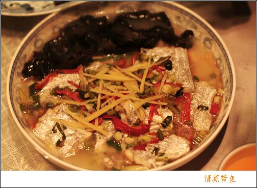   
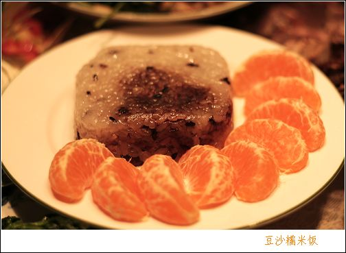   
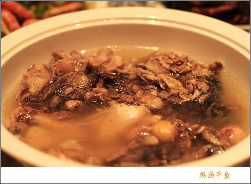   
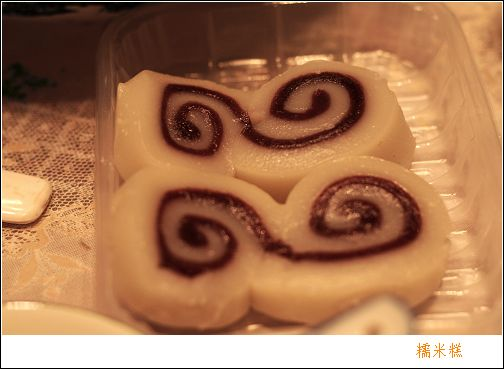

---

## 评论（13）

**Cuentos Chinos** · 2007-02-17

菠菜有凉拌吃法吗？菠菜不是热炒的吗？

**[andy](http://elfix.spaces.live.com/)** · 2007-02-17

在姐姐这里第一次坐到沙发哦  
松花蛋的做法和北方这里不同～～  
祝你新春快乐

**jiajialing** · 2007-02-18

丰盛的年夜饭，温馨的大年夜，精彩又一年，新年快乐！

**orange juice** · 2007-02-18

这么多好吃的,看着受不了,流口水......  
祝新年快乐!

**[爽客甲](http://issomebody.spaces.live.com/)** · 2007-02-18

口水流了一地。。。。能在家过年就是爽啊

新年快乐哦～

**Jonathan** · 2007-02-18

豆沙糯米饭很诱人。。。

**[afan](http://blog.wenxuecity.com/myindex.php?blogID=22490)** · 2007-02-19

mouth watering…..  
we had the new year eve’s dinner with friends in a sichuan restaurant, too spicy

**Christina** · 2007-02-19

呵呵，跟我口味一样，我也喜欢糯米饭的口感~

**Jonathan** · 2007-02-19

哈哈。越看越想吃。前段时间去无锡出差没看到这个。下次有机会去南京吃！

**ILN** · 2007-02-19

新年快乐!

**backhand** · 2007-02-25

新年快乐！

**fluent** · 2007-02-26

Hi Christina, hope you still remember me. Did you cook all these dishes? I believe I’ll dream of them tonight! You are still beautiful and wish you are beautiful forever!

**Sherry** · 2007-02-27

这些都是你做的啊？？？我不信。。。。。。  
要真的是你做的，你要做给我吃！！！

