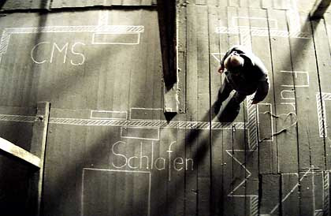

# HGW XX/7

昨晚看完这部德国片[《窃听风暴》(The Lives of Others)](http://www.mtime.com/movie/41005/)（或《别样人生》、《别人的生活》），那种不平静缘自很久未曾有过的看片瘾，真正是满足了对人性与心理细致描述的偏爱欲望。  
  
时间是1984年，地点是在东德柏林，每一次的开头字幕出现的是“公开化无处不在”。全东德百姓被一百万史塔西秘密警察控制着，还有两百万名告密者，他们的目地就是要知道别人生活的任何一个细枝末节。  
  
   
  
秘密警察Gerd Wiesler上尉(乌尔里希·穆埃饰演)，他那身陷的眼窝突显着炯炯有神的眼睛，冷漠的表情观察着周围的一切。饰演这个警察的演员选的好， 特工的面孔、发型，淳朴的体态，影片到最后你会觉得这个警察体态表现出的可爱和善良。最打动我的有几场戏：  
1、窃听过程中他逐渐被乔治·德莱曼Georg Dreyman(塞巴斯蒂安·考奇饰演)和克里斯塔-玛丽娅·西兰德Christa-Maria Sieland(马蒂娜·戈黛特饰演)夫妻两的生活所打动，偷走德莱曼的诗集，躺在温暖的光线下，持着那张豪无表情的面孔阅读的镜头使得我眼眶温润起来；  
  
2、Gerd Wiesler召妓与艺术家夫妇的生活形成强烈对比，难道秘密警察不是受到美好而人性的东西驱使向往亲密无间向往家庭生活，渴望一个女人的陪伴吗？这幕戏也是为了表现冷酷制度下丝毫摧毁不了人性中最柔软的部分；  
  
3、克里斯塔-玛丽娅·西兰德为了保护自己的爱人，保住自由和艺术生涯不得不接受艺术部长的性骚扰，在艺术家夫妇为此痛苦矛盾，妻子克里斯塔-玛丽娅百般进行思想斗争的时候，秘密警察Gerd Wiesler以一个普通观众的身份出现在她面前，给她心理上的支持和劝导，使得这个女演员有勇气拒绝部长的无理要求回到丈夫身边；  
  
4、秘密警察Gerd Wiesler的代号为HGW XX/7，柏林墙拆掉后，他成了一个默默无闻的邮差，有一天他在书店看到乔治·德莱曼新出版的书籍，打开封页上面写着HGW XX/7....默契和感激等等一系列复杂的心情都在那一刻迸发出来，很难察觉到Gerd Wiesler表情的变化，但却是以他那双深邃清透的眼睛为剧终镜头......  
  
这种片子看得很过瘾，也想让人翻一翻德国的历史资料。  
  
饰演秘密警察的演员 - 乌尔里希·穆埃 Ulrich Mühe曾出演以下电影:  
拜见希特勒 Mein Führer (2007)   
窃听风暴 Leben der Anderen, Das (2006)   
Schneeland (2005) ..... Knövel   
哈姆雷特X Hamlet\_X (2003)   
间谍佐尔格 Spy Sorge (2003)   
见证人 Amen. (2002)   
城堡 Schloß, Das (1997)   
大快人心 Funny Games (1997)   
Rennschwein Rudi Rüssel (1995)   
冒牌货 Schtonk! (1992)   
荧光血影 Benny's Video (1992)

---

## 评论（8）

**[Marcher李](http://www.yqrundream.blog.com)** · 2007-03-09

好片国内难求呀  
风过

**[May](http://blog.sina.com.cn/u/1224876730)** · 2007-03-09

I heard it is a great movie too. I am looking forward to watching it.

**lcm** · 2007-03-09

新界面风格清新，配的照片很有感觉。

**Lee** · 2007-03-10

好喜欢这个背景， 一直喜欢这种色调，孔雀蓝， 孔雀紫...

**Christina** · 2007-03-10

TO：YOUZI  
除了第二段是摘抄电影简介外，其他都是自己写的观后感。

**Martin** · 2007-03-12

每次看完历史相关的片子我都会wikipedia一番  
好像上次看过的关于德国就是the pianist了,没看过的话推荐一下

**汐** · 2007-03-16

这部电影真棒。  
我看完后向我闺蜜激动地推荐，这个长腿金发的德国美女很气愤地拒绝了：“ 德国电影叫好叫座的不是讲纳粹就是讲东德， 不看。“ 我只好虚弱地安慰她， “那不还有快跑罗拉和西西公主么。“

**KW** · 2007-03-25

中国没有HGW XX/7!有CCP XX/8..CCPXX/9…........他们绝不会干HGW XX/7!这种蠢事

