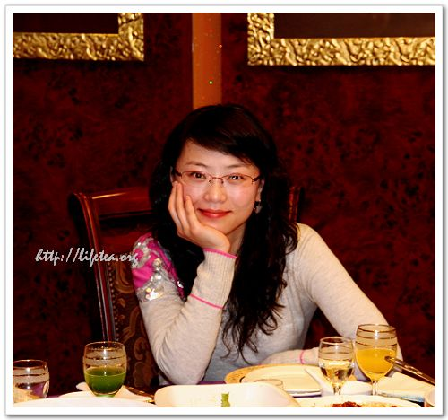

# 无题

长辈的世交请了我们一家人去吃晚饭，她家的儿媳妇正要上任我们公司所在区的区长，很年轻的女士，儿子又是某局处长。饭局尾声有个男人进到包间里敬了一圈酒，典型的场面寒暄与规范笑容，想来做官一定很累。福气就那么多，这里有了别处自然会少一些，所谓这世上无完美之人，无完美之事。公司这么多年的年会上我只抽到过一次四等奖，我相信这里没有运气，一定是在某处享用了。  
  
家庭活动有时能让我意识到现实生活，这话乍听起来是废话。我想表达的譬如你活着但不会感觉到“活着”，只有受到病痛折磨或处于生命边缘的时候才会意识到“活着”的状态，这样是不是理解我所说的？每天一个人去上班，到了办公室坐在深邃的隔段里工作，晚上下班回家，日复一日的内容似乎有些真空，这是较平静的真空。一旦参加家庭活动，每个小家庭就好象成列品似的铺开在众人面前，彼此谈论，相互观察，这时候会意识到现实的状态。  
  
   

---

## 评论（10）

**Jonathan** · 2007-03-11

说得好

**Martin** · 2007-03-11

红泥?  
我倒相信你享受的幸福和你受的苦是相等的，你在某个时候，某个地点受的苦，一定会享受的相等的幸福。

**[afan](http://blog.wenxuecity.com/myindex.php?blogID=22490)** · 2007-03-12

hey, you should feel lucky  
the biggest raffle ticket win for me was when I was in third grade of junior high school, I bought my first raffle ticker for Asian Cup in Beijing (compulsory by teacher). After I scratched the ticket, it said “you have chance to try another” so I tried another one for free and that was it. No more lucky win in my life bigger than that!

**mandy** · 2007-03-12

对什么都别奢望太高，你就能满足。你也能快乐！

**christina(宁波)** · 2007-03-12

偶然在网上看到你的博客屋，很巧，我的英文名也是christina，和你一样，不过感觉你出道比我早，应该叫你一声姐姐吧：）  
同样喜欢艺术，小时候也爱画画，不过毕业后却从事比较机械的工作，星座说我适合做艺术工作，也许很多时候自己所作的不一定是最爱的，把最爱的留作业余爱好也不错，呵呵。

**[静](http://hi.baidu.com/%D1%A7%BB%E1%BF%ED%C8%DD/creat/blog/)** · 2007-03-12

有幸来到你这里，关注你很久了，今天是第一次和你说话，喜欢你！  
支持你  
！

**Christina** · 2007-03-12

博客屋???  
出道????  
晕!!!

**[afan](http://blog.wenxuecity.com/myindex.php?blogID=22490)** · 2007-03-12

有人的地方就有江湖  
hahaha :D

**christina(宁波)** · 2007-03-13

难道不是么？呵呵，不好意思，应该说阅历吧，说的俗了点。

**Orange** · 2007-03-16

生活，而不是活着！

