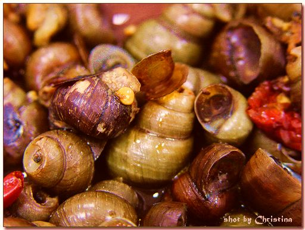

# 辣螺蛳

妈妈烧了上市不久的螺蛳，非要让我午饭带到公司尝尝，在办公室里吃这个有点夸张，好在中午只有我一个人在办公室，少些尴尬。  
  
现在小龙虾也上市了，比去年晚了半个月，市场上每天可供应5、600百斤的量，大点儿的40多元一斤，小的十几元一斤。以前有个同事的先生很喜欢吃这个，每次买回家都很认真的每个刷干净，让太太烧给他吃。电视上介绍南京澳洲龙虾有望在两三年后价格卖的和当地小龙虾一样的价位，事实上那不是真正的澳洲龙虾，而是澳洲龙虾和小龙虾杂交的“南京澳龙”，青色外壳，个头比小龙虾稍微大一点。但据说杂交的东西不会好吃。南京人吃龙虾有股疯狂劲儿，旺季时据说南京每天可以吃掉10万斤龙虾，哇~~  
  
为了自己喜欢吃的东西愿意付出劳动也是好同志。可我对活的东西总是下不了手，尤其恐怖的是黄鳝，已经被开膛破肚切成片了，清洗时神经仍然在动...我的汗毛会竖起来，这样的情形也无法下手继续的。最矛盾之处在于我偏好吃荤菜，市场上买回来的肉食最好能切好块，鸡头鸭头什么最好不要出现，那惊恐的眼睛也是我无法忍受的情形。  
  

---

## 评论（2）

**Martin** · 2007-03-17

螺蛳好吃！不过更想小龙虾呵呵  
没有对子女不好的妈  
YOUZI这不正是你的幸福吗，我权当你在这儿诉说你的幸福了

**[wcoco](http://prettymom.blogspot.com/)** · 2007-03-18

it looks yummy!  
i like to eat but i’m scared of cooking them myself.

