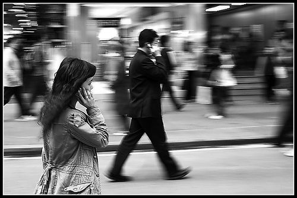

# 只是看似幸福

[《城里的月光不再》](http://blog.sina.com.cn/u/499bf929010008wp)  
你抽的烟，让我找遍，镇上的店   
一个美且静的女子，这样用力的爱，终究也只是伤了自己。  
  
  
  
上周似乎是工作上最忙碌的一周，每天下班后毫无精神，吃过晚饭就想睡觉，一下班哈欠便接连不断地开始了。上周也是春天到来后温度最高的一周，户外出现一些穿着短袖的年轻人。万物蓬勃生长，暖冬给了害虫和老鼠良好的生存环境。春天带来又一次生命的延展，人们体内各种欲望蠢蠢欲动，象空气般游走。美好的，纯情的，愚蠢的，丑陋的......真实而无可阻挡。  
  
上周...听一个朋友娓娓道来，爱与幸福还在，只是内心有支撑不起的激情与热情。两年多没有夫妻生活，象大多数人的婚姻一般患上了阳痿。由不顾一切的爱情到难以割舍的相伴，身体却不再对对方敏感、渴望，转而需要新鲜的东西填补进来。朋友若有所思自言自语道：“还是要去这么做的，一定要试着去做。”做爱，由衷地做爱，对婚姻究竟有多重要？大多数人在伪生活中挣扎，也有将伪生活粉饰得光鲜亮丽，如真的一般引来羡叹。我们会心一笑...那还是伪生活！大多数人按约定俗成的线路在现实中行走，象模象样，看似幸福地结婚、怀孕、生子。想到“谁都有秘密”，想起某人BLOG里写着“谁都有点破事”，恐龙那句“或许网络的背后是一只会打字的狗”，不知道真相，便可继续看似幸福的生活，难道你不是吗？  
  
有个朋友说：“你只是看到别人光鲜亮丽的一面，想象又夸大了这种光鲜亮丽。不好的你只是不了解而已。了解的你也知道那是虚伪地表演。你说总和差的人相比不会进步，其实进步什么的都是虚的，自己快乐才是真的。”此时此刻想戴上耳机听着音乐漫无目的地在黑夜中行走。  
  
笑话一则：  
老师问学生：“虫牙、烂萝卜，怀孕的共同点是什么？”  
全班只有两个学生有答案，一个得了80分，一个得了100分。  
80分的答案：都是虫子惹的祸。  
100分的答案：都拔得太慢。

---

## 评论（25）

**KK** · 2007-04-02

哈哈，2楼的回复够强

**哈哈** · 2007-04-03

幽默!   
youzi 兄,,你用 过蓝药丸 ?  
感 受 如何?

**嘿嘿的一沓** · 2007-04-03

youzi, 你看这么说如何?  
“看来你家那位 控制能力挺高，这么多年  
都没 出过 一 点差错.”

**backhand** · 2007-04-03

不错的笑话

**绿恐龙** · 2007-04-03

阳萎的不一定不会中标  
会中标的不一定不阳萎

**Martin** · 2007-04-03

这跟技术有关吗哈哈  
有种东西叫condom

**mandy** · 2007-04-03

万事别看表面。看别人活的光鲜亮力，其实都很累！这年头想怎么活就怎么活吧，别被那些模式所束缚住，活的只要自己开心足矣！

**Christina** · 2007-04-03

对于不善良访客阻止是最简单的方法。我想youzi需要的不是礼貌，自称在美国很多年，不如我家附近菜场的大叔大婶善良，更不如我家初中的外甥女懂礼貌、尊重他人。您在美国没有学会理解和宽容，骨子里的糟粕还是那么严重！您不如在国内混混得了，一点蝇头小利沾沾自喜，狂热地向人炫耀，除了可笑和鄙视，您从我们这里得不到任何情绪！用你的方式回报你了：）

condom，计划生育，丁克一族....想什么时候要孩子，要几个，是自己家里的事，关你鸟事？！：）您在这里大放厥词，看不见任何美好，心态不良吗？笑话是广播上听来的，您要赞扬就赞扬媒体娱记们的水平高咯。您的俗气让人牙根发软，浑身起鸡皮疙瘩，您知道我们忍受你多久了吗？

**Anyayaya** · 2007-04-03

youzi的肤浅、自以为是和猥琐实在让人反胃，赞成剔除。

**Vodka** · 2007-04-03

只想进来说：我最近也和christina一样，“下班后毫无精神，吃过晚饭就想睡觉”，恐怕是春乏吧。。。大家继续。。。=.=b

**KEWL** · 2007-04-03

这年头出国很平常. 要想在国外定居也不是什么难事. 有点钱就行, 钱还真不需要太多. 要是一年能有个500WRMB/年,混的好的话为什么出国?

再说出国要是做生意那还情有可原(毕竟是赚老外的钱吗!) 但是要是出国还是去做劳动力(那些什么技术移民的骗局)...那就真的可悲了... 劳动力廉价也就算了,就怕是在国外时间长了,人格也CHEAP了

**浮萍** · 2007-04-03

生活在那里都无所谓，生活只是为自己。生活中当然是需要钱的，但幸福不是用钱来衡量的。

朋友给我介绍了这个地方，对于同是南京人的我，远在他乡，甚是感到亲切。但同时又感到那么陌生，离开南京已经5年了， 是我变了?是南京变了?还是我们都变了?

在国外的生活，没有了亲朋好友的时时关注，不再需要生活在家人和朋友的羡慕和赞美声或是议论中。更多的是自己想做什么，物质上确实要比在家里艰辛了很多，自己却是无比的自在和满足。或许这就是在国内只是看似幸福的原因吧

**Christina** · 2007-04-03

我姐姐一家在美国三年，后来还是回来了。除了工作、抚养小孩就是回家，偶尔和朋友聚会聚餐，此外的社交就是同事。要想在那里获得地位和人格上的尊重，不是短时间能改变的。我第一次去欧洲，最深的印象是有钱在哪里都一样过。国内有的时装品牌不比国外的差，只要适合你的、和谐的就是美的。

不知道是否有人发现，开头的两段与末尾的笑话显得格格不入？我想表明的是一个人从开始到末尾的变化也不过如此...中国茶刚建立的那两年，我的脏话中除了猪狗之外，还没学会生殖器的骂法....可我不为变化的自己难过，见了糟粕才能成长。比起将近30的人还自称生活在童话王国里少了许多矫情和无知！

**You know who I am** · 2007-04-03

众人已经让众人疲倦，你又何必还在乎众人的言语行为。自己写东西本是舒舒胸臆，何必随别人的赞美或者猥琐起舞，更何必反击争辩。良言自口，莠言自口，心若似古井无波，自在悠由，管它市井厚薄。  
新闻组里有个很重要的原则： Don’t feed the troll。  
骂一骂只是出口恶气，郁闷的依然是你自己。有些人只是为了有人注意，不管被怎么看，和广告一样，只要知名不要美誉。忽略它们就可以了，反击会让它们更兴奋，甚至不由自主地就达到高潮了。

溪声山色，一点浩然气，千里快哉风，世界即使狭小浅薄，依然有自在的空间。

我知道你不太喜欢我的这种态度，只是忍不住。

不要在乎众人，莫令我忧。

保重！

**绿恐龙** · 2007-04-03

都太有才了

其实我上面的第二句话就说的Youzi  
不知道他是否能绕的过来

**LeughAtYou** · 2007-04-04

youzi, you are so rude!  
该掴你一记耳光!

**[afan](http://blog.wenxuecity.com/myindex.php?blogID=22490)** · 2007-04-04

混的好的话为什么回国?  
hahahaha :-)  
围城 围城

**Christina** · 2007-04-04

看你在意什么。我姐夫他们在美国生活的也不错，而且是直接去那里工作，只要继续签约就可以继续在那里工作。回国的收入和在那里差不多，并且拥有一定的社会地位，业余生活丰富，朋友同学亲人构成的社交圈等等都是他们看重的~在国外薪水低、打零工甚至做黑户也不愿回来的大有人在，不是吗？

**Christina** · 2007-04-04

You know who I am..如果我没猜错的，应该是GOD，哈哈~~善意的态度和言行我都可以接受~对于类似youzi这样的访客视而不见N次之后兔子也会发彪咯。

**大亮** · 2007-04-04

被人歪曲和戏讽是任何人都难以接受的，似乎也看到了Christina 的底线，，，有人说摇滚是一种革命精神，如果有的话就是拉二胡也一样能表现。优雅和敏锐是一种气质，如果有的话即使引黄笑话也一样能振聩于心。或许柚子走的太巧合了，碰到了地雷：）

**HANK** · 2007-04-04

呵呵，CHRIS终于发飙了，也早该发飙了。

**Martin** · 2007-04-04

“新闻组里有个很重要的原则： Don’t feed the troll。  
骂一骂只是出口恶气，郁闷的依然是你自己。有些人只是为了有人注意，不管被怎么看，和广告一样，只要知名不要美誉。忽略它们就可以了，反击会让它们更兴奋，甚至不由自主地就达到高潮了。”

有点同意，我觉得人的性格，以及本能反应，在年轻的时候就已经形成了。有些人需要谩骂别人和被别人谩骂才会体会到快感。就像巴士阿叔，youzi阿叔也需要宣泄来减压。毕竟一个人养活一个家庭，并且being proud of himself, 也不容易。不过阿叔还是处处体现出早年国内工作养成的思维习惯。  
我还是不觉得出国有什么好，如果在国内已经混得不错了。很多移民可能刚落地也找不到什么工作，如果单纯为了孩子，牺牲也太大了。

**Michael** · 2007-04-04

确定是兔子吗? :)

**[cecile](http://shanghaicecile.spaces.live.com/)** · 2007-04-04

只是看似幸福。。。很精辟。

**mamamia** · 2007-04-06

今天本来心情挺不好, 但在这里看到YOUZI被人扁, 心情大快, 这垃圾早就该清理了.   
我的心理是不是也挺萎琐的...

