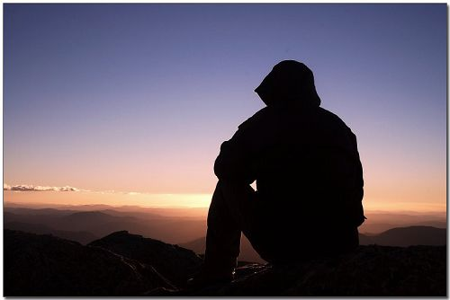

# Easter澳洲第一峰摄影手记 - jiajialing

前两天hank说他和jiajia去哪儿哪儿玩的，当时在忙没时间多聊，今天看了jiajialing msn space上[Easter澳洲第一峰摄影手记](http://jiajialing.spaces.live.com/?owner=1)，真TMD棒，那些照片！过两天我也要上些PP：）  
  

---

## 评论（4）

**Michael** · 2007-04-18

谁挡住了我的阳光??!!

**[农妇](http://adelinelv.spaces.live.com)** · 2007-04-18

最近这么忙啊？习惯了你以前一天两三篇帖子，事无巨细的唠嗑儿；现在好几天才冒个泡。。。  
不过忙起来，说明有压力，有压力才会有进步。  
祝好。

**Inn YAN** · 2007-04-19

上次上ChineseTea的时候，还是3年前吧，那时，还在大洋彼岸。好像记得和同事们一起闻到了新茶的清新、体会到沁郁的高雅....  
现在，费了好大的劲，才从google一大堆莫明其妙的连接上找了过来。新的界面让人开始有点疑惑，这是不是还是那个Christina？ 那个有点小资、有点不安分，又有点传统的ChineseTea?  
还好，帖子内容还是有那股熟悉的茶香，应该品的还是中国茶。  
打开相册，没错，还是那美丽的容颜，只是略加上了岁月淡淡的妆点......

**Hank** · 2007-04-19

呵呵，没有想到这些照片竟然惹的CHRIS爆出了TMD，看来没有白白在山顶挨冻，赚回了辛苦。

