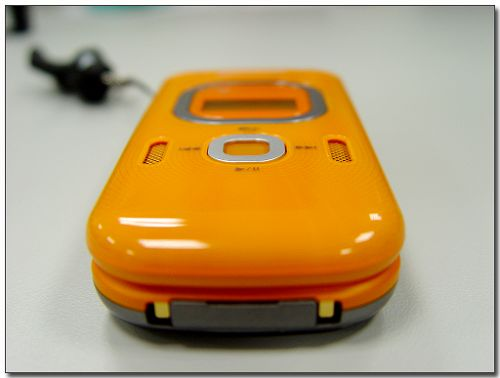
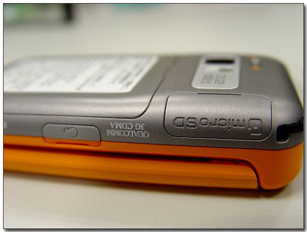
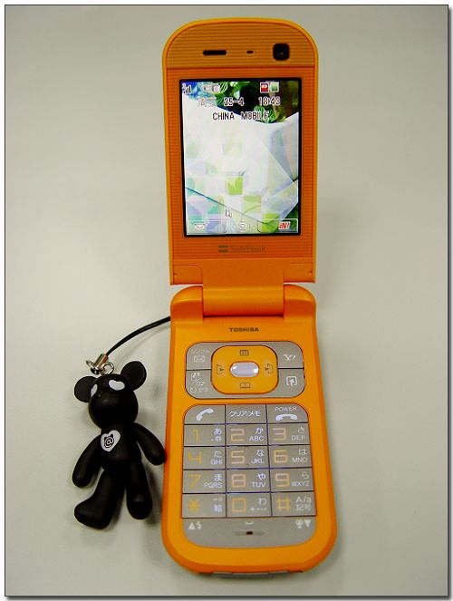

# Toshiba 811T

刚买了款Toshiba 811T，这么眩的颜色好象不是我的颜色，之前的手机摔到地上两次，摔坏了公放，等有了配件才能修。  
   
   

---

## 评论（7）

**jiajialing** · 2007-04-25

新搞的水货机?颜色漂亮!

**njujessica** · 2007-04-25

你换手机的速度也太快了阿

**ricerain** · 2007-04-25

chinese tea,

一直喜欢看你的博，虽然从来没留过言。第一次上来发言就想请你帮个忙，有点冒昧。有个可爱的孩子丢失了，忍不住想尽可能帮帮他。自从自己有了宝宝，就不忍看到这样的消息。不知道你能不能帮传一下有关寻找这个可爱小孩子的连接。不管你时候方便帮助，都谢谢先。  
http://cartoonforchildren.blogcn.com/diary,3024700.shtml

**[青花碎瓷](http://来)** · 2007-04-26

漂亮

**mandy** · 2007-04-26

呵呵！炫！  
今天刚买一款三星F308送人。  
心里纳闷，以前没有手机人类还不是活的好好的啊？手机功能那么多真的有用？

**Smily** · 2007-04-26

手机链很漂亮

**流浪在窝** · 2007-05-02

想买这手机才搜到你着的 呵呵 我喜欢白色的

