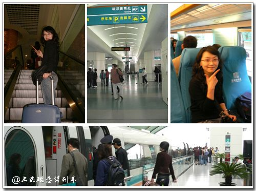

# 1/日本之行

下大雨，差点没赶上中午12点的火车，刚上车火车就开了。发现一个奇怪的事儿，我们从12节车厢上了火车，走到第9节车厢居然到尽头了，列车员要我们下车，往后走再上第8节车厢，第8节车厢前有个火车头......太奇怪了。不会同时两辆火车一起走吧？  
  
没觉得动车比原先的T字头车舒适在哪里，速度倒是快了半小时，好象到上海前只停了常州站。下了火车换乘地铁到龙阳路下，接着换乘磁悬浮列车到机场。预订了机场边上的上航假日酒店，从机场打车出来居然走了四十多分钟，价格一路跳到49元。觉得不对劲，打电话到酒店问，从机场出来只有三公里路程，大约10分钟左右。司机老先生煞有介事带着我们左拐右拐，真象那么回事，NND~~到了酒店门口我问出租车司机怎么办？他说：“你付11元吧。”后来酒店服务生说绕路、拒载等不符合规定的情况，可以不用付钱给他。  
  
早前就耳闻上海的出租车服务很规范，这是第一次遇到这种状况。驾驶员编号为207900，如果您正好在浦东机场乘上这位司机的出租，务必小心哦~  
  
明天下午14：35的飞机，18：10到成田机场。这个时间好象有点问题，两个小时应该到东京了吧？冈本后天还在东京就好了，嘿嘿~~  
  
第一次乘坐上海磁悬浮列车。  

---

## 评论（10）

**rainoo** · 2007-04-30

welcome to tokyo ~~=~~  
东京这两天很热哦

**[punkyouth](http://punkyouth.blogbus.com)** · 2007-04-30

旅途愉快哦. 日本, 我嫉妒的直冒酸水. 另外, 为什么我5分钟就从龙阳倒机场了呢, 你的表是不是走慢了哇, 小心别误飞机..:)

**Dan** · 2007-04-30

惭愧啊，磁悬浮就在家门口都没有坐过。  
上海的出租车也要看公司的，大公司相对比较规范，比如：绿色的大众、黄色的强生、白色的锦江。其他的公司相对较小，而且车子也不是很干净。一般出门如果路不熟的话，我都会选大公司的车坐。哪位朋友来上海的可要注意Christina的前车之鉴。：）

**Christina** · 2007-05-01

磁悬浮真的是很快，有可能是5分钟，我的时间概念差咯:P~

**[灰子](http://yaohui.blogbus.com)** · 2007-05-01

节日快乐，旅途快乐，多发些照片看看！

**Jonathan** · 2007-05-01

这么巧？我刚从日本回来。日本真的很不错。相信你会有同样感受的。有机会一定要体验如下几项：在富士山脚下的五个湖中其中最大的两个湖畔找间酒店住，在酒店房间里坐在沙发或者床上能看到富士山，感觉很好；吃地道的日本鱼生船，通常团餐是不包的，但是绝对值得自己出钱尝尝；泡地道的日本温泉、很舒服；吃正宗的神户牛肉，团餐同样应该不包，但是你试了就知道国内的所谓神户牛肉是多么不正宗了（其实据说真正神户牛肉都不出口的），真正的是入口即溶的，很好吃。  
至于其他的（如购物以及我自己更关注的感受日本发达的细微方面）还有很多，去了可以自己感受。譬如说科技(特别是融入到生活中的科技)、礼仪、绿化等，不胜枚举。  
想说的是，我去过日本后，只能说：我仍然不喜欢日本这个国家和民族，但原因却只是我是中国人、有民族感情。我推测，没有这种民族情节的第三国的人民、譬如欧洲人等，从日常的生活中，能找到的不喜欢这个国家和民族的理由不会比中国更多。。。  
此外，你去的时间刚好碰上日本的五一黄金周，人流车流都很多，并且从5月1日起，日本好像天气一般。祝你好运。

**最爱GUCCI** · 2007-05-01

前年开始关注这个博客，当时用了近10天的时间把茶从2002年4月份开始的所有文章都看了一遍， 一边看一边想着同时期自己在做的事，突然有一种恍如隔世的感觉，也就这样爱上了这个博客。

虽然不是天天上茶，不过每过一段时间总会上来看看，上茶已经成了我生活中的一部分，记得去年有一段时间突然上不了茶，心中很失落，感觉失去了一位老朋友，不过好在后来又正常了，又看到了熟悉的人和熟悉的文字。

今天是本人第一次在茶上留下文字，在这里和茶说一声“生日快乐”，虽然这句话说的晚一点...

**单旋~舞** · 2007-05-03

祝你能在日本能有一场艳遇哈~~~~hoho~~

**zhi** · 2007-05-03

banner很好看，^^

**[doroboy](http://www3.pf-x.net/~happyjet/)** · 2007-05-06

> 明天下午14：35的飞机，18：10到成田机场。这> 个时间好象有点问题，两个小时应该到东京了吧？

日本和中国有一小时的时差。日本18：10相当于中国的17：10。

