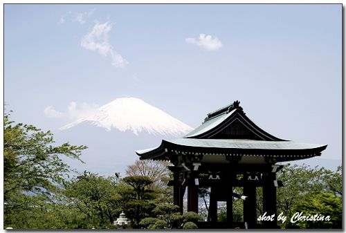
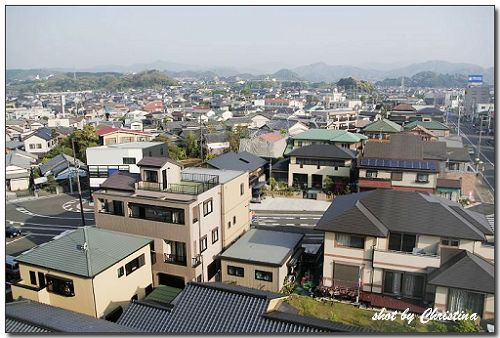
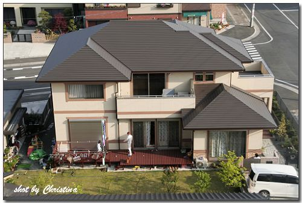
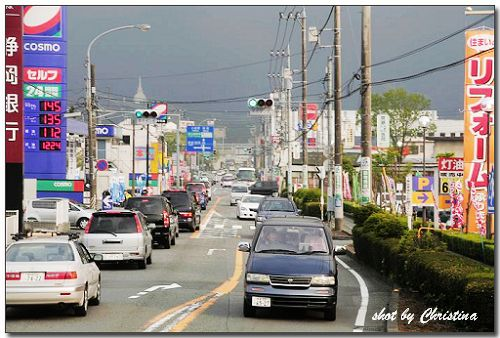
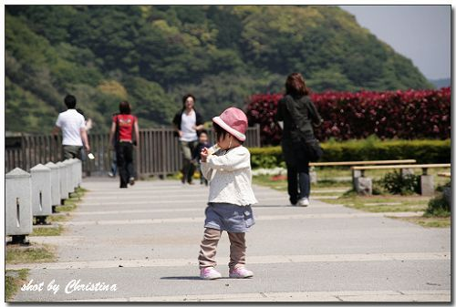
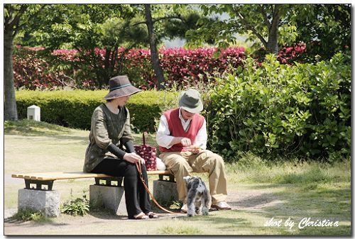
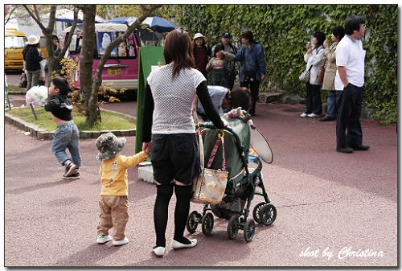

# 3/日本之行

晚上9点多才从藤枝市到达南京友好城市名古屋。日本放假不管是哪里都塞车，高速公路上也是，郁闷地令人发指！这种时候导游就会不停说话了。说日本人去中国看到对联“金玉满堂”的横批，日本男人都争相拍照，“金玉”在日本意为男性生殖器，恰好我认识的一个人就叫这个名字#￥%#&@日本人的姓里有叫“猪头”、“狗卷”、“醍醐”的。导游说日本词语里没有“鸡”，他们管烧鸡叫烧鸟，猪肉为豚肉...不过冈本说日本有“鸡”这个字，和我们发音一样。  
  
日本有三多：乌鸦多、麻将馆多、自动贩卖机多；  
日本有三少：警察少、垃圾桶少、小孩胖的戴眼镜的少。  
  
导游说在日本乌鸦是吉祥的象征，东京的乌鸦比其它地方要多。但是冈本说很多日本人并不喜欢乌鸦，吉祥的说法不对。日本乌鸦又黑又亮，叫起来声音还带回响的。乌鸦喜欢扒垃圾，所以路边的垃圾都用网袋收集在一起。  
  
常能在路边看到卖二手车的，南京刚上市没多久的漫步者已经出现在日本二手车市场里，很新的宝马、奔驰也有。很多人异口同声地说日本人实在，购买节能环保的车。就我这两天的观察，未必如此，有经济实力的日本人也不会拒绝购买高档车的。  
  
在日本生活10年的导游告诉我们，日本人很虚伪，女孩子夹上一口你做的饭菜还没送进口，就会马上称赞“好吃”，估计叫床也一样虚伪吧？！日本人不会说“不行、否、不能”之类直接的话，总是很委婉地表达真实意思。如果日本人热情地叫你去家里玩，你可得仔细想想是不是真的。日本女人无论老少，脸上一律涂粉、化妆，嘴唇上涂着唇彩。她们从中学开始对化妆品就有研究，不过一张嘴一口层次不齐的烂牙。观察中发现日本女人大多为中短发，很少看到留长发的女人。  
  
日本英文普及率很低，一个30岁左右的人会说TANK U，SORRY。在富士山下遇见一家日本人，男孩28岁，一点英文不会说，姐姐36岁可以说一点，父母曾到中国旅游，会说一些简单的中文，对中国印象比较好。（按照日本人的虚伪方式，不知道这印象好到底有多少真实成分？）  
  
日本人退休后就是旅行和享受生活，他们一般不愿意为子女带孩子。兄弟姐妹之间的感情也很淡，宁借高利贷也不会向家人借钱。日本人本着不给别人添麻烦的观念与人交往，“君子之交淡如水”的方式是不是有值得我们借鉴的方面？就我这次日本之行来看，到目前我只为自己买了一件600多元人民币的商品，其他都是给同事、朋友带的礼物，负担挺重的。怪不得我姐姐都没对单位的同事提起，聪明咯~日本人最好的永远留给自己用，次好的出口给别的国家，包括送礼也是送小东西，中国恰恰相反。  
  
最后，建议到日本旅游避开1月1日、5月初，可能的情况下建议自助到日本旅行。可以选择租车的方式游览日本。国内大城市的物质生活条件不见得比日本差，只是其中的人不同而已。请提高自我修养和素质，配合一下我们所拥有的生活。  
  
平和公园远眺富士山  
   
  
藤枝市鸟瞰景。日本“市”比“县”小。   
   
  
藤枝市清晨6点多钟，我住的房间对面有户居民，妈妈在为屋前的花草浇水，小小孩跟在妈妈后面。一个稍微大点的男孩出来抽了根烟，和小弟弟踢了几回足球便返回了。这家的小狗狗跟着小小孩高兴地摇着尾巴。这样的生活情形让看到的人都感到幸福~  
   
  
去箱根路过静冈  
   
  
路上的休息站。去日本旅游应该避开1月1日和5月初，5月1日是工作日，4月29日昭和天皇生日，3日宪法記念日，４日緑の日，5日孩子的节日。放假日本人会举家外出旅行，路上塞车严重。据说4月樱花盛开的季节，即使自家门前有樱花树东京的日本人也会涌到公园里赏樱，那时就是人挤人的场景。常见到一家成员中有一条或两条狗狗一起出游的情景，狗狗在日本应该比在中国幸福吧？至少没看到过流浪狗，没听说政府对流浪狗实行安乐死，没人会烧死流浪狗和它的BABE。。。。。。  
   
   
  
芦之湖  
   
  
**comment by 冈本@ May 08, 11:05am**   
日本没有劳动节。  
5月1日是一般公司，上班的。  
但是那期间是叫“黄金周”。  
因为，4月29日昭和之日（原天皇生日），30日代替休息日，5月3日宪法纪念日，4日绿之日，5日孩子节。  
5月1日和2日是上班日的。  
5月5日孩子节是，也叫端午节。  
本来跟中国的一样的概念。日本也以前采用农历。本来的端午节是什么意思，我不太明白。但是吃粽子的习惯还有的。  
照片上的别墅嘛，他们家好大。日本不一定所有的人住在那么好的房子。  
我妹妹家是很小的公寓。4个一家人住在40几平方米里。但是租金9万日元（6750RMB左右）。

---

## 评论（10）

**Anna** · 2007-05-04

看来这次日本之行还没上次去丽江这么好玩吧?嘿嘿~~~可要记得去他们的药妆店多买点东西哦,什么都有的

**[灰子](http://yaohui.blogbus.com)** · 2007-05-05

怎么没有在富士山上的照片？

**rainoo** · 2007-05-05

平和公园远眺富士山  
不知道导游跟你们讲到没有，那口大钟的方向没有正对着富士山，而是偏了一些，因为富士山是一座活火山，300年一个周期喷发，而现在又正直三百年的喷发的时候，人们敲钟祭神的时候，怕钟锤正对富士山而惊醒了这座在日本人心目种的山神，所以为止偏了一些。  
呵呵，你的这个照片角度照的正好。

**[青花碎瓷](http://来)** · 2007-05-05

果然是有才的女子  
出国玩还 不忘把孔子的“食，色，性也”做一个“具”解  
呵呵———-日本人很虚伪，女孩子夹上一口你做的饭菜还没送进口，就会马上称赞“好吃”，估计叫床也一样虚伪吧

**youming** · 2007-05-07

最初无意中因为一首歌曲地搜索，找到Chinese Tea，一直到Te Cinese的突然消失，今天又终于又在无意中找回了茶，  
今年五一从北京回杭州，因为一些事情，执意去了趟南京，你生活的城市。虽然不论什么城市，总是有些许不足的，但是总体来说还是喜欢南京城的，就像我爱着北京和杭州一样。

**雯子** · 2007-05-08

51七天没上网,全在旅游景点搞”拉练”活动.今天上班第一件事就是打开电脑迫不及待看你的博,想看看你日本旅游的见闻.没想到出国旅游的你也赶上了人多时候哦!国内人多啊,简直不是在看风景是在看人海.

**Michael** · 2007-05-08

那里的路怎么看比我们这的还要窄呢??

**冈本** · 2007-05-09

日本没有劳动节。  
5月1日是一般公司，上班的。  
但是那期间是叫“黄金周”。  
因为，4月29日昭和之日（原天皇生日），30日代替休息日，5月3日宪法纪念日，4日绿之日，5日孩子节。  
5月1日和2日是上班日的。  
5月5日孩子节是，也叫端午节。  
本来跟中国的一样的概念。日本也以前采用农历。本来的端午节是什么意思，我不太明白。但是吃粽子的习惯还有的。  
照片上的别墅嘛，他们家好大。日本不一定所有的人住在那么好的房子。  
我妹妹家是很小的公寓。4个一家人住在40几平方米里。但是租金9万日元（6750RMB左右）。

**Christina** · 2007-05-09

那是在藤枝市拍摄的房子，在日本是不是地域不同，住房情况会有所不同呢？

**rainoo** · 2007-05-09

一般来说大都市住房紧张一些，apart多一些，别墅少。现在9万日元的租金，也就6千元。日元贬，人民币升，没有那么多了。

