# 富士山/日本之行

富士山地区一直是日本最有名气的作家、诗人和艺术家创作灵感的源泉。很少有山能够象富士山这样因其美丽而备受赞赏，也很少有湖泊能象箱根的芦湖那样屡屡成为摄影师瞄准的镜头。这个地区大多数地方被指定为“国家公园”，但由于日本关于保护自然资源和限制商业开发利用的法律还相对薄弱，所以这儿的国家公园经常被人们看作“天然的”娱乐公园。  
  
富士山海拔3776米，完美对称的火山锥，最后一次喷发是在1707年，不仅吞没了江户时代的东京，并且使方圆100公里的地区都被火山灰覆盖。就像其他自然纪念物被看成是神圣的富有生命的一样，据说富士山每300年喷发一次。富士山在许多世纪里是妇女的禁区。直到1867年，一位英国妇女大胆地攀登了富士山，才有了妇女登上富士山顶峰的记录。现在，每年40万的徒步登山者中有一半是妇女。官方规定的登山季节是从7月1日开放，8月31日结束。只有在这段时间里，山顶的临时营房和服务设施才对外开放。  
  
对于地大物博的中国来讲，芦湖与富士山不会在中国人心目中显得那么稀有和珍贵，有的中国游客看到芦湖后失望至极，认为芦湖还没有他家门前的湖壮观幽静。远观的富士山远比近观的它更富有神秘色彩，好似爱情都是远观一般美丽！  
  
富士山脚下有一面温度计，上山前导游说那里的温度在零上10度。山上有着浓浓的商业气氛。我和姐姐在那里吃了一份烤鱿鱼圈，可惜凉得太快。  
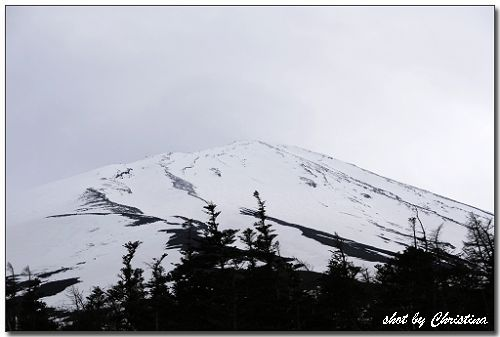   
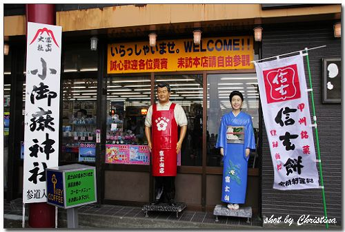  
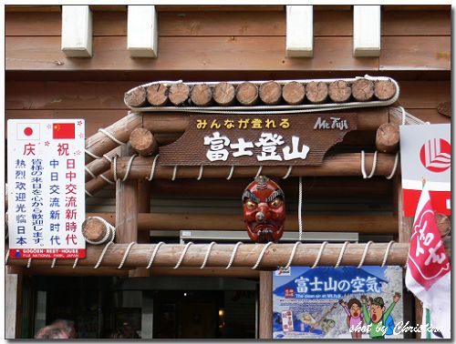  
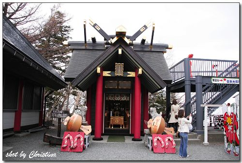  
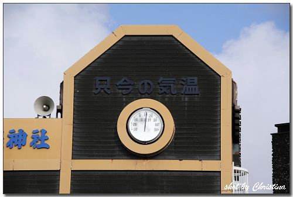  
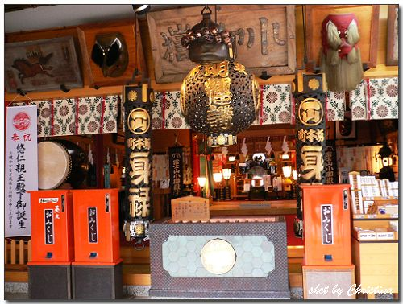  
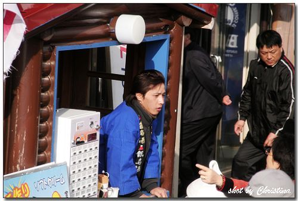  
  
远观的富士山。  
在日本生活了9年的同事说日本5月5日男孩节家里会挂起鲤鱼旗，3、5、7岁是男孩的大节，多少条鱼代表多少岁。但是导游介绍是第一条大鱼代表父亲，下面的小鱼代表这家有几个儿子。不知道哪种说法是正确的？  
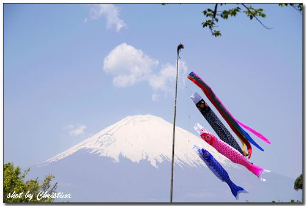  
  
芦湖  
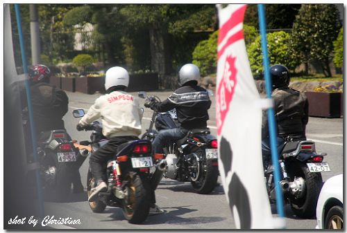  
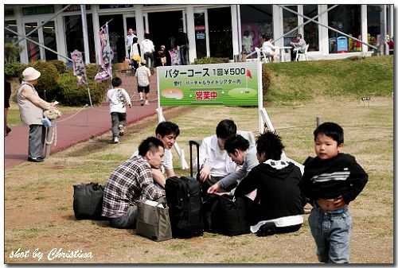  
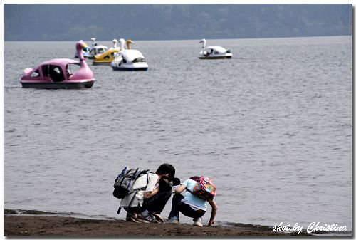

---

## 评论（2）

**[灰](http://yaohui.blogbus.com)** · 2007-05-15

大鱼和fuji这张拍的太棒啦，喜欢～

**angie** · 2007-05-15

上富士山的据说都是去自杀的，一般人都在山角下面瞻望．

