# 京都/日本之行

东京是政府驻地，大阪集团企业家的精明于一身，而京都则代表着传统的日本，有一种贵族气质，且是17个联合国自然文化遗产所在地之一。未旅行前冈本就曾提到京都，建议去那里看看，有着地道的日本味儿，可惜我们只停留了半天即离开了。跟团只能蜻蜓点水、走马观花，兴趣与好奇心浓厚的只能自己办商务签证再次前往。  
  
京都古旧建筑与寺庙居多，别以为那是一座小城，它可是日本第五大都市，有150万人口。象其它日本城市一样，这所拥挤嘈杂的大都市具有现代气息，缺少审美吸引力。寺庙里常有一车车的游客和一队队的学生来来去去。  
  
二战后成千上万的旧式住宅被新式的现代的住宅所代替。宽敞方便的旧式住宅大多列于京都道路两边，都是木质外观，直线式设计，由活动的纸门、嵌在泥墙里的窗棱、格式窗、花格凉亭、长凳、芦苇和竹编的百叶窗。  
  
早春4月是樱树开花的季节，到了5月其他花卉大多也开始绽放。秋季的色彩是土红色，11月是橘红色的天下，这是京都最佳的游览时间。  
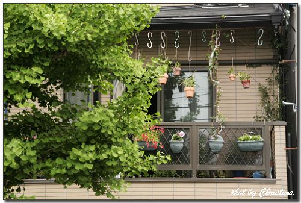   
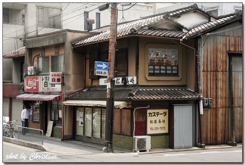  
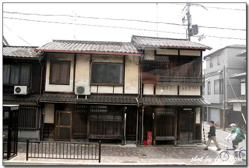  
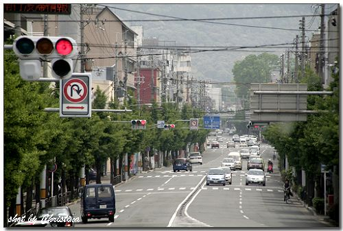  
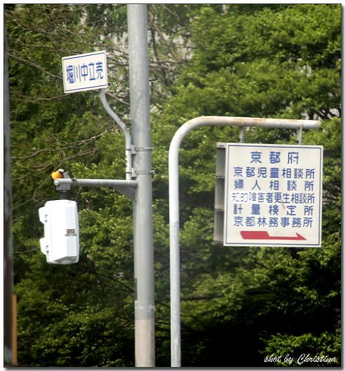  
  
金阁寺是全日本最著名的寺庙，是于1955年建造的15世纪建筑的复制品，1987年重建，外面贴上金箔。亭阁有3层，每层反映了不同的风格：第一层是宫殿风格；第二层是武士住宅风格；第三层战士了禅宗寺庙风格。亭阁前的大池塘及其四周使之成为一个完美的格局。  
  
原寺庙于1950年焚毁，纵火者是一个因被亭阁的美丽所吸引而进入佛门的人。他认为如果烧毁起初令他心醉的实物本身，他的审美观可能回接近完美，于是他真的那样做了。日本作家三岛由纪夫将放火烧亭这一情节写进他1956年的小说《金阁寺》。  
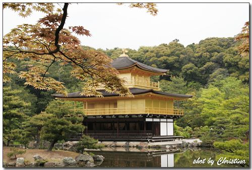   
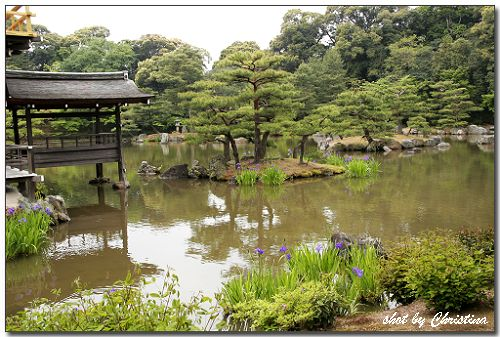  
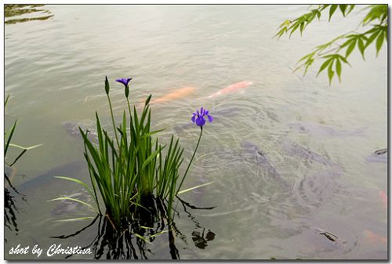   
贵人榻，呵呵~~  
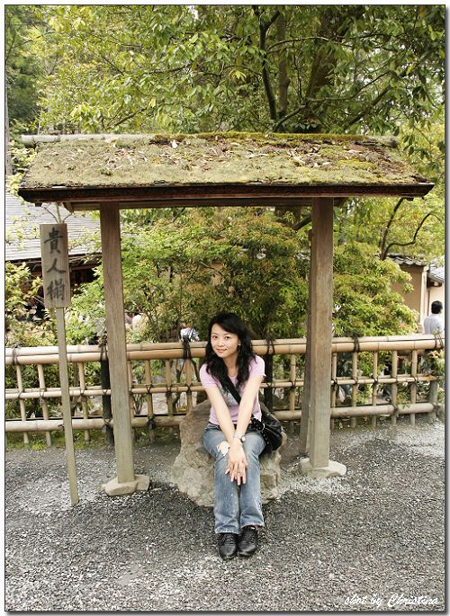  
  
寺庙内品茶  
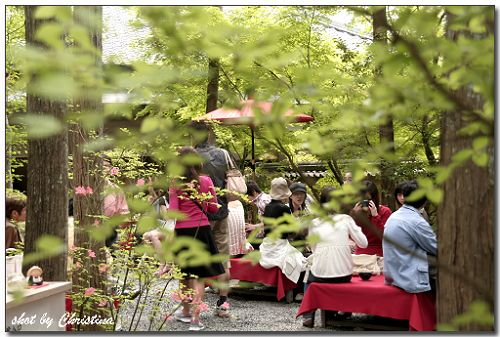  
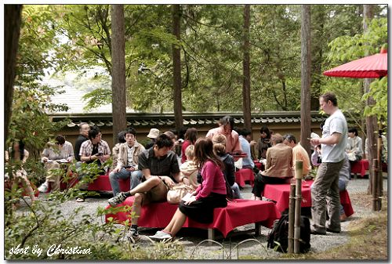  
  
不知道日本人拜的是什么神哦？  
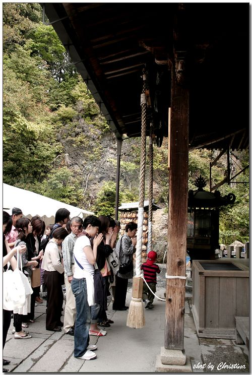  
  
寺庙外的年轻人  
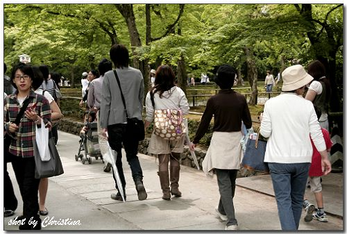  
  
寺庙外的自动贩卖机。大大小小的自动贩卖机在日本街头巷尾随处可见，非常方便。买过几次之后，渐渐喜欢上机器里的冰咖啡，有次在公路休息站，投币进去，掉出一罐咖啡，握在手中居然滚烫的。当时还以为中午太阳太辣，将机器里的饮料都烤热了。后来才知道贩卖机也分冷热，红色的代表热饮，蓝色贩卖机是冷饮。  
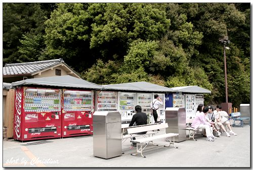  
  
平安神宫与其说是一个神殿，不如说是一个建筑研究所。这个供奉着京都第一个和最后一个天皇的神殿，是最初皇宫的复制品。原先的皇宫建于794年，最后于1227年毁于大火。  
  
神宫建于1895年，用来庆祝京都第1100个周年纪念。战士的是平安时代的建筑风格，当时中国的影响正处在最高峰，神殿在这个时期呈现出佛教庙宇的特色，简朴的木材首次漆上油漆。穿过神殿的大门时，很难想象这个神殿只是按原先皇宫的2/3比例建造的。  
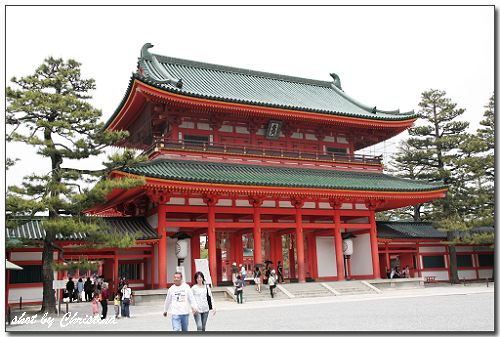  
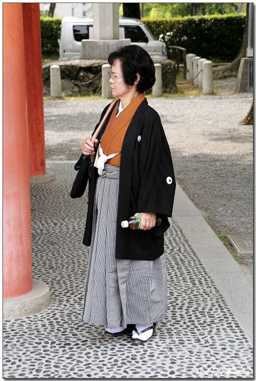  
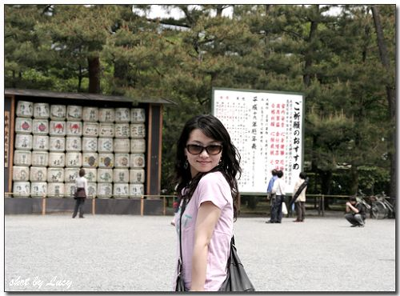  
  
挂满木牌子的祈愿亭。  
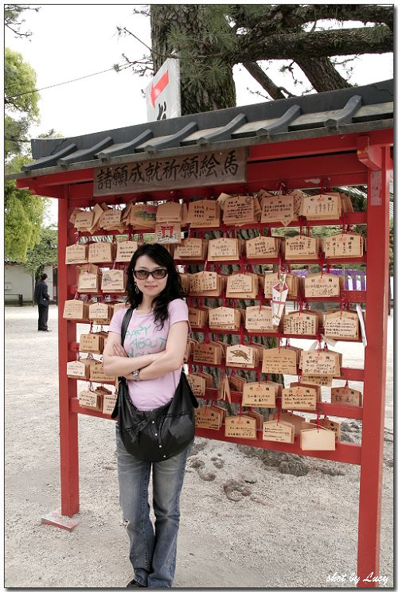  
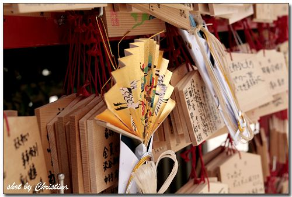  
  
一进神宫大门，左右两边各一座青龙、白虎石雕，晕~啥意思？！黑社会呀？  
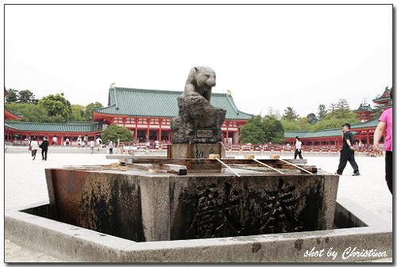  
  
5月5日正好是日本的儿童节，在神宫里遇见一个穿着和服的小女孩，虽然没能在京都看到艺妓，但能遇见这个小女孩运气也不算差啦。游人们见状纷纷冲上前去跟她合影，简直跟见着明星般的激动~  
  
人们往往以为和服源自日本，恰恰相反，象许多日本“特色”的东西一样都是来源于中国古代宫廷。在奈良时代，日本宫廷采纳了中国的“袍子”，是和今日和服类似的长襟服装，色彩华丽，装饰繁杂。日本的和服与中国唐代妇女所穿的袍子类似。确实现在天皇和皇后所穿的平安时代（710-784）的宫廷服装仍是中国12世纪的风格。  
  
当然，日本也吸纳了其他外邦文化，和服也经历了种种变化，最终形成了今天的日本特色。例如在室町时代（1338-1573），妇女服饰采用了名为“腰带”的一种实用兼装饰的饰甲，使它更适合日本的气候和风格。已婚妇女穿短袖和服，便于做家务，未婚妇女穿长袖和服。11月，神殿里会聚了3岁、5岁、7岁的男孩，他们身着和服，不过一般都是租来的。中国人非常好奇日本和服后面的包包里装的到底是什么？其实里面是空的，为了装饰而已。  
  
由和服想到我们中国妇女的代表服装是旗袍，这是满人的衣服，我们汉人的民族服装呢？早些时候电视上曾报道过南京有一批拥护汉服的年轻人，他们自制汉服并将汉服穿上街头散步，希望以此来推广汉人的民族服装。想来惭愧，中国人自己丢弃了多少民族传统风俗及文化？民族就是时尚的，是世界独一无二的！不过当看到一位中国大妈在日本寺庙里旅游时穿着高开杈的长旗袍，感觉怎么不是滋味呢~试想一位日本大妈穿着和服在中国游山玩水....  
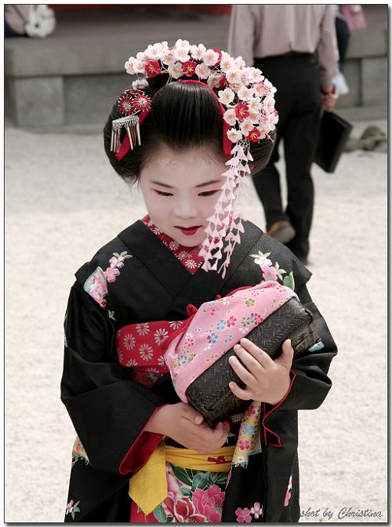  
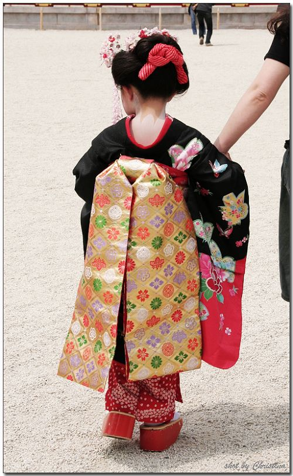  
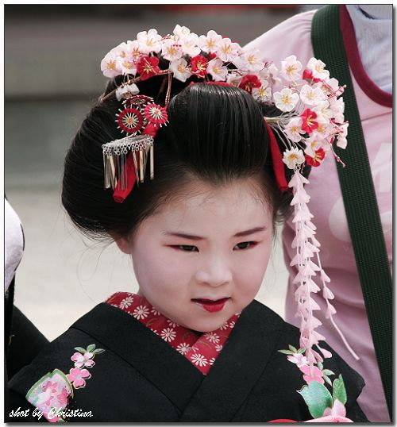  
  
京都的和服表演  
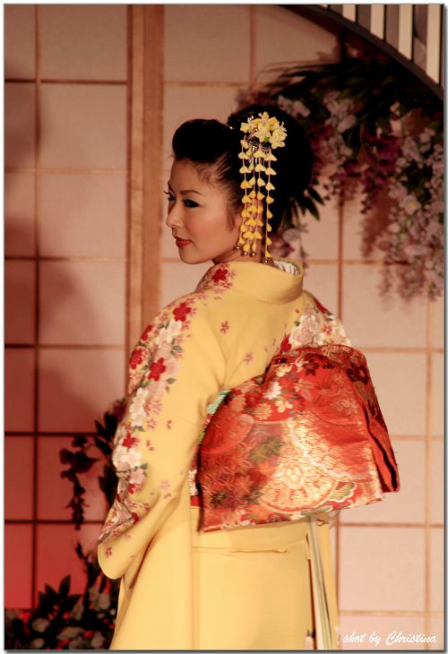  
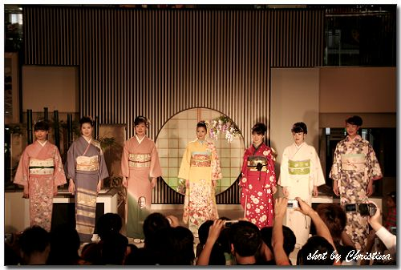  
  
从神宫步行到停车场的路上，发现铁栅栏围着的园子里有一些老年人在玩弓箭，另一边安静地坐着好几排人，好象开会似的。我是爬上半人高的围墙才拍摄下这些画面的。  
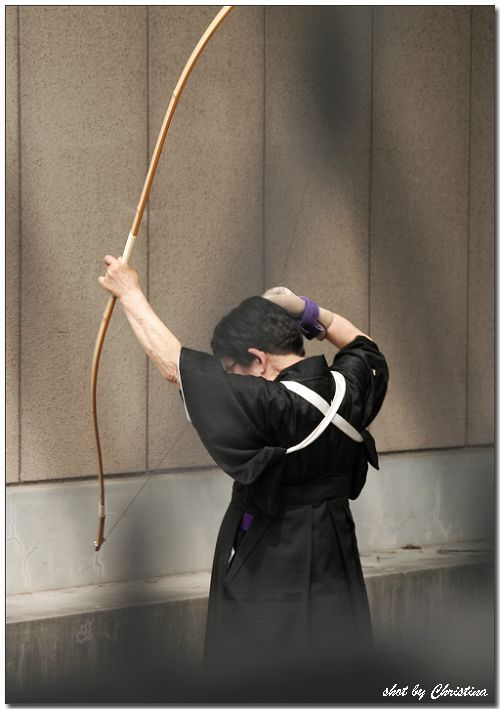  
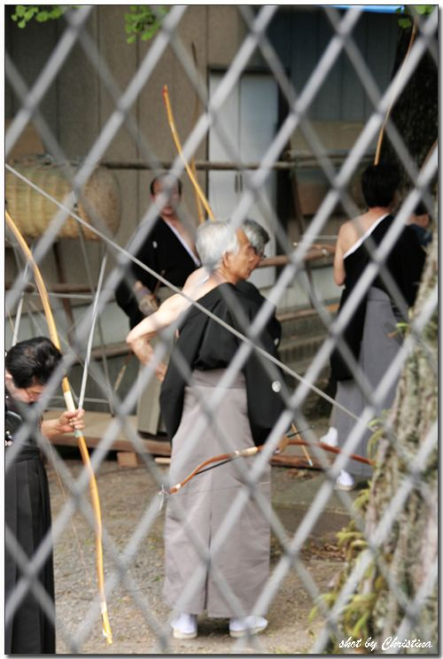  
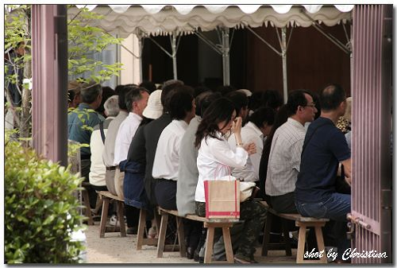  
这位大姐拿的可是弓箭？  
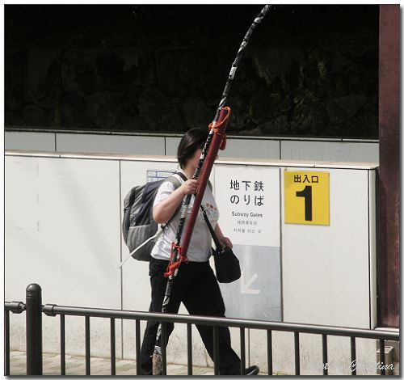

---

## 评论（17）

**Anyayaya** · 2007-05-15

通过纵火来提升审美观，可见日本人有多变态。。。。

**[灰](http://yaohui.blogbus.com)** · 2007-05-15

贵人榻，沙发，最近在这里对日本了解很多～C的纪录好仔细生动。

**冈本** · 2007-05-15

二战时，虽然京都是大城市但是免得美国爆炸的很少的城市。所以各地方到处都有日本传统的房子。  
我们日本人去京都散步就感受原来的日本的市容.....

我中文正确吗？？？哈哈。

**Christina** · 2007-05-15

这次正确的，呵呵~~  
不过上次留言里写的“我真讨厌”，真幽默，应该写完整“我不喜欢KTV的女孩子”。

**angie** · 2007-05-15

还正确啊？＂虽然京都是大城市但是免得美国爆炸的很少的城市。＂这句是病句

**Christina** · 2007-05-15

能写这么多中文字不错啦，鼓励鼓励~~

**Michael** · 2007-05-15

可能是出行的时间问题,在照片中能看出太”赶”了一点...可能旅行照片大多都这样  
那两张自拍很神气吗?!:)

**[Nio](http://nio.infor96.com)** · 2007-05-15

鼓励一下冈本，复句很难的。  
青龙、白虎、玄武、朱雀是古代四方神兽，很神圣的，我家里摆了有这四个。日本的漫画里边也经常会提到。  
黑社会用这些纹身估计和用龙纹身是一个道理吧，好看？装酷？认为自己是老大？或是为了护身？不甚了解，呵呵。

**Dan** · 2007-05-15

“二战时，虽然京都是大城市但是免得美国爆炸的很少的城市。所以各地方到处都有日本传统的房子。”  
是不是应该这样说比较通顺？  
“二战时，虽然京都是大城市，但却是幸免于美国轰炸的少数城市之一，所以在那里到处都可以看到日本传统风格的房子。”

**绿恐龙** · 2007-05-15

那张侧身的很美澳

**冈本** · 2007-05-15

谢谢大家。我继续努力学中文。  
但是已经学腻了。昏。。。。。

对了，那穿和服的女孩子。  
化妆也这么好，很少看的。应该有什么大意的。

对我们大阪人来说，京都是一个去约会的地方。  
这么传统的建筑，都有浪漫的感觉。  
但是我已经35岁了。现在去京都有心里稳定的感觉。  
应该我老了原因。呵呵。

**martin** · 2007-05-16

我真没发觉你是日本人，我还以为是有着特殊语法习惯的某个地方的人．．．如果腻了就看看中文版的日剧吧．．．

**Joy** · 2007-05-16

好喜歡姐姐的文字和人哦, 好PL 哦

**septulip** · 2007-05-16

想请教一下Christina，你平时出去时带单反相机，是用专门的单反相机包装，还是塞在自己随身携带的包包里？我总觉得要带两个包很不方便，可是直接放在自己的包里又怕磨损。有什么好建议吗？

**Sherry** · 2007-05-17

我喜欢那个穿和服的日本小女孩，好漂亮！日本娃娃真人版。。

**enriquesun** · 2007-08-19

冈本原来是日本人

难怪说”我们日本人”  
中文说得还是不错 赞一个

**龙舞清风** · 2008-11-17

那位大姐手里拿的是日本弓，日本弓长有两米左右

