# 大阪/日本之行

自从踏上日本国土，我常嚷嚷着问“哪里有药庄？”听说日本的药庄什么小东西都有，品种繁多，对于一个背负采购委托的人来讲，找到药庄意味着可以早些完成任务。直到大阪，才见着传说中的药庄，一条街走下去有N家之多.....  
  
一路从东京走到关西，到了京都才体味出日本味来，可是到了大阪才渐渐对日本有些好感，因为大阪的酷哥酷女真的很多！大阪的商业气息非常浓，比东京更有些嬉戏的味道。有些日本人斜眼看大阪，好象它属于这个半球里某个不相干的部分，它的幽默很特殊（从冈本身上体会到了），问候语也很切中要害：发财了吗？大阪以当地人的性格而闻名：直率、懂得做生意、乱穿马路、知道如何吃好。据说世故的京都人把钱都花在衣服上，而大阪人却把辛苦挣到的钱花在烹饪上。  
  
大阪有很多绰号--多得能使最热情的城市推销商昏睡过去。其中一个绰号为“水之城”，因为它有许多河流和运河，还有人叫它“桥之城”，因为它有一千座桥横架于水路之上。所有这些水路和桥梁都为同一个目的服务：那就是把商品运出和运进大阪--这一日本的国际贸易港。  
  
大阪是山口组的老巢，该组织建于上世纪20年代，是日本12个流氓集团中最大的一个。据警方统计，大约有2000个帮派逾15万流氓成员分属于各大集团。日本流氓与中国的三合会、美国和意大利的黑手党都有往来，参与贩毒等其他犯罪活动。他们表面上也会从事合法生意为其犯罪做掩护。据统计他们在美欧从事合法经营的资产达100亿美圆。日本流氓的历史可追溯到17世纪，当时一些没人雇佣的武士常常着装怪异并手持长剑恐吓百姓，以此为乐。后来幕府雇用这些人与那些拿政府供奉的雇员赌博，以敛钱财，这些参赌者渐渐引入一种向雇主致歉的行为--剁手指和纹身。  
  
大阪人比东京人时髦，打扮个性，标新立异，不一味跟风、模仿，对穿着非常有自己的想法和风格。千日前街头的年轻人更是让人目不暇接，几乎没有重复的服饰，据说大阪人是武士的后裔，所以男人大多身材高大魁梧，面孔英俊。如果你想感受真正的日本最好先去京都和大阪，这仅仅是我个人的建议。  
  
大阪城堡，是这个城市最吸引游客的地方，颇为遗憾的是这座城堡只是一个复制品。城堡主塔是1931年建的复制品，而原建筑是有丰臣秀吉于1585年建成的。在封建主的协助下，这座巨大的建筑只用了3年就建成了。但30年后被德川家康摧毁，后来又被重建。许多原来的地面、墙壁、护城河都保留下来。繁重的城堡修复工程完工于1997年，它现在是多层的博物馆。大阪城堡建了拆，拆了再建...快赶上南京政府反复在马路上挖了修、修了再挖的频率咯~~  
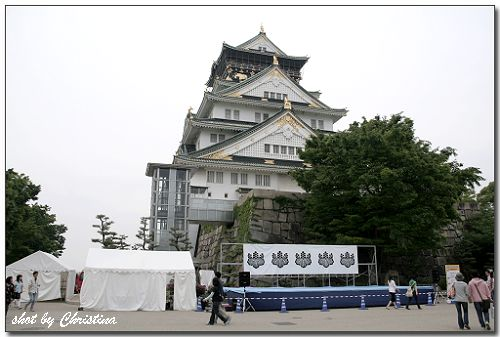  
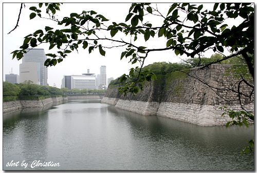  
  
大阪城堡里的游客  
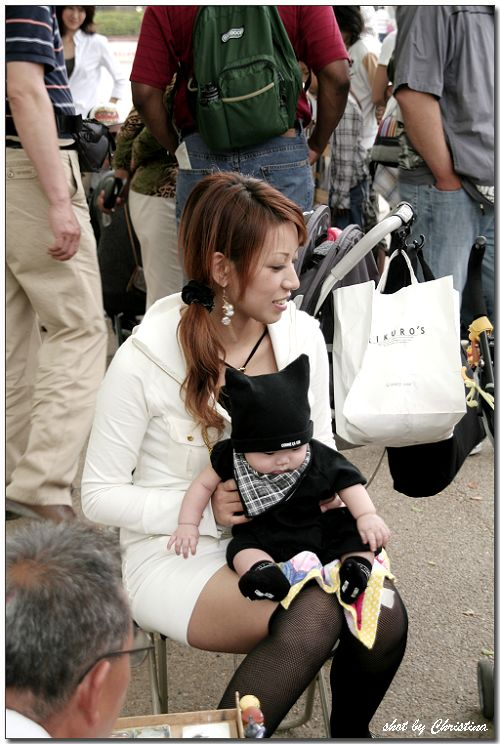  
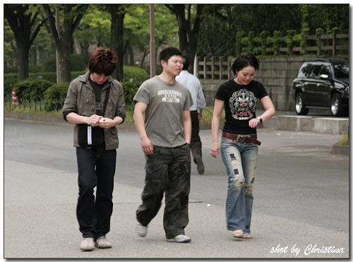  
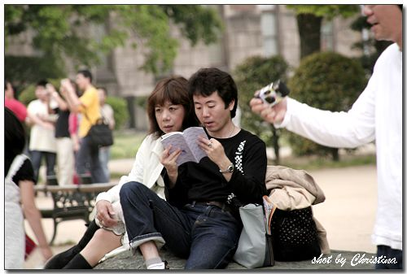  
  
大阪的学生看起来比东京的酷~  
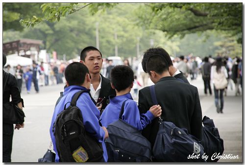  
  
日本居然有这样遛狗的  
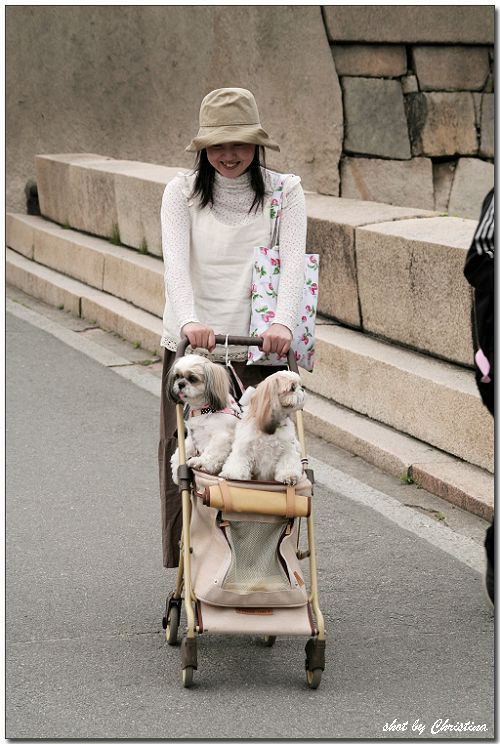  
  
大阪城堡里居然还有遛猫的  
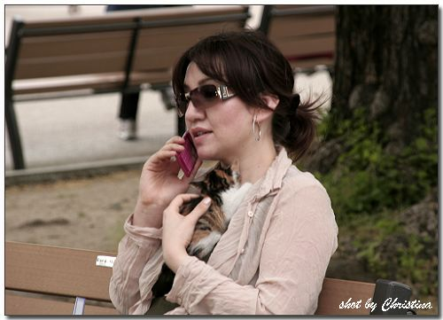  
  
MM读书的姿势很优美咯~  
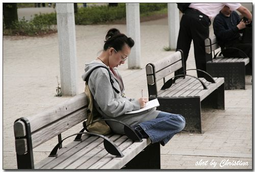  
  
来张自己的~  
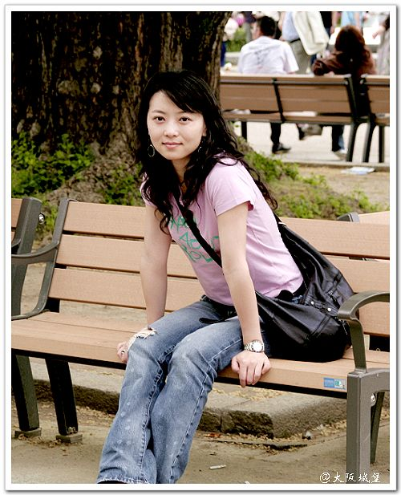  
  
大阪最迷人的地区道顿堀（ku）娱乐区，这里霓虹灯映照着海鲜餐馆的透明水池，里面游动着蟹虾和章鱼。对日本游客来说，必须要停下来和“食倒”合影，“食倒”是一个自动击鼓的小丑，麦当劳和肯德基两个加在一起也比不上“食倒”在当地名声大。你看日本女孩子照相就一个手势，这么酷爱V这个手势为什么？奇怪~  
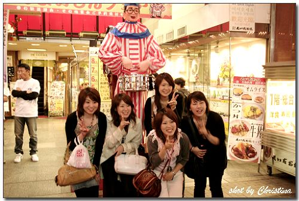  
  
道顿堀数百年来还是日本的戏剧中心，这里有6个歌舞伎剧院，5个文乐剧场，还有众多可容纳大阪说书人和喜剧演出的场所。如今多数老剧院已被电影院所取代，其中松竹剧院是和黑白电影的黄金时代密切相连的建筑。中座、角座演出仍很频繁，她们是道顿堀仅存的正宗的剧院了。  
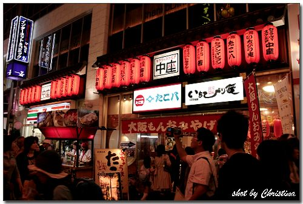  
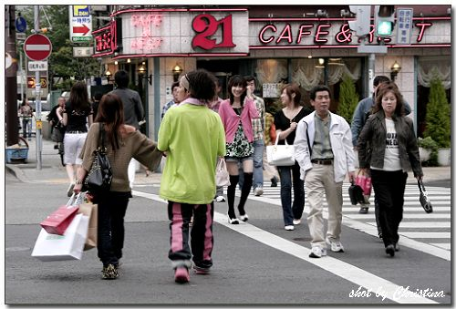  
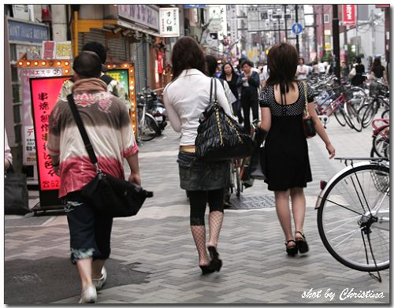  
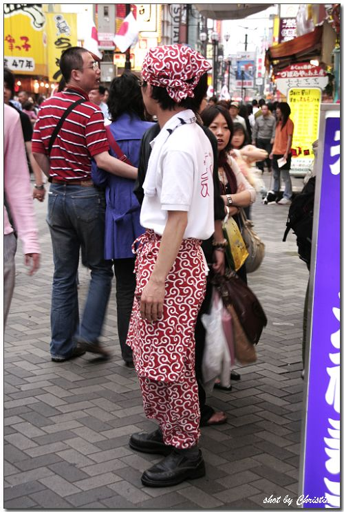  
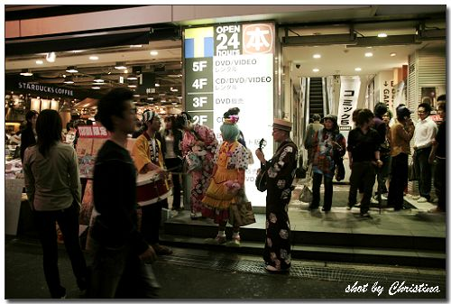  
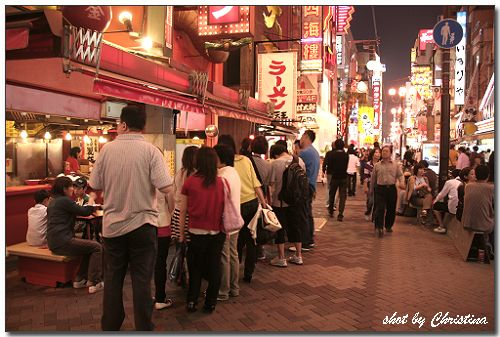  
  
打弹子赌博的店，据说这种店都由黑社会经营管理的。  
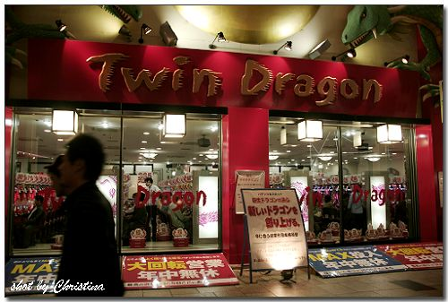  
  
摆放于日本男孩节的男偶，大阪一家电器商场里拍摄的。  
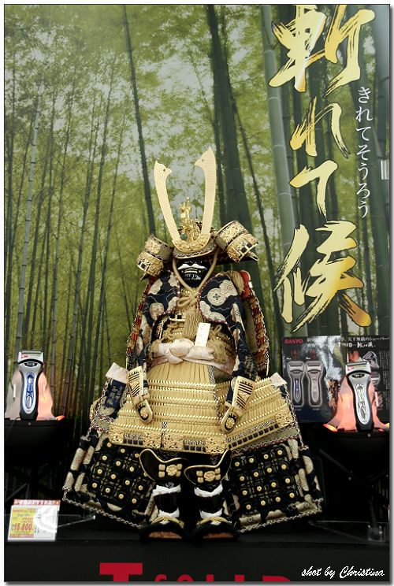  
  
一位躺在大阪闹市区的流浪汉，居然就躺在十字路口中间，带了四只猫，一只狗。据说日本的流浪汉一般不乞讨，乞讨钱财的多是为了给猫狗买食物。日本政府有给流浪汉洗澡的地方，那么流浪者没有钱如何生存？导游说超市对于食品效期有着严格的处理，例如到5月21日下午5点到期的食品，超市工作人员一定会按期处理掉，不然会被停业或罚款到破产。于是在超市处理食品的地方，流浪汉会排队去领取那些即将过期的食品。听留学日本的同事说，日本政府会定期给那些贫民区每人发500只鸡蛋，大家领取鸡蛋非常有秩序。走了日本几个城市，发现流浪汉也有社会公德，早晨睡醒了把自己的东西收拾得整整齐齐，活得依然有尊严。  
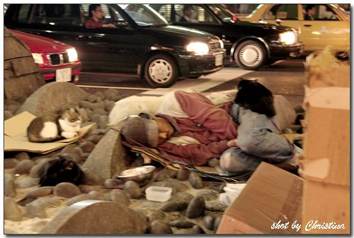  
  
东京皇居外的流浪汉，衣着整洁的躺在草坪上过夜。  
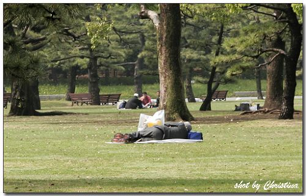

---

## 评论（22）

**Michael** · 2007-05-17

那个男的穿着和中国奥运会的火炬有的一拼：）

**淡蓝色** · 2007-05-17

好像是“药妆店”吧。呵呵。下次把店里的情况和买的东西也展示下下吧。

**雯子** · 2007-05-17

图中的婴儿跟他妈妈是黑白配嘛。

**[afan](http://blog.wenxuecity.com/myindex.php?blogID=22490)** · 2007-05-17

from a friend:

mazda几乎是subaru的对立面。几乎没有人会同时喜欢这两个牌子的车。

喜欢mazda的人往往性格外向，善于交际，赋有生活情趣，大部分人对艺术的兴趣远远高于技术。如果碰上一个长长的周末，这些人宁可游山玩水，或者邀朋喝友，也不愿意呆在家里独自静静的品一杯好茶。

BTW: my new car bought last month is a Subaru Outback. Thanks for the help and comments from you and youzi.

**冈本** · 2007-05-17

孩子的妈妈好看的。  
他应该被画家画肖像画。是不是？

打弹赌博店不一定黑社会经营的。这样现在很少。  
老板是一般的人多。但是不一定日本人。本来朝鲜人开的多。不一定都好人的。也有黑钱的.....

大阪热闹的地方分开两个。  
你去的大阪的“南 minami”。那里大阪人的气质，最浓的地方。  
另外是“北 kita”。那里是比较有现代感。商业的人最多。我喜欢“北”。因为没有“南”那么吵闹的。  
“南”比较象中国的。很热闹。呵呵。

**Michael** · 2007-05-17

Subaru… ...  
外形就过不了关...

**[Takemoto翠](http://www.vunion.com/dotclear/)** · 2007-05-17

关西和关东，就是不一样

**[afan](http://blog.wenxuecity.com/myindex.php?blogID=22490)** · 2007-05-17

?? pls elaborate …

**Michael** · 2007-05-17

Subaru太外形太怪了。和SAAB有的一拼。  
我要是你就选LEXUS的车-安静，动力也不错。上了车和到家了的感觉差不多。

**[afan](http://blog.wenxuecity.com/myindex.php?blogID=22490)** · 2007-05-18

Not quite agree with you. I think Subaru has a cool outlook and it is beautiful. I can tell a Subaru from 2 km away, very special. Wide base contributes more stability to car safety. Subaru Outback is also very quiet. I do think Lexus is better than Subaru but they are not at the same price range.

Also from the same guy, I think what he wrote is 80% acurate.

前注：subaru 的意思是二十八星宿里的昴，这就是为什么他的徽记是六颗星星。由于它的生产厂家是日本富士重工，所以又叫富士车。港台地区称之为扫把佬。

喜欢富士车的，是不折不扣地实用主义者，个别还是技术至上主义者。这些人一般追求的是安逸舒适的生活，乐于享受于平静而悠长意境。大部分购买subaru车的人，都仔细的研究比较过这些车的技术指标。这些人在生活中，往往从事技术工种，熟悉机械或电子方面的原理和应用，是家里的handyman.

以上不适用于Subaru WRX车迷。

**Michael** · 2007-05-18

:) 车就是这么回事。看每个人的追求。  
但要要看你那车买了多少钱,排量, 配置, 售后服务...etc

新车都比较安静，但是开过一段时间后，隔音不好的就开始显现了。有的车噪音大，不得不开大音响来掩盖...千万不要看什么厂家的拖写的“大部分购买subaru车的人，都仔细的研究比较过这些车的技术指标。这些人在生活中，往往从事技术工种，熟悉机械或电子方面的原理和应用，是家里的handyman”这算是什么？是他们的统计还是宣传的标语？他们的车的target demographic就是这类人？that’s crab man! 如果这样下去SUBARU早晚要破产的！！还参加什么车赛，在家种菜了！

每个人买车都是要比较的，选到自己喜欢的才是重要的。对厂家的忽悠说NO！

**Michael** · 2007-05-18

打错字了  
“crap”   
:)

**[afan](http://blog.wenxuecity.com/myindex.php?blogID=22490)** · 2007-05-18

These words are not from what 厂家. It is written on internet by someone who knows lots of cars. His series called 车如其人:

车如其人 – 9

来源: Fagger 于 07-05-16 22:43:10 [档案] [博客] [旧帖] [转至博客] [给我悄悄话]

其实，车如其人是有事实依据的。

设计师在开始设计一款车的时候，市场分析部门就会提供这一款车所针对的特定的销售对象的特点，其中最重要的， 就是这些人的购买心理。而设计师的工作，就是通过一系列的表现手法，去尽量迎合这样的一些心理。市场部的工作则是通过广告等手法，进一步把这些东西传递给潜在的消费者，进一步强化设计师企图表现的理念。

这些理念的贯彻，最彻底的是在概念车上。但是，由于概念车性格过于鲜明，不可能大量投产，所以上市的产品会稍稍柔化这些理念，以便争取更广大的顾客群。

我所作的，只不过根据车的设计特点，猜猜设计师设计的时候在想什么。

**[afan](http://blog.wenxuecity.com/myindex.php?blogID=22490)** · 2007-05-18

They are just for fun. Don’t take it too seriously. For me, the important part is promotion. When I bought Subaru Outback, it came with promotion that I can get leather seats, power seats, privacy glasses, registration, stamp duties and insurance all free of charge. Totallly those saved me about AU$3500 :D

http://www.subaru.com.au/quicklinks/current-offers/outbackluxq/

**冈本** · 2007-05-18

怎么关于汽车的话题讨论呢！？？！  
很奇怪！

**Michael** · 2007-05-18

Yeah. you are right. i am not serious about it at all. I’ve got my own vehicle, worse than yours:) I crashed it several times… you know it’s just a god damned transporting tool we are talking about. it’s just a part, a very small part of our lives.

you may change it, you may not…whatever…no big deal. just for fun. a cup of cappuccino(R&B)

cheers

**雯子** · 2007-05-18

我不觉得孩子的妈妈好看,到是母子二人衣服是经过搭配了一番才出来逛街的吧。孩子的妈着装时尚小孩的穿衣品味也就差不到那去了哦。

**[高光光](http://www.blogcn.com/user18/momo_guangguang/index.html#)** · 2007-05-20

日本之行系列真不错！我给日本朋友展示，她也觉得有趣。我们同时惊叹于街头女孩的装扮，这在美国，活脱脱就是特殊职业妇女啊。

**ILN** · 2007-05-22

In USA, only hookers wear stocking like that. If Japanese women came to US like this, they may get themselves into some un-comfortable situation.

**Christina** · 2007-05-22

道顿堀那里的女孩子打扮得和南京华新、莱迪里的小女孩差不多，青春的色彩本就五颜六色的。相比较更喜欢有气质和内涵的时尚，大阪这类人也不少。

和朋友谈起时尚的话题，最后总结一个观点：其实很多东西都是美的，就看穿在什么样的人身上，怎么搭配~

**[myspace music](http://1006711427@msn.com)** · 2007-10-04

layout myspace tupac web [url=http://change.iega.info/sm.html#133359483]layout myspace tupac web[/url] http://change.iega.info/sm.html 1185113359

**六欲有节** · 2009-11-02

我也喜欢大阪，曾经早起在大阪城堡跑步，感觉非常好。

