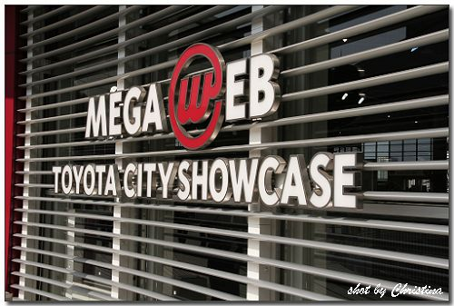
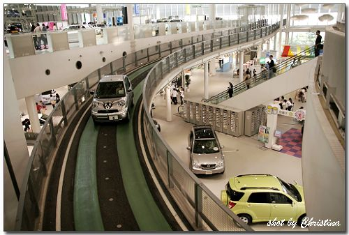
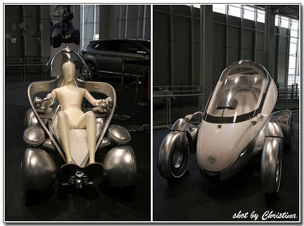
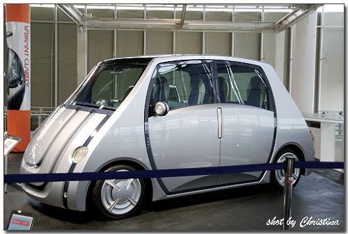
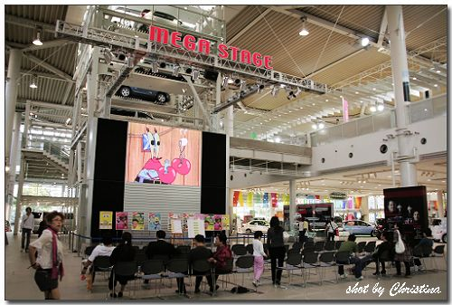
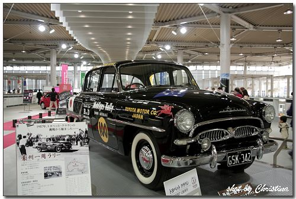
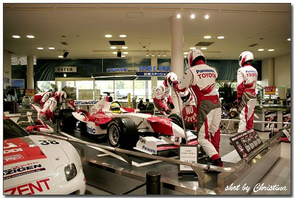
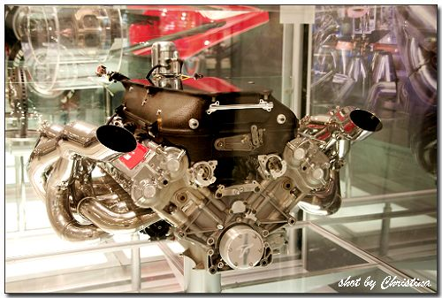
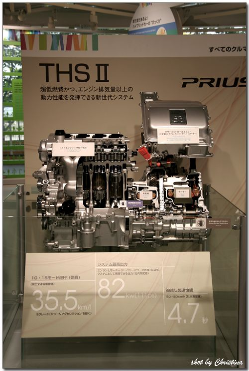

# Toyota City Showcase@Tokyo

在东京的丰田汽车展览馆。里面有古老的丰田车和最新的概念车，如果有兴趣的话还可以花点钱在馆内试乘试驾一下，不过好象不用自己开，汽车自己顺着轨道走。就我本人而言只看过法拉利汽车展馆，介绍相关文化及产品，除此之外便是丰田车了。不过没有那个品牌的汽车能象法拉利那样有着悠久的历史和文化，相关产品也特别多。（在平和公园对面看到法拉利在美术馆里做一个展览，匆忙拍了富士山远景之后便冲进馆内观看起来。）当然丰田车对于日本人意义深远。什么时候我们也能有一个大家都拥护和认同的国产品牌汽车就好了！  
  
  
  
  
  
  
  
  

---

## 评论（5）

**polo1.4tt** · 2007-05-22

不得不承认，日本人造的车，的确很好，日本的车床很好，钢材很好，都很好……

**[yaotian](http://www.xiongcaocao.com/html/photo/?sid=1&aid=18)** · 2007-05-23

你的网站和照片不错．  
引发了我的摄影热情．也准备上一个D400。 这是我用Sony卡片机拍的http://www.xiongcaocao.com/html/photo/?sid=1&aid=18

**阿Dee** · 2007-06-01

I like it! These photos ,great.

**joseph wong** · 2007-07-11

请问〈丰田汽车展览馆〉每天都开吗？？还是有指定的日期？？如果有指定的日期，那2008年是什么时候呢？？如果可以，请尽快通知我，急用……  
谢谢你~~

**Christina** · 2007-07-11

我只是去旅游，所以并不清楚是否每天都开。  
但看情况似乎应该是每天都开的，我指东京的。因为那就是给大众参观的场馆。

