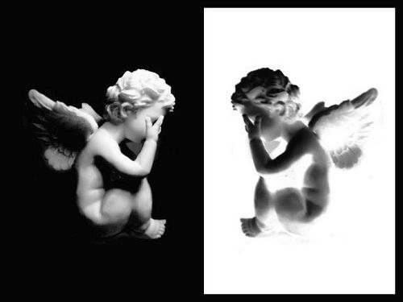

# 无题

信任是把双刃剑。  
  

---

## 评论（8）

**大亮** · 2007-05-30

你需要一场邂逅

**Eddy_Fresh** · 2007-05-30

那要看你怎麼看它了...  
信任也許让你看到真正人性.  
支持你的看法!!

**polo1.4tt** · 2007-05-30

这句话我正好刚刚深刻体会到……  
不过我还是选择信任，哪怕再次受到伤害。

**daphnis** · 2007-05-31

又是分类“龌龊后清纯”？最近连续“龌龊后清纯”嘛。^\_^

**bihu** · 2007-06-01

miss u!

**[青花碎瓷](http://blog.sina.com.cn/chinatea)** · 2007-06-02

为什么你会形容它是剑  
可能只有它才能打开你的心  
算了吧  
这没什么不好

**Michael** · 2007-06-04

信任是相互的.

**stella** · 2007-06-04

Trust is a fragile thing  
Once earned,it affords us tremendous freedom  
But once trust is lost,it can be impossible to recover

