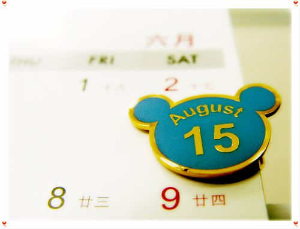

# 不好奇，不忧伤

  
  
早晨的窗外弥漫着白色气体，我不认为那是可爱的雾，我认为那是污染，这里的空气让人越来越无法信任。  
  
因为国家政策有变，我们的供应商都在赶货，期望在7月1日前报关出运。曾有长辈说中国政策多变，联想到最近传闻中5年内卖二手房要增收20%的税，股票交易增加2‰的印花税的新政策。国内经济红火的令人感到害怕。  
  
刚刚因为工作的事情发了一顿火，我总为不应该发火的事情发火，认真的人混不下去的。有人曾说：“70年代出生的，做妓女的还有些本质的真情，80年代出生的妓女满嘴谎言。”呵呵~~骨子里千万别认真，面孔上却一定要人模狗样的表演出认真来，这个时代生存的技巧？某早晨路遇同事，体恤衫领子竖着，很酷，车开得也快，我追了半天才追上。到了公司，人家边把领子翻下来边等电梯。  
我说：“平时你开车很慢的呀？”  
“我只在公司开车慢。”  
敬佩之余，惭愧自己情商低，境界也低。智商更是连80年代的小屁孩都不如。不如回家做职业妇女~  
  
收到短信，大致意思是与我迎面驾车而过，发现我的车牌号和他妈妈的生日及他的身份证尾数一致，所以找到我的手机号码打个招呼...我对这类行为非常烦感，现在真是什么人都有！对方怎么弄到我的手机号码的？这种人在马路上遇见不止一个，有的简直就是小流氓，死皮赖脸地拼命打电话发信息，他以为天下女人他想搞谁就搞谁？但人家就是搞到你的号码了，虽然只是在大街上看你驾车而过，TNND~~什么世道！那些登记在车管所的个人信息是否受到法律保护？那些执法部门难道没有义务和责任保护公民的个人信息和隐私吗？可是我开的车一点也不招摇，都快成街车了，难道它的外型还不够男性化？  
  
我和你和他和她一样有许多百思不得其解的问题，有些还象小时侯一样仍然充满着好奇，有些试图去理解但未必接受，有些不理解不接受也不好奇不忧伤。你在意的就将成为你的弱点，不是吗？

---

## 评论（19）

**[afan](http://blog.wenxuecity.com/myindex.php?blogID=22490)** · 2007-06-05

“7月1日前报关出运”   
Isn’t it for Christmas?

“但人家就是搞到你的号码了，虽然只是在大街上看你驾车而过”   
holy 靠 !!

**jiajialing** · 2007-06-05

靠,这都行..无语,还是要小心点呐

**Eddy_Fresh** · 2007-06-05

哈哈～你的车可能不招搖.  
但是谁要你长的美?? \_\_

**Christina** · 2007-06-05

误会。也许是我开的快了点~

**Dan** · 2007-06-05

如果知道车牌号，可以通过车管所查到车主登记的手机号。

**雯子** · 2007-06-05

真是很奇怪哦，不知道那些人那里弄到的号码，我好友也有接到莫名其妙的电话。反正还是小心为好！

**Michael** · 2007-06-05

Christina好像最近似乎是不太顺利吗...还以为你最近能休息呢   
开车还是慢一点的比较好... 我是开不快,快了紧张(可能是我的车不行:)

**[Nio](http://nio.infor96.com)** · 2007-06-06

电话号码还是比较容易搞到的，即使有立法也没用，知法犯法的多的是。我后来就因为这些烦人的电话一怒之下换了手机号。

**大亮** · 2007-06-06

这有点像瓶中信呢？每个人都希望和更多的人有联系找渊源，人家找到你而不是别人这说明你的魅力至少让那个发短信的人产生了希望，并试图尝试接近你，哈哈，你应该高兴才对。因为很多人都害怕衰老，因为这样她们就会失去情人，而你现在众人的目光中有时会多于世界

**Christina** · 2007-06-06

问题不在于有多少人联系你，问题是什么样的人联系你，曾经我遇到那种要债公司的小混混，头发剃成板寸，穿着运动裤、运动鞋，开着黑色别克车，高架上跟着我的车追，我都开到150、160时速了，十字路口停下来人家摇下窗户就为了搭讪：“你开车很快呀，好几次遇见你的车...请你喝茶，好吗？”开车快关你鸟事，老套的搭讪，不是喝茶就是吃饭，我没茶喝没饭吃吗？不管你是黑社会还是良家男子，这种行为最让人烦感！看着什么人就追，就搭讪，不被理睬继续频繁地骚扰！骚扰，知道是什么概念吗？后来有一次我接了电话，我把他们的姓名、年龄和住址等等详细情况报了一遍，别以为只有你可以弄到我的信息。然后我问：“你想从我这里得到什么？友谊？爱情？你认为你可以从我这里得到什么？”......从那以后再没被骚扰！

**Michael** · 2007-06-06

我都开到150、160时速了  
我从来没开过那么快. 是遗憾还是什么...?

**Christina** · 2007-06-06

我最快开过时速200，我那车的极速了，就5、6分钟，自不量力和一个A6飙，那时高速上还没监控。高速驾驶之后手心出汗，腿打飘，高速时车身重的好，安全！午饭啦，88~

**Anyayaya** · 2007-06-06

记得在南大一年级的时候，老有所谓的某艺术学院美术系研究生（当然，男的）在外院女生宿舍楼下转悠，自以为飘逸或深沉地走向进进出出的女生，邀其作人体模特。我也给拦了一回，那个胡子乱糟糟的家伙扶着我的自行车龙头胡邹了一通所谓的艺术感受，然后发出邀请。那时候还没有“我Kao”这种表达方式，但如果有，在当时应该是我脑子里冒出的第一个词。连这种破事儿都有！当时比较嫩，比较不好意思劈头盖脸地拒绝，不过我说：我考虑考虑吧，你过几天给我打电话。他问名字和电话，我说我叫XXX,住315。那是班上一个有着中性名字的男生，而315是我们那一层放拖把扫帚的杂物间。比较佩服的是我的同学，估计碰上了相同的人，那人很恳切地问：我能和你说句话么？我的同学停下来斜眼看看他。他又问一遍，我的同学还是这么瞧着他。还真是锲而不舍，他又问一遍。我的同学轻描淡写地说：“不能！”然后高跟鞋笃笃笃地走掉了。我对她佩服得五体投地。 对尾随的猥琐的小混混，与其气氛，不如调侃调侃。“喝茶就算了，没心情，最近缺笔钱，不知您愿不愿意借点儿，也不多，50万美金。。。惹了个官司，要赔人家的。。。”

**绿恐龙** · 2007-06-06

这种骚扰方式换个角度应该开心 至少还是给有心人骚扰 查个号码也不容易 还要在开车的时候记得你号码

**[afan](http://blog.wenxuecity.com/myindex.php?blogID=22490)** · 2007-06-07

现在的小年轻脑子都不好使，买了车当然用来追没车的女孩，追有车的不是自己找笨么

**Aimda** · 2007-06-07

开车是为了方便工作生活，事故往往发生在一刹那。  
理性驾驶，安全第一。

**大亮** · 2007-06-09

生命只有一次，而时钟在一分一秒的流逝，我们当然不能把有限的时间给那些小混混糟蹋。高贵始于拒绝，但有时候拒绝不一定就高贵。那种凌厉的傲慢和鄙视更像是惩罚和作弄——因为他们主动的沟通，恳切的寻觅，但前提是他们是小混混，他们尽管开着车，但他们脱离不了他们虚伪的本质——他们是小混混。我感觉高贵的另一面应该宽容，远离愤戾和鄙夷之气，尽管这个世界已经糟糕到这个样子了，所以这种宽容的强势更可贵。我一直认为女人应该是阳光，而不是黑暗中傲立的那棵草，她越强势越显得悲壮。

**Christina** · 2007-06-09

是啊，那棵草爱憎太分明了~

**yezi** · 2007-06-12

现在一堆货出来了，没有舱位走哦。NND

