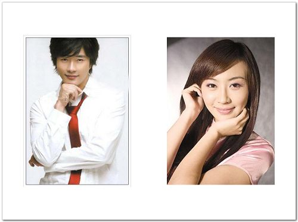

# 权相佑恋爱了~

报纸刊登了权相佑和[大陆演员李菲儿](http://blog.sina.com.cn/muzifei)恋爱的消息，称权相佑特地飞到北京与李菲儿幽会，如果不是权相佑，谁知道李菲儿是何许人也？一度追随权相佑的所有消息、图片、作品，现在依然很喜欢他的眼神、笑容和走路的神态~可是，这个李菲儿看上去妖里妖气的，跟南京华新女孩一样，有点儿“zuo"！看了她的BLOG，如果不是搞怪做作，自然状态下的形象真没什么出彩的面儿！我又要用那个被糟蹋的形容词了“不大气”，扭捏作态，当然作怪才能吸引更多眼球，不是吗？81年出生还自认情窦未开，你信吗？更倾向章子仪、周迅、归亚蕾、孙俪那种自然大方的。权相佑原来是这样的品味咯~  
  

---

## 评论（5）

**Jadeite Takemoto** · 2007-06-07

呵呵，或许80年代的女生大多有这种“吸引更多眼球”的欲望。我认识一个82年的，拍照总是低着头侧着脸，从不拿正眼对着镜头，喜欢摆S造型，不过人家自称自己的座右铭是“简单 自然 唯美”。  
哈哈，就当看一场场作秀咯

**[Adeline](http://农妇的自然生活)** · 2007-06-07

人不可貌相。何况你也许根本不了解人家。若真是两情相悦，必然有他们的理由，局外人又怎么能体会和感受。还是希望天下有情人都能终成眷属吧。

**[smartland](http://smartland.blogspot.com/)** · 2007-06-07

都不了解。不过zuo确实让人恶心的，呵呵

**martin** · 2007-06-08

一der都不上档次，一der都不大气。。。

**Sherry** · 2007-06-19

此女子的眼神跟某人很像，难怪让你想到华新，哈哈！

