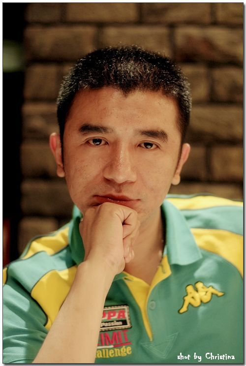
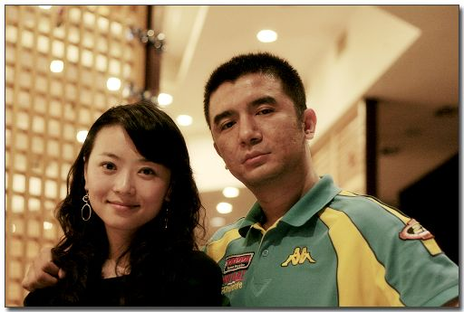

# 艾伟桉的失恋季节

  
  
  
在我那已经停产的SONY笔记本里还是我的Chinese Tea速度比较快，Sina或者space慢得让人抓狂。为了查[**艾伟桉**](http://blog.sina.com.cn/u/1197530002)和[徐婷](http://blog.sina.com.cn/xuting)的博客，那是相当需要耐心的滴。周末艾伟桉找到我，15年没见，他的摸样一点没变，只是脸上多了好些火山坑，难以想象他的青春期怎么过得？当年的他不仅英俊，而且潇洒不羁，不喜欢受束缚的家伙。曾伙同我的室友在我回南京期间偷吃了我妈妈托人捎给我的香肠和咸鸭蛋，我回去后这家伙说那些东西全都变质被扔了...  
他说：“你还记得吗？过了段时间你找我去后面操场谈心，你说你怎么这样呀，你以为我不知道，其实我心里都清楚，你还骗我...”他模仿我小时侯的腔调让我哈哈大笑起来。  
“你那时侯特傻，你知道吗？”  
“我现在还是很傻，你不知道吧？”  
“你现在看上去成熟多了。”  
特佩服很多人对过去的事情记忆犹新，特别是很多男人。而我好象患有阶段性失忆症，好些事情真的一点儿也想不起来了。是不是那时侯我还没开窍啊？据说那室友在上海开了家大理石厂，还有个11、2岁的女儿，这世界变化之快让人怎能记下那么多事情呢？  
  
艾伟桉原来的名字叫...，不明白他为何要改名儿，从事着对于我来说完全陌生的职业，名人有经纪人，他不是帮个人经纪，而是做文化项目，在我理解应该和某某传媒、某文化公司差不多的性质吧。  
“你有博客吗？”  
“有啊。”  
“帮你包装成美女作家吧，呵呵~~”  
“别吓人啊，你去网络上看看‘作家’太多了，我那点儿东西根本不行！”  
“你不知道有些歌手到卡拉OK厅去根本不会唱歌，全是被包装出来的。”  
  
我没想到会有人在Chinese Tea上用真名留言，也许文艺圈的人需要“名”气才能有钱赚，所以不忌讳真名上网？这么多年过去了，他走路还是那样特自由放肆的放松着每个关节，所以他最适合现代舞，可是他让很多机会都溜走了，这点在他身上尤为明显。或许他太自尊，或许太随性，或许太理想化......纯粹做艺术的人是发不了财的，只有将艺术当作生意一样去经营才会有名得利。不过我们那些人里还是出了些文艺名人的，有的人在90年代居然就赚了第一个2000万，太不可思议了~我、和部分从事朝九晚五工作的故友一样过着看似稳定的生活，稳定？我父母一直推崇的生活状态，稳定在老年人看来就是幸福。所以，在此抨击我父母的想法是不人道滴。  
  
“15年了，我问了很多人知不知道你的情况，很多人都不知道。”  
“[**虎子**](http://ting.006.net/singer/singer_1288.htm)也是去年才联系上我的，我好象不大主动和别人联系。”  
“哦，后来我们大家就猜，你是不是去做特务了，哈哈~~”艾伟桉说道。说到我心坎儿里了，我特想做特务，特想去安全厅工作，这种职业充满了神秘和传奇色彩，应该很酷吧，当然也很残酷，是吗？有时，我还想去酒吧当服务员，没有原由的想法。  
  
“啊，虎子和你联系的，他现在在哪儿？”  
“在北京啊，你不知道？”  
“虎子刚去北京时找过我和[**李延亮**](http://www.guitarchina.com/lee/)。”  
当晚和虎子通了电话，这人正在开会，说是要为《疯狂石头》原班人马新拍电影[《疯狂赛车》](http://ent.nubb.com/movie/20060826/5787.html)做电影配乐，天呐~离我太遥远了~  
  
从晚上7点半一直聊到凌晨4点多钟，这季节恰逢艾伟桉失恋，失恋的人一般都跟祥林嫂似的，没想到这家伙也会失恋，印象中只有他甩人家的范儿，狮子座的人在感情上一旦认真起来，那可是要命儿的~狮子座扔下北京的亲朋、抛下在北京从事的工作和生意决意去广东追逐谈了三年的爱情，居然还搜索到[艾伟桉帮其前GF写的文章](http://www.thefirst.cn/90/2007-02-25/49578.htm)，然而结果是必然的，70年代总会被80年代的人给涮喽~黯然神伤的他将重返北京那个承载着一切悲欢记忆的城市。那晚一起的还有个央视主持人，和艾伟桉同年同月同日生，加上我，三个狮子座，好象找到共鸣似。也许我已不是标准狮子座性格了，性格果真决定命运吗？命运或许也能改变性格吧？这个季节之后，狮子座还会抛下所有去追逐爱情吗？

---

## 评论（7）

**[yaotian](http://www.xiongcaocao.com/yaotian)** · 2007-06-11

美女，聊到凌晨4点？ 你家人不担心呀？：）

**Jaul** · 2007-06-14

眼睛很诱人！

**Sherry** · 2007-06-19

此男我当是哪个明星呢，蛮会搞深沉的。。

**[airylea](http://www.airylea.net)** · 2007-06-20

《与青春有关的日子》里有个高洋，看照片此男有点他的气质。。。  
未见真人，乱说的。呵呵

**Christina** · 2007-06-20

他以前是学舞蹈的，还是有那种气质的~  
是不是也很象《寻找回来的世界》中那个男主角？

**NAME** · 2007-06-21

让他失恋的女朋友性格象冯裤子象电影情节那样注定要涮象高洋一样的他。

**liulangtianji** · 2007-08-18

我把你的地方逛了个遍  
收获不少

只是怎么看也不像70年代的人！

