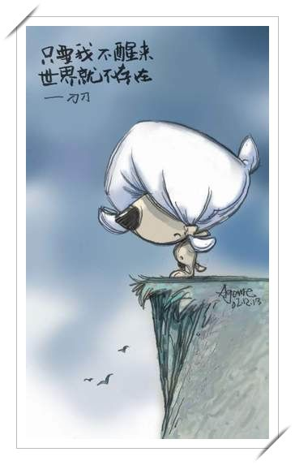

# 无题

当我们无可奈何的老去，有人担忧有人无奈。  
谁分享了我们最好的年华？  
  
  
ＹＣ说：除了工作，就是上课，逛街，和家人聚聚，和朋友聚聚，感觉有点空。这样很空虚，整天在买东西，真的很无聊。我也喜欢买衣服，感觉好看的东西是可遇不可求的，好像以后再也买不到了似的。  
  
Ｃ说:以前我也这样，下班就去逛街，不停的买衣服买服饰，越这么做越空虚。现在只会突击性的买些衣服。你倒提醒了我，我现在没有空虚感了，我在想为什么？  
  
Ｄ说：失恋的人容易病急乱投医，有个刚失恋的家伙昨天跟我说要结婚了，FT...很多人都是这样，以为可以摆脱寂寞，到头来更加寂寞。  
  
  
Ａ说：主动加你的100个里估计就2~3个正派的人，我之前不是有写过我在yahoo里贴照片交友的，一天有一百多个留言要认识的。前段时间ＨＩ５上一个中国人一定要我ＭＳＮ我就给了，因为那人看上去很斯文的样子，４０多岁，聊过一次我就不想聊，是华侨国外的。后来一次他邀请我看视频，我靠！竟然在放Ａ片，妈的！！！我气死了，马上阻止删除，以后不认识的统统都不加在ＭＳＮ里，都不是好东西。  
  
Ｂ说：以前我用SKYPE，有个话框跳出来上面居然一大生殖器，我当时不在座位上，回来才看到，怀疑别人是不是都看见了，我靠，只有老外才做的出来。  
  
Ｃ说：今天有个家伙说我看上去性欲很强，我就说他看上去象个“鸭子”~~  
  
Ｄ说：靠~都什么鸟啊？哪儿来那么多贱人？  
  
Ｅ说：烂鸟。  
  
Ｆ说：这次出差我一当警察的同学跟我讲了很多事情，好些外表文质彬彬、道貌岸然的人，私下做的事儿极其自私变态，你想都想不到的。不要以为你自己很复杂，与这个复杂的社会比起来，你还嫩着呢。  
  
Ｇ说：你把我当呆X，我就把你呆X。  
  
Ｈ说：即使和TA没鸟关系的事也要叨叨，就一爱好，今天对你说她，明天对她就会说你，总之是要说的。那张嘴谈电影、谈音乐、谈文学、谈生活...？什么都谈不出来，再不让它叨叨点是非，那不是很不人道么？贱人，总是无处不贱，无人不贱。再说了，ＴＡ自个儿干净吗？  
  
Ｉ说：泼辣的女人等于成功了一半，我尽量不让自己骂人。（是不是等于尽量不让自己成功？：））  
  
Ｊ说：我20岁前也阳光啊，30岁又开始阳光了。 现在我看到感性的男人就怕，和这样的男人在一起特别累。我喜欢简单，简单意味着快乐，即使不是太满意，但快乐就好了。  
  
Ｋ说：那就赶紧分，要不你们两都去看看心理医生吧！

---

## 评论（7）

**仙道** · 2007-06-27

哈哈哈哈，特想看一下那个性欲很强的人长什么样。。。

性欲和长相有关系吗？没有关系吗？有关系吗？。。。

一个有趣的话题。放在MOP上一定点击率很高：）

**YC** · 2007-06-27

虽然很无奈，但是，也可以很优雅的老去。

**okdata** · 2007-06-27

This is life

**[青花碎瓷](http://blog.sina.com.cn/chinatea)** · 2007-06-27

呵呵  
看你最近的文多犀利  
不知道是不是思索的东西太多  
以至于茶多厚重而少清寡  
美丽的人  
随心的泡茶  
随心的喝茶

**mandy** · 2007-06-28

大千世界，无奇不有！正常~正常~

**大姜炖去** · 2007-06-28

无意中路过。  
看到了可爱的刀刀，  
至今已收集了一打练习本，  
只因为上面有这只可爱的小狗。

只愿人能简单而善良~

**Jaul** · 2007-06-30

有意思！我也喜欢刀刀！ 人生就那么回事！简单着复杂着！

