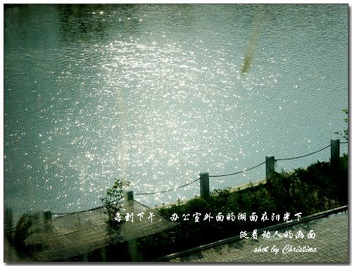
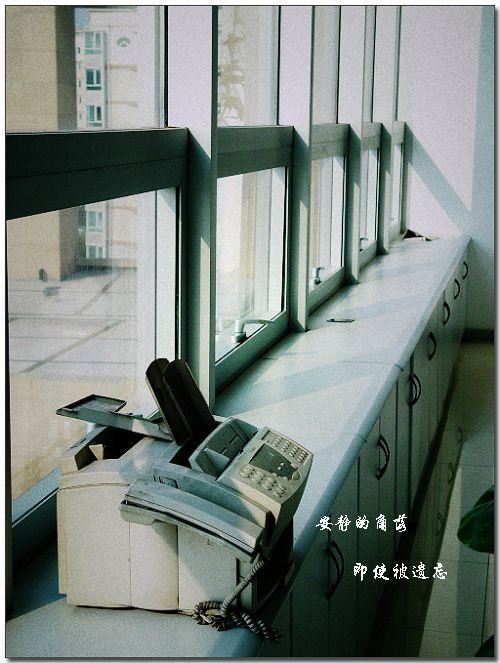
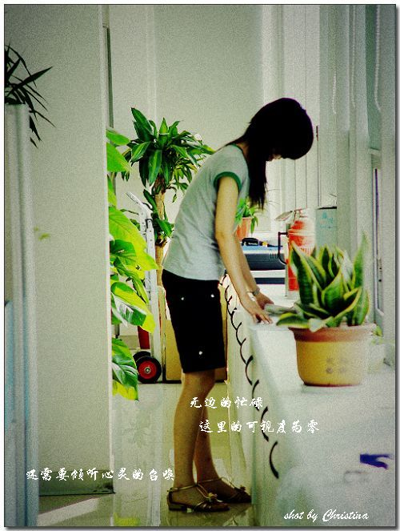

# 无常下午

   
   

---

## 评论（7）

**[青花碎瓷](http://blog.sina.com.cn/chinatea)** · 2007-06-29

题目为无常  
但我从照片的顺序看到的却是不经意的有序  
图边的文字告诉我们这个下午  
你的心事。。。。。。

**ILN** · 2007-06-30

Downtown Nanjing from my hotel room.  
http://www.imagestation.com/picture/sraid225/pfc7c02f03c36c565010fc7423545f670/e8d2a549.jpg

A conversation between a Dad and his 7 years old son.

Dad: The true color of the sky is blue.  
Son: No, Dad you are lying. It is gray! Can’t you see?

**一斤蓝色** · 2007-06-30

前段时间不知道为何一直打不开链接？今天无意中发现又可以进来了！  
喜欢茶  
喜欢有气质的文字  
喜欢精灵般的空间

**[高光光](http://gaoguangguang.blogbus.com)** · 2007-07-01

我回复了你的留言。但是因为改了一下版面所以留言不见了。我因为选择了另一个工作所以放弃了去南京那个job。那是个夏天的工作，在南京一个月。你的博客版面是我见过最好的，照片也很好。

**Christina** · 2007-07-02

这张照片上的南京市中心看上去好苍白~

**Michael** · 2007-07-02

LZ第一张照片拍的不错!  
照片中的对角线(黄金分割)用的不错

**Christina** · 2007-07-02

俺不懂黄金分割线：）

