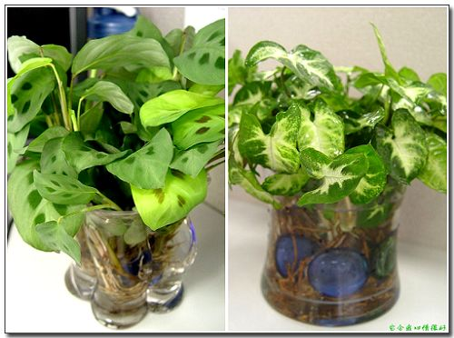
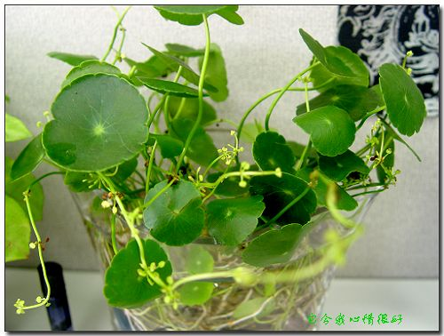
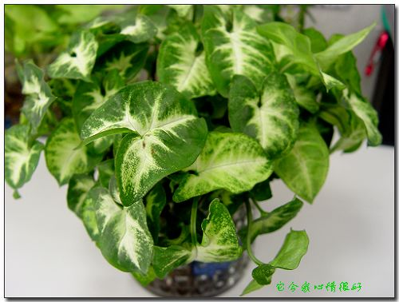
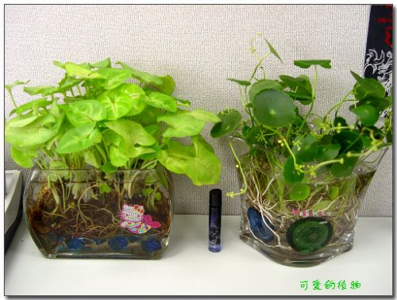

# 它令我心情很好

连续多日暴雨后的花卉园大棚里超闷热，待我双手拎着大小袋子走出花卉园，已经满脸是汗。许多可爱的植物，挑了几株，深深浅浅的绿看了就让人开心。为植物的生长而喜悦，你就比别人多了一份快乐！  
   
   
   

---

## 评论（7）

**稚** · 2007-07-10

是无土栽培吗？

**Christina** · 2007-07-11

是的，换水就好，生命力很强，偶尔晒一小时阳光，很容易养的~

**mandy** · 2007-07-11

我也养了些无土栽培的无名植物，可没有你那么好看的玻璃花瓶！原配的吗？

**Christina** · 2007-07-11

是另外买的。原先这些植物都是种植在塑料花盆的土壤里，可以要求卖家清洗掉土壤种植在玻璃器皿里。我在玻璃器皿上贴了用在手机上的贴纸（那个小美人鱼），很多地方都可以买到这些漂亮的各种图案的贴纸。建议到郊区的花卉园里购买这些植物，很便宜，品种也多。南京花神大道上有家“万博花卉园”，可以还价的。

**mandy** · 2007-07-12

谢谢！我会去！

**faye.chua** · 2007-07-12

绿色的植物非常养眼。

苦心栽培 却终无花开 若人 会怎样？

**Sherry** · 2007-07-12

挺好看的，很养眼，平时少对电脑，多看植物。

