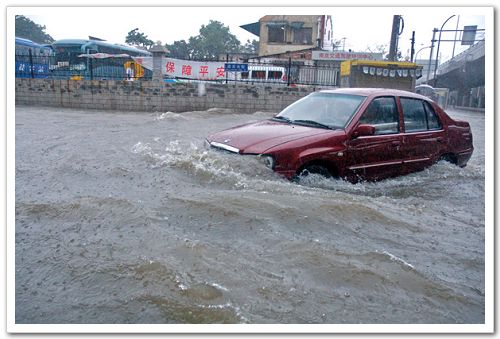
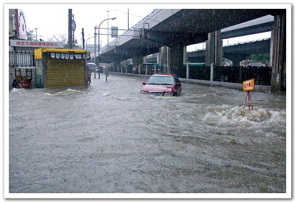
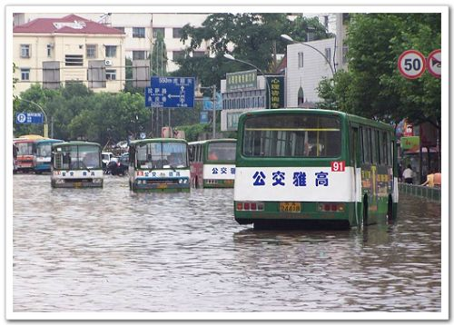
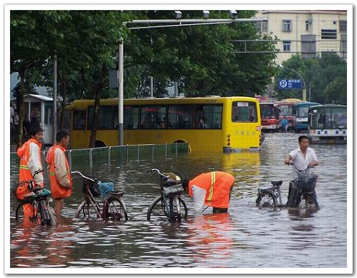
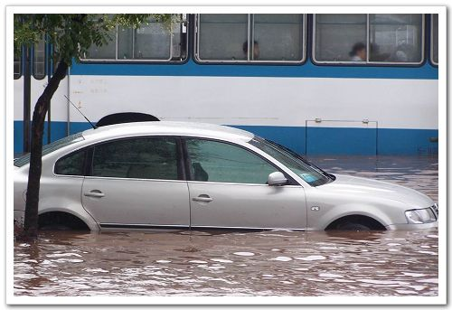
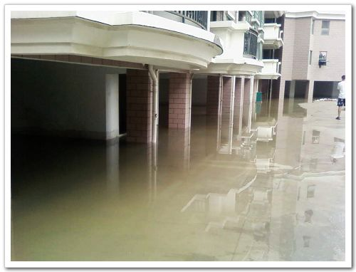
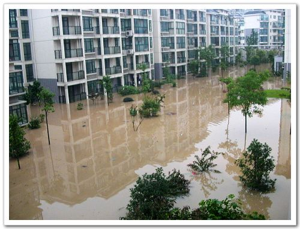
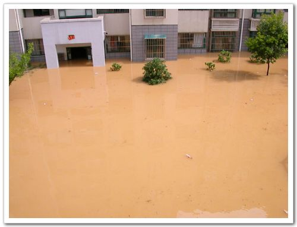

# 暴雨下的南京

上周末下的暴雨，南京好些地方都淹了。据防指统计数据显示，南京市各郊县受淹街镇共36个，受影响人口20.3万人，农田积水面积50.5万亩。由于降雨量过大，南京城区共发生积水现象178处，南京多处市政设施遭到破坏。一些地区因地势低洼，排水不畅，造成近千户居民家中进水。   
  
南京市供电公司：7日下雨暴雨期间，因雷击造成多处供电事故，形成多处较大范围停电。截至8日12时，雷击共造成跳闸221条次！  
  
  
  
  
  
  
  
  
  
  

---

## 评论（3）

**ILN** · 2007-07-11

O My Goodness! The Mother Nature is so unfair. So much water here, very little water or no water in another places.  
Christina, how is your life effected by the flood? Did anyone showed up at your work safely? You didn’t drive in that flooded street, did you?   
Best of luck to the people in the flooded effected area!

**Anyayaya** · 2007-07-12

这个页面照片有点诡异。。。最近在看盗墓小说，看到这种色调的画面总情不自禁有点心慌。。。

**[Proke](http://hi.baidu.com/prince)** · 2007-07-14

那辆吉利胆子还真大，油门一丢发动机就该大修了。

