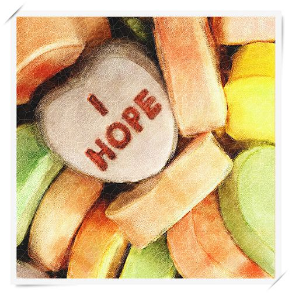

# 爱能等多久

文/Lost Angel  
  
  
等，基本是所有电影的必定命题。  
  
等着恋人开口，等着心仪的女孩回家，等着路灯熄灭，等着去远方流浪，等着孩子出世，等着目标接近，等着疑犯现身，等着高手出场。好象生命的本身都是一场等死的游戏。只是有些人在这过程中安享受，有些人则倍受煎熬。  
  
能等来什么并不重要，重要的是你付出了时间赴一个约会，去盼一场奇迹。但大多数时候，我们都没能坚持到底，等不来结局，进而自行做个了断。  
  
《东邪西毒》中张曼玉为了等待一句承诺而浪费青春，精疲力尽终是空梦一场。能做的只有倚着窗棂遥望远方，远方看不尽，眼泪亦道不尽个中苍凉。等不来的那个人，却是梦中最真实的风景。年轻的时候，我们都不懂让步，等着看谁先臣服，等着谁先放手。我们以为时光漫长，以为非己不可，以为力尽千辛终成眷属，以为执子之手与子偕老。但其实都不是，等的人终究会老，万千风情已不复，而你心心念念的人去不在你身边。他是缺席的，在你最好的时候，在你与时间对峙的时候。  
  
《爱在黎明破晓前》中的等待虽然短暂，但再次相逢却已是9年之久。九年前的邀约因为种种变故没能等来邂逅的她，日后的人生就此改变。书店的再遇，已经是前额深深的痕迹，已经是眼角藏不住的岁月。往日激情不再，那可爱的固执也随等待而消磨殆尽。现在的他们理性、果断、拘谨甚至逃避。9年后的重逢依然不能改变什么，经历了如此漫长的等待，有几人会舍得放弃所有。在岁月面前，生活比爱情大。他最后能给的浪漫也是误了飞机而已。  
  
《苏州河》的等待是琐碎而唠叨的。马达在不断的诉说中确定牡丹的存在，然后在这个肯定了的结论下苦苦地寻找。他相信牡丹没有死，或者他希望牡丹没有死，所以他等，所以他找。他会一直找到死，一直等到死。他欠牡丹的，是过去，而他在等待的却是未来，于是注定了他们没有明天的终场，两个人一起奔向死亡，一祭奠马达悠长的等待。  
  
《断背山》那两个牛仔等的是每年几次的会面，每年几次的缠绵。等的是墨西哥的美好生活，等的是公开的细小幸福，等的是世人的接受和祝福。同样，他们也没能等到，一个撒手人寰，一个紧拥着衬衫，在曾经的梦想里怀念。等什么时候开始变得如此残忍，如此无常。  
  
偶尔等到了所预想的事物，就象《两小无猜》里的朱力安和苏菲，4年，10年都无法阻止他们的疯狂，无法阻止他们那危险而甜蜜的游戏，然后他们幸福地生活，安静地老去。童话终止，现实隐去。  
  
同样是等，《独自等待》是苦中作乐，《漫长的婚约》是坚定执着。  
  
但是，我们究竟可以等多久。可以相信多久，可以浪费多久呢？  
  
是象杨过等小龙女这般孤守16年的死守？还是象等待戈多那样永远期待下一场爱情？我们肯用多少去等待一份爱。烟花会坠落，美好会消逝，情人会死去，而生命终将继续。我们舍不得拿精力去照料已有的感情，却情愿花时间来等待梦中情人；我们并不相信爱情的永远，却总是在等那个传说中的地老天荒；我们说要放手，却还一直紧握着念念不忘。  
  
总是在等待梦想中的那个人，那件事，那句话。等到失去，等到认命，等到死亡。最后已不知，我们等的，到底是信仰还是希望。

---

## 评论（6）

**freshair** · 2007-07-12

christina,静静地看着你的文字也好些年了，像是一个相伴已久的朋友。现时自己也正进行着一场坐以待毙的等待，觉得荒唐，觉得不甘，可还是认了。爱能等多久啊？是对他的质问，更是对自己的质问。

**[大亮](http://blog.sina.com.cn/u/1221009213)** · 2007-07-13

有一种想哭的感觉，含在眼里。 想起一首诗，一样的悲伤：认得这透明体，智慧的叶子掉在人间?消沉，慈净—— 那一天一闪冷焰，一叶无声的坠地，仅证明了智慧寂寞 零的终会死在风前！昨天又昨天 美 还逃不出时间的威严；相信这里睡眠着最美丽的 骸骨，一丝魂魄月边留念，—— ………… 菩提树下清荫则是去年！

**confus** · 2007-07-13

也许我们迷恋的也就是等待本身，而等什么，是否等到已不重要。

**mandy** · 2007-07-13

等到不想等为止！

**单旋~舞** · 2007-07-13

等待是一场盛大的颓败.其中,是否能结出花,只看你的修缘.

**sisi** · 2007-07-13

好文，“等待是一场盛大的颓败”很精准。

