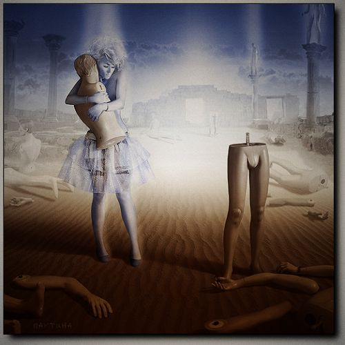

# 是，我们全是。

  
  
“人生两样东西，一个是形式，一个是内容。”  
“你们是疯子吗？”  
“是，我们全是。”  
这是电影[《飞跃疯人院》](http://datalib.ent.qq.com/movie/1131/)中的对白。如同电影本身一样精采。1975年的美国是思潮的年代，是质疑生活的时代。这是一个疯人院的故事，故事的主角是一个没有疯的疯子。疯人院的病人们并不是被强迫而来，是自愿来的，人们不约而同地得了一种通病，这种病叫做”逃避“。逃避生活，逃避压力，逃避感情，逃避一切令我们感到不适的东西。这个世界病了，即使你没有病，在这个病态的环境下，你不能说自己是完整的。  
  
怎么能把正常的人彻底弄疯？就因为他太正常了。大个子同样是正常人，有力气，他也向往自由，但他不自信，可以说完全不信任自己，所以装疯，装聋作哑。有力气还要有智慧，相信自己，才能过正常、自由的生活。  
  
按照心理学家的说法。精神患者是一些精神撕裂的人。他们内心的世界无穷大，无穷远，无穷小。从某个角度说，都是一些精神优秀的人。因为不被了解和接受，被视为病患。除了极少数具有暴力倾向的患者，其他都是安静的思考，自语于内心分裂的世界。  
  
精神自由与身体自由一样重要，精神压抑远比身体劳累压力更大。

---

## 评论（4）

**loopy** · 2007-07-19

世界上最幸福的事莫过于彻彻底底地疯掉．

**John** · 2007-07-19

世界上最幸福的事莫过于身体自由精神自由.

**[大亮](http://jiaze98@163.com)** · 2007-07-20

我也是

**[BENM](http://blog.sina.com.cn/BENM)** · 2007-07-23

那些被扭曲和压抑的精神或者思想，总是沉醉于“自我”这个没有门窗的密室，按照自己的方式独自生存—这种“无比”地自由，我是不敢奢望了，我更喜欢”open air”

