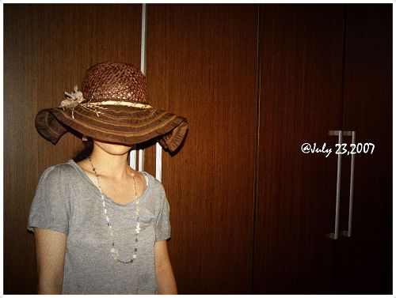

# lost without u

傍晚买了几张好听的碟，[**拍了些照片**](http://photo.lifetea.org/v/Its+me/July-23-2007/)，夜晚剩下的时间用来等待白天。好碟中有一张“THE EVOLUTION OF [**Robin Thicke**](http://p.g.yupoo.com/nph-proxy.cgi/000110A/http/cn.last.fm/music/Robin+Thicke/The+Evolution+of+Robin+Thicke)”，很喜欢~舒缓的节奏带给你的轻松感，好象是踩在软软的沙滩上，一种无知觉的沦陷。  
  
  
  
Robin Thicke[**《lost without u.mp3》**](http://zsptez.net/BBS/milk/Billboard/Robin_Thicke_Lost_Without_U.mp3)  
  
I’m lost without u   
Can’t help myself   
How does it feel   
To know that I love u baby   
  
I’m lost without u   
Can’t help myself   
How does it feel   
To know that I love u baby   
  
Tell me how u love me more   
And how u think I’m sexy baby   
That u don’t want nobody else   
U don’t want this guy u don’t want that guy u wanna   
Touch yourself when u see me   
Tell me how u love my body   
And how I make u feel baby   
  
U wanna roll with me u wanna hold with me   
U wanna stay warm and get out of the cold with me   
I just love 2 hear u say it   
It makes a man feel good baby   
Tell me u depend on me   
I need To hear it   
  
I’m lost without u   
Can’t help myself   
How does it feel   
To know that I love u baby   
..................

---

## 评论（3）

**joanna** · 2007-07-24

更喜欢露出前额，很清爽。  
ps:相片的噪点是室内原因，还是后期PS特意的效果？后几张因为看起来噪噪的原因反而觉得有味道呢。

**Christina** · 2007-07-24

是的。

**Simple** · 2007-07-24

一个人的帽子  
一个人的照片  
一个人的音乐  
一个人的时间  
一个人的生活  
...... 一个人

