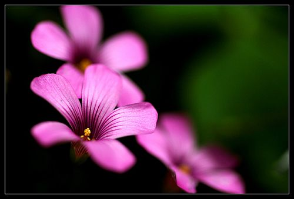

# 友谊象花儿一样

晚上去了大众书局，打算买《无目的的美好生活》和《追风筝的人》。只买到了后者，以阿富汗为背景讲述两个人之间的友谊，其中一个在感情和道德上不知何去何从，摇摆不定；另一个单纯、忠诚，生性纯良正直。但后来他们两人的决裂对他们各自的生活影响巨大。  
  
晚上想着一个人，象一根眼前划亮的火柴，将我拉回多年前的我；象一根轻柔的绳子牵引出我内心的纯真、感动和真诚，象是“冬夜相互取暖”，悄无声息、精神上缓缓溢出来的依赖和满足。不强迫自己走向某种关系，但就这么自然而然的发生了，却又不想袒露内心的感受。环顾四周，大多数的友谊似乎更象是做一个伴儿，精神的交流、理解与共鸣是否象伴儿一样得之容易？在远离世俗浮躁的心灵世界，在你“冷”的时候，我会为你捂脚丫：）  
  

---

## 评论（7）

**zhuyuxan** · 2007-07-24

没想到4年了,还能在网上见到你BLOG.

**joanna** · 2007-07-25

洪晃这书我在当当买的，她在书中也提过dangdang网，因为和当的女老板相识。作为女性，读着特畅快，全当年轻人倾听老大姐经验之谈，只是这书怕不能叫自以为是的男人们瞧见——从头到尾读下来，脑子里就一概念——我要做个独立的女性，而且绝不能太贤良淑德^o^

**Simple** · 2007-07-25

鲜花总有花开花败的那一天，干花却能常开不败，不过如果不经常去掸灰，干花也会衰败的。。。  
友谊应该象干花一样，虽然没什么香味，只要你经常去呵护，却能常开不败！

**雯子** · 2007-07-25

当当上有得卖。很久没去书店买书看了。全是在报摊卖些杂志看。看杂志是图片比文字好看。唉，该看看书了。反正最近空闲得很。

**Christina** · 2007-07-25

鲜花也好,干花也好,都需要呵护~  
鲜花照顾的好每年都有芬芳的季节~

**[大亮](http://jiaze98@163.com)** · 2007-07-26

这样的友谊多可爱啊

**yd** · 2007-07-28

无目的美好生活我看了  
觉得有些失望 因为里面的文章都是从洪晃自己blog里摘的  
甚至书里有些文章还有删节  
如果你有耐心对着电脑看的话  
还是比较建议就看看她网页的好

