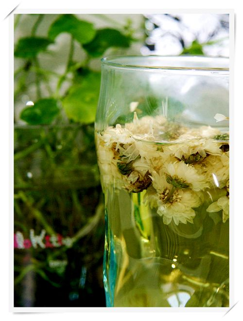

# 入秋

入秋第一天，上火。  
嘴唇、下巴上冒出红红的疙瘩。  
  
  
  
手上两件事令我颇为烦躁，一是黄金退运，一是佣金。  
这两件事的压力来自时间上的限制，一个是海关给的，一个是信用给的。  
  
更令人在酷暑的早晨恼火的是，打扫卫生的阿姨不知用拖过什么地方的拖把打扫办公室？一股臭鸡蛋味儿，比起以前她倒是不用每次叮嘱，算是尽责了，但依然是无语。还是那个观点，有智慧会思考的人即使卖茶叶蛋也能卖出市场和口碑，打扫卫生和做家庭主妇也是同样的道理。  
  
这些事情带来的情绪烦躁，让我听不到自己的声音。可是内心却极为安静~

---

## 评论（12）

**Jack** · 2007-08-08

今天立秋，祝安好！

**angie** · 2007-08-08

疯子好像应该都这样,表面看到变化无常,内心却是死水一潭.嘎嘎

**Simple** · 2007-08-08

外表烦躁，内心静如止水的表现如何体现？

**Christina** · 2007-08-09

嘿嘿~~  
仔细观察一下，不正常的人看上去一般都很正常的样子。

**sunpower** · 2007-08-09

呵呵，稍安勿躁！

**sunpower** · 2007-08-09

今天明明是9号，怎么回复以后显示是8号啊？

**Simple** · 2007-08-09

BLOG换图片了！那只蝴蝶为什么躺着？

**Christina** · 2007-08-09

死了啊~time to say goodbye~

**乔西西** · 2007-08-10

hehe~,Yes

**Michael** · 2007-08-10

thanks

**blue_zebra** · 2007-08-10

那个蝴蝶,身上有铜钱的那个,我以前没逮到!

**绿恐龙** · 2007-08-12

绿豆百合比菊花茶好。。

