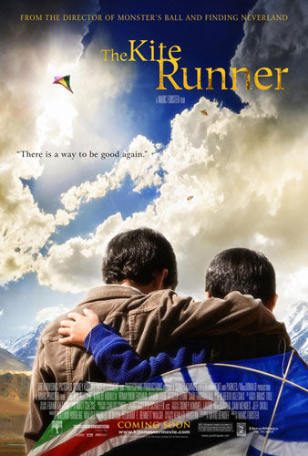

# 《追风筝的人》将于11月上映

得知小说《追风筝的人》将被拍成电影，欣喜万分。曾有人说最好的文学作品反而词语简洁明了，没有太过华丽的修饰，这部小说给我的感觉正是如此，情节扣人心弦。该书甚至曾一度将《达·芬奇密码》挤下了美国畅销书排行榜冠军宝座，且最初上市未做任何宣传，完全靠读者口碑相传火起来的。影片由梦工厂操刀制作，曾执导过《寻找梦幻岛》、《死囚之舞》等影片的导演马克·福斯特任导演。剧组先在网站上进行海选，挑选了两名阿富汗小朋友饰演主人公阿米尔和哈桑，曾在阿巴斯电影《橄榄树下的情人》中担任主角的侯赛因·莱扎伊在片中扮演主人公阿米尔的成年时代一角。  
  
电影《追风筝的人》海报  

---

## 评论（9）

**enriquesun** · 2007-08-20

用空再看！  
不过提个建议。这个wp主题的边栏导航条正好盖住一点最左边一列的内容，看起来有点不舒服

**emma** · 2007-08-21

8卦消息一则, the kite runner 已经在拍了, 年初来过北京拍一部分. 我的一个外国朋友还当了回群众演员. 书去年就买了,还没有来得及看. 一起期待吧.

**Christina** · 2007-08-21

昨晚读到哈桑被塔利班人杀害......难过极了......

**jack** · 2007-08-22

这是一部看了开头就知道结尾的故事，并没有传说的那么出人意料。  
这部小说很适合被好莱坞翻拍，一方面它有厚重的政治背景，可以轻松把塔利班塑造成极端流氓的恐怖组织；另一方面它有极其真实的感人温情，可以抚慰我们日渐荒芜的心灵。

**[Nio](http://nio.infor96.com)** · 2007-08-22

去年看完了这本书，很不错，哈桑不死，主人公也不会变得坚强。同是兄弟，差别真大，不同的环境激发不同的潜能，呵呵。

**okdata** · 2007-08-25

Purify himself, purify all readers

**[BENM](http://blog.sina.com.cn/BENM)** · 2007-08-27

虽然已经忘了电影是什么滋味的了，就像那颗口渴的人梦中的酸枣，只剩下期待.......

是什么影响了生存的世界？民族？上主？政治？还是人心？以前每每看史匹堡Schindler’sList都会潸然泪下，不知现在还有没有这样的电影？

希望不会是3D主宰了一切，只有“×刚”的(其中一部被七夕唱开了)？

**[afan](http://blog.wenxuecity.com/myindex.php?blogID=22490)** · 2007-08-28

Update your blog, laze women!

**daphnis** · 2007-10-11

英国女作家莱辛获得2007年诺贝尔文学奖，她的作品和“追风筝的人”颇有异曲同工之处，你也可以赶时髦去买了看看。期待你的读书笔记哦；）

