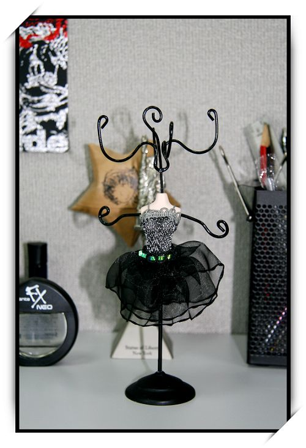
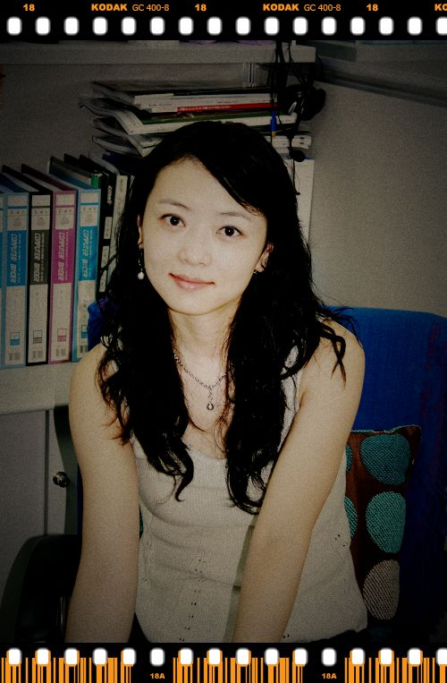

# 无题

\*\*\*“忙”，“非常忙”，已经成为一些人生活的常态。人们见面问：“最近忙吗？”你要回答“不忙”，就有下岗待岗或无理想无能力亦无成就之嫌疑。越忙越是成功者，成了我们这个时代的新刻板印象。  
  
《放慢生活的脚步》中写到：“匆忙的生活不可避免的会导致肤浅。”  
好在这个世界上还有明白人，在这个世界上从容地生活是一种境界。从容不是懒惰，不是无聊，是明白自己到底想要什么后的神闲气定。  
  
\*\*\*我评价一个人的外貌，不太注重五官是否符合审美，而是看整体的感觉。我比较相信一个人的容貌跟他/她的心态是有内在联系的。当然，不是说心态越好的人长得就越漂亮。但是内心慈悲的人，脸上常会显现出快乐、从容的神情。久而久之，面相就越来越和谐、优美，看上去很舒服，亲切。  
  
\*\*\*失意还是诗意，完全取决于你怎么看？  
  
\*\*\*跟别人总爱唱反调，在某些人身上是因为缺乏自我肯定，在另一些人身上可能是因为个性太强。因此，那些野心很大的人，那些嫉妒心理很强的人，那些无法忍受别人比自己强，别人比自己好，别人比自己有魅力的人，都可能倾向于与他人“针锋相对”，因为唯一能显示自己重要，使自己有力量去面对对手的手段，就是否决和反对别人。有些人往往意识不到，这种辩驳的游戏是为了让自己变得重要的伎俩。  
  
  
Angie寄给我的首饰架，恰好我有一个穿白纱裙的首饰架，比这款大：）放在一起很配对~  
  
  
生日买的项链，粗粗的链子，末端一颗珍珠，和前年买的的耳环很配对~

---

## 评论（10）

**Okdata** · 2007-08-30

You are talking abot philosophy, a little bit serious:) But they are right. It’s easy for one to lose himself in this modern society. Calm down and stay away may be better, and you have to giveup lure around.

**Christina** · 2007-08-30

哦？是么？我是比较认真的人，所以有时显得不合群，哈哈~~与其花精力花时间去和没有话说的人打哈哈，不如去做自己喜欢的事情。

**[afan](http://blog.wenxuecity.com/myindex.php?blogID=22490)** · 2007-08-30

hmmm, tolerant doesn’t mean not being serious or compromising yourself. But it is hard to judge the line.

**稚** · 2007-08-31

眼睛有些些红，但气色很好。

**KA KA LEE** · 2007-08-31

你好，能加你的MSN吗？我的是lijiajia17@hotmail.com

**上海裁缝** · 2007-08-31

嗬嗬，如果你能猜出我是谁，我就比你还高兴：）以为你现在的生活会很忙，哈哈，没想到还是和从前一样的，希望你和你的朋友们开心健康！

**Christina** · 2007-08-31

呵呵，你是木木吧？：）和我MSN联系哦~

**enriquesun** · 2007-09-01

生活在乐趣中......

//为什么订阅你的博客显示的标题会打不开呢？  
碰到两次了!

**绿恐龙** · 2007-09-03

不错 脸上始终保持微笑的美人儿

**上海裁缝** · 2007-09-10

呵呵，你果然猜不出我是谁：）提醒你一下，一个会搭讪的人，曾经看过最美丽的愤怒在雪山脚下......我上班不能用msn,你的电脑还是那个小巧的Sony吗？希望下次来宁，能有空喝茶，谈谈彼此老了多少：）祝快乐！

