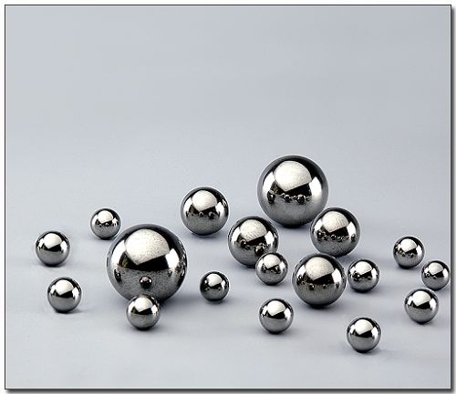

# 当梦想照进现实

早晨腥来浑身跟灌了铅似的沉重疲惫，又一个工作周开始了。心里却轻松着，以前干吗活得沉重，压根没必要，为着别人而活，不值。再说了，时间能解决所有问题~~  
  
  
  
最近想学室内设计。小时侯喜欢画画，可惜我父母没把我往那上面培养，我属于父母非计划外产品，如果我出生是个男的，我父母准备把我送给我姨娘，女滴，他们就留着养。我这产品完全没有什么系统的规划的发展计划，他们会以爱的名义强迫我违背己愿，我会有情绪上的反抗，但年龄大了，才越来越明白干吗要有情绪，哄着他们开心比期待共鸣重要。回到原题上，前年在南艺上过平面设计的一些课程，老师讲课速度那个快，难道学生们都是天才？上素描课最搞笑，上来就让我们临摹，不停的画，这样我完全可以自己在家里画啊，干吗交钱和别人挤在一起画呢？学设计的想法时不时就会从心里涌出来，必须静下心去做这件事，有人说干这个挺苦的，有人说你都多大年龄了？也有人说你能学到什么程度？现在我无法解释，理由只有一条：喜欢。将来能实现个人价值，当然是更好的结局，做喜欢的事，总比混沌度日好些吧？不能，就当兴趣爱好。  
  
当梦想照进现实，选择在现实义无返顾的去实现梦想，还有其他选择吗？

---

## 评论（4）

**Ben** · 2007-09-10

他是个理想主义者，当理想无法照进现实的时候，成就了他的悲观。

**enriquesun** · 2007-09-10

终于等到了更新！只是吃完饭回来就有了回复 汗

～～～～～～～～  
为什么男的要送养，女滴就留着呢？有悖情理

～～～～～～～  
这个不错“理由只有一条：喜欢。”

**[BENM](http://blog.sina.com.cn/BENM)** · 2007-09-11

看来Christina家重女轻男呀，男娃女娃都一样，不过幸好生了个女娃，因为到现在我还做不到“哄着他们开心比期待共鸣重要”境界。现实里总是变幻莫测，计划快不及变化快，理想在现实中最后都会成梦想的，梦想，就是只有在梦里才能想一想；义无反顾，世界上有几人能像享德尔那样，只有等父亲离世了，才去实现自己的音乐梦想，父母非计划外产品应该都不简单

**Orange** · 2007-09-12

当理想还未照进现实。。。

