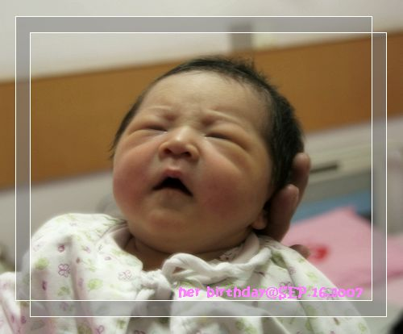
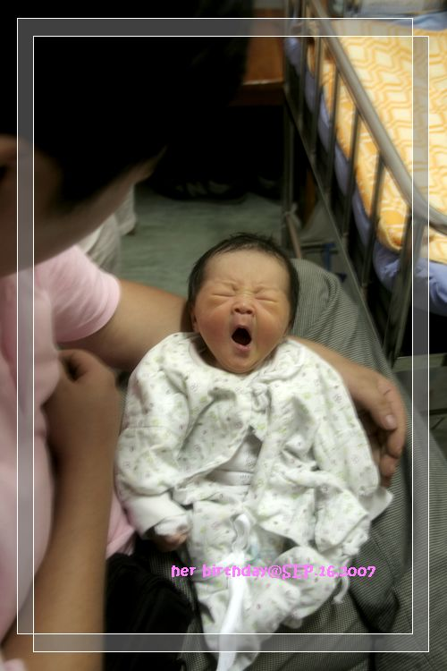

# 又一个新生儿

嘴巴和她的爸爸(我的同事)很象，出生才两天的小宝贝，很聪明哦。一个人睡在床上就大声哭泣，抱起她哭泣便嘎然而止。离开母体后的孤独感，使得她极为想亲近人。  
  
  

---

## 评论（12）

**chenwei** · 2007-09-18

真丑啊

**[kayika](http://svice.net)** · 2007-09-18

恭喜～～

**Christina** · 2007-09-18

刚出生的宝宝没几个漂亮的，但是长开了会不一样。  
一般小时侯漂亮的长大了未必漂亮：）

**enriquesun** · 2007-09-18

两天的孩子这么大啊？？  
头发也这么多阿！

**yellowstone** · 2007-09-18

姜丰的一对混血龙凤胎真是太漂亮太可爱了， 让人嫉妒。 姜丰要姿色有姿色，要才华有才华，她要回国做主持人一定是No 1. 不过，在英国过小资生活也是不错的选择。

**[BENM](http://blog.sina.com.cn/BENM)** · 2007-09-19

想必Christina宝宝时候也像这个一样丑了，呵呵

下面那张是打呵欠，还是大叫了？－在挣扎！  
眯着眼有点像刚出生的kitty  
lucky No:7

别忘了别贴PP照哦！小心被 封，以后来不了

**[afan](http://blog.wenxuecity.com/myblog.php?blogID=22490)** · 2007-09-19

so cute  
I want my second child to be a girl

**okdata** · 2007-09-20

So cute!

**Michael** · 2007-09-24

楼主机架是什么牌子的?我上次又买了一个便宜货(300的), 又坏了－还没用几次呢....气死了......这次想买一个稍微好一点的(1000左右的)．

**Christina** · 2007-09-24

我那个差不多也300多元，还不如最早买的60元的好用呢。别迷信价格！

**Michael** · 2007-09-24

谢谢. 我还是去找一个质量好一点的吧

**Christina** · 2007-09-26

质量好的肯定很重,带出去麻烦。

