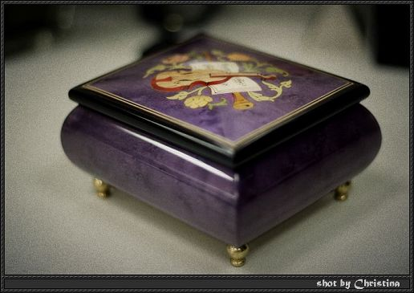

# 无题

左肩肌肉僵硬，酸痛，用电脑保持一个姿势时间太长造成的。  
晚饭后妈妈贴了两个圆圆的东西在我的肩膀上，打开另一边的开关，比盲人按摩效果好，上瘾。我父亲每天按摩两遍腿脚，对他多年的经脉曲胀有帮助。我特怕遗传父亲的经脉曲胀，所以常去泡脚捏脚，如果仪器有效果，买回家用倒是方便。  
  
每天出门上班，小区里布满了带着孩子的老老少少，天天早晨如此，婴儿泛滥的2007年，令人诧异的是都挤在一堆晒太阳，唧唧喳喳的声音和我路过他们上班的脚步声很不和谐。  
  
   
  
从德国寄来的八音盒，和中国茶一样的色系。  

---

## 评论（10）

**ALx** · 2007-09-28

姐姐你下巴上是不是冒痘痘了？

**Christina** · 2007-09-28

是呀。

**yellowstone** · 2007-09-28

机器按摩一定不如人按摩的效果好，国内人工便宜，好好享受，在国外SPA&MASSAGE一次至少要100美元以上。很喜欢孩子多的感觉，羡慕，特别小小孩，可爱好玩。

**大姜炖去** · 2007-09-28

其实可以做做操  
完全靠机器还是不如人自身运动好  
穴位按摩时间长了就没感觉了  
结合疗效好  
**\_**

**Christina** · 2007-09-29

讨厌扎堆，尤其是女人聚在一起没什么好话。总之很排斥扎堆！

从小我母亲就杜绝我串门、吃零食，认为是女人几大恶习，还有传播制造是非。现在可好，我是极少张家窜到李家，在办公室里也是，可这样和周围人感情交流少，显得孤僻。不太吃零食，同事常拿出零食给张三李四分点，可我的零食太少，怎么分给人家吃呢？并且很厌恶在办公室里吃零食，吃颗糖果、梅子的动静不大，有时居然还吃西瓜什么的，弄的办公室地面不象样。这哪是上班的氛围呀，真不知道这些人是怎么想的。

我自己也是女人，但女人这个群体身上的某些习气我自己都厌恶。有一天我也会是中年妇女，我不要做那种琐碎唠叨没有脑子的中年女人，那是可怕的现象！真希望我还能保持现在的心态，保持一份热爱生活的情怀。

**雯子** · 2007-09-29

同意Christina的说法.国庆快乐!!!!!!!!!!!

**[sofiah](http://i.cn.yahoo.com/profile-L9zU5mw_YqOBb7HdDyWOFvEAdVdZ)** · 2007-09-29

严重同意怯支持你的看法，我办公室有人竟然喜欢带瓜子，母鸡一样咯咯笑，吐，咬瓜子皮的声音，天，你不会相信，这是教师办公室。  
女人在一起不见得没好话，这也极有道理。可惜不是每个女孩都有一个理性的好妈妈。

**乔西西** · 2007-10-19

那个仪器叫什么名字，我也想给妈妈买一台

**[情定音乐盒](http://www.52yinyuehe.com)** · 2008-04-22

呵呵，这款八音盒是我们的产品，是出口德国的！你可以百度搜索情定音乐盒。

**Christina** · 2008-04-22

这款八音盒是SWISS MADE~在瑞士购买，在德国邮寄。

