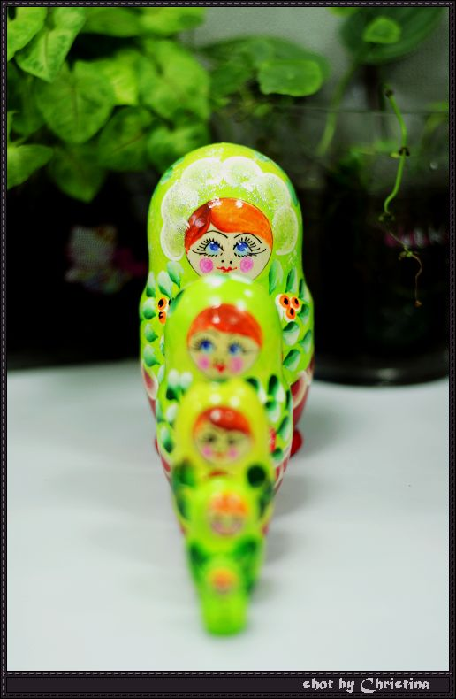

# 每个姑娘都不一样

同事从俄罗斯回来送给我的套娃，老话讲“红配绿，丑得哭。”  
可这种冲突的颜色我倒觉得很好看，视觉效果很强烈。  
每个姑娘的表情都不一样，到了那个最小的姑娘，表情就很呆滞了，呵呵~  
  

---

## 评论（5）

**[青花碎瓷](http://blog.sina.com.cn/chinatea)** · 2007-09-30

套娃做到后面就是这样的  
再说了  
俄罗斯人做东西能做到这么细已经不错了

**[BENM](http://blog.sina.com.cn/BENM)** · 2007-09-30

套娃不就是俄罗斯的工艺品么？以前在新疆买个一个七套的，着色没这个精细好看

**[chickli](http://www.beijingcoffee.cn)** · 2007-10-03

夫子庙有好多俄罗斯商品店，也有套娃卖，不过怀疑是仿制品。

**enriquesun** · 2007-10-04

想起套娃就伤心

**绿恐龙** · 2007-10-09

颜色很漂亮奥

