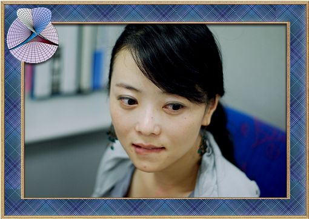

# 节前告别

同事从网上购买了一只无牌定焦镜头，[要我帮忙试镜](http://photo.lifetea.org/v/Its+me/2007/)，臭美一下~  
预祝大家国庆节放松身心，好好休息！  
  

---

## 评论（10）

**okdata** · 2007-09-30

郁闷不要，会长痘痘；档次不要，要上凳次:)

**大姜炖去** · 2007-10-01

脸色不是很好  
好好休息

**[dimlau](http://www.dimlau.com)** · 2007-10-04

本来只是路过txp程序的，不过还是顺便喊一嗓子吧  
美女啊~~~

**treeinrain** · 2007-10-04

好久没来看这个BLOG,长痘痘了,多吃点下火的东西

**King** · 2007-10-07

不知道是镜头出问题了还是肤色不好,嘿  
长痘痘?长年轻了?哈

**ALx** · 2007-10-08

pas mal

**Michael** · 2007-10-08

光圈看来很大,除鼻子外都虚化了：）

**dongdong** · 2007-10-09

清纯可爱^\_^

**Sherry** · 2007-10-12

眼神貌似汤唯。有点幽怨，有点暧昧。  
很少看到你这么低眉顺眼的样子，呵呵。

**[Nico](http://www.carusojazzcafe.com)** · 2007-10-17

Hi Christina, I’m Nico from Florence I hope you remember me.It’s so difficult to visit your web site and the wonderful pictures you made, because I don’t understand cinese language.Please contact me with email, send me some your photos to:info\_carusojazzcafe.com

Peace

Nico

