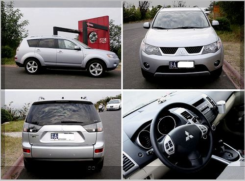
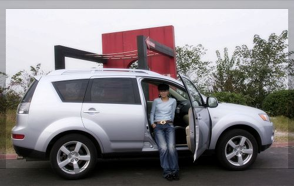

# 新伙伴 outlander EX 3.0

10月购进[**outlander EX 3.0豪华版**](http://www.autohome.com.cn/25/)，最近一期《汽车之友》杂志針对outlander EX 2.4L和honda新CRV做了对比，评价自有公断。不过2.4L和3.0配备了不同的发动机，据说轮毂比3.0小，今年年底进口销售。  
  
   

---

## 评论（8）

**绿恐龙** · 2007-10-22

车比想象中的还要大，就是车模太小 哈哈哈

**Michael** · 2007-10-22

我个人感觉新O比CRV要好很多. 至少我一坐进新O就能感到CRV的垃圾了.  
但是还是要把那 汽车之友 买来看看吧

**Christina** · 2007-10-22

我妈第一次看到这车没反映，和我站在车边上说了半天话，告别了看我傻笑才发现我换车的；

我爸知道了拿了纸和笔抄下我的车牌号，不晓得干吗用。

我痛恨这车是浅内饰，黑色就好了。在开着它上下班之前为座椅装了布套子，总之蛮土的，但为了干净也只能这样了。

**[BENM](http://blog.sina.com.cn/BENM)** · 2007-10-22

原来换了欧蓝德呀，好车！看着挺宽敞的，很漂亮！cool!  
很衬你的衣着,看到图片，感觉顶级型的黑色内饰确实更好看点！  
新车就被“抄牌”了，哈！小心驾驶！

**[阿帆](http://blog.wenxuecity.com/myblog.php?blogID=22490)** · 2007-10-22

看来银色还是很受欢迎的，我们家两部车都是银色。车从后面看有点怪怪的，估计是灯抢了后窗的空间。  
开大车有倒车探测比较容易些，国内加多少钱？我们这里是400澳币。为什么不加车顶cross bar呢？真要郊游能绑不少东西在车顶：）估计国内用不上tow bar的了，不用拉trailer，一般国外这样的车都不管3721都加上tow bar先。  
PS 香车照片还不错，美女应该把帽子摘了，在车的多个角度多拍几张。

**Christina** · 2007-10-22

银色是所有色彩里安全系数最高的，耐脏，而且看上去比较大方。黑色内饰南京这家店没进口卖，所以只能是米色内饰。cross bar是不是车顶绑行李的架子?如果是这个是有的呀~  
2.4L的最顶级配置为27万人民币;  
3.0顶级的为33万人民币;  
均为进口的裸车价，中国汽车进口的关税应该比澳洲高吧？

我今天看一帖子，说有人看车上来就问几个喇叭是不是真皮有几块胡桃木...快成国际笑话了。

**[阿帆](http://blog.wenxuecity.com/myblog.php?blogID=22490)** · 2007-10-22

澳洲车关税在西方国家算高的，但是肯定还是比中国便宜。我的Outback 2.4L是4万多一点，大概25万人民币，比标配加了前车灯和车头盖保护，地毯，cross bar, tow bar和倒车探测器。加倒车探测器是400澳币，你的倒车探测器是标配还是另外加的？

cross bar是在车的竖杠上再加两条横杠  

**chenwei** · 2007-10-22

米真多啊！

