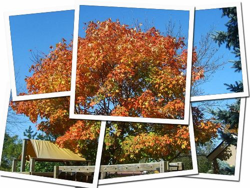

# “neck of the woods”

Someone loves the color of the sky!  
*--Shot by someone*  

---

## 评论（6）

**ItIsMe** · 2007-10-24

Days like this in Nanjing are getting less and less. I miss days like this a lot.

“Neck of the woods” refers to any neighborhood, area or communities,   
In Chinese,“小区”

**Christina** · 2007-10-25

这个小区的名字有意思~  
南京难得见到有哪个小区种植这么高的树木，拥有这么清澈的蓝天。谢谢提供这片蓝天，呵呵~

**[afan](http://blog.wenxuecity.com/myblog.php?blogID=22490)** · 2007-10-26

国外的天比中国的清澈薇蓝，国外的月亮也比中国的又大又圆又亮，不是说笑话是真事，因为中国现在污染太严重了。还记得２０多年前我父亲带我在路边指天上的星星银河，现在中国的父亲恐怕没几个能做到了吧。还记得出国前看动画片The Simpsons一开场时云开见蓝天的时候我觉得动画里的天蓝的很假，我根本不相信天能蓝成那个颜色，出国后才知道原来国外的天真就是这种蓝色的！  

**[chickli](http://www.beijingcoffee.net)** · 2007-10-26

我心目中一直有个疑问：南京究竟是从来没有蓝天还是最近几年才没有的蓝天？  
因为朋友的解释是由于靠着湖和江，水气太旺才没有的蓝天。

**Christina** · 2007-10-26

靠着湖和江？哪个南京老乡给出这么奇怪的原因？  
那在大海边上不是更看不到蓝天了？

**大湖** · 2007-10-27

chickli,  
真是可怜了你们这一代人! 当你们刚刚有记得忆的时候, 南京的天空就已经被糟蹋了. 改革开放使得经济发展了,但是也夺走我们的蓝天和健康.

