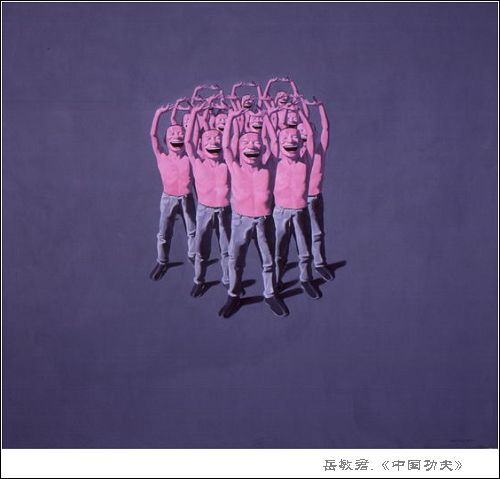
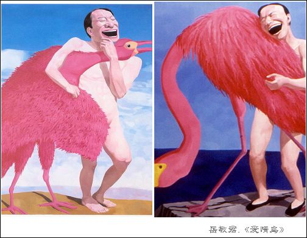
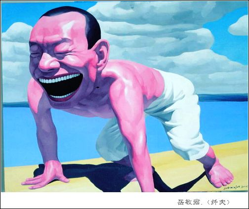
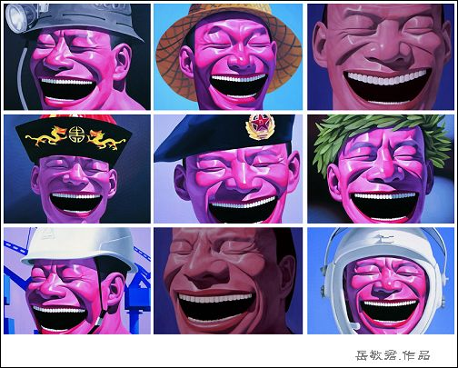
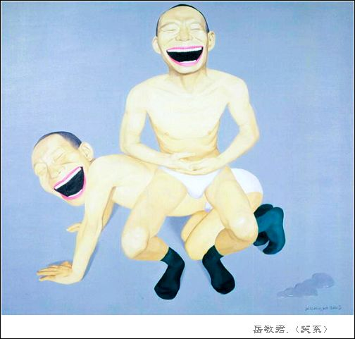
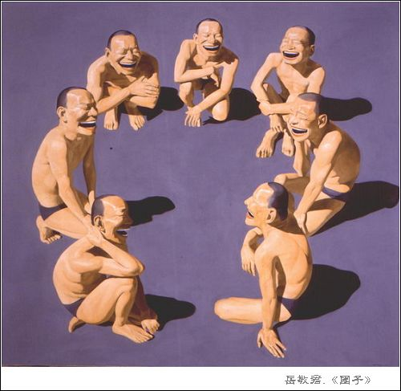
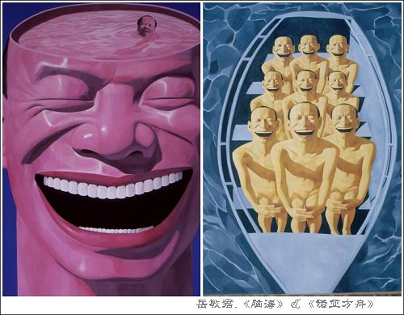
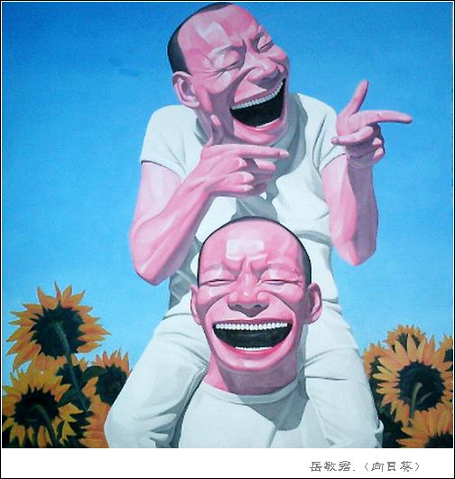

# 岳敏君.作品

我的作品就是幻想和虚构，描述了我眼中的"真实"世界,在一种不"真实"中重塑自我。  
  
::::::::: [**岳敏君**](http://www.yueminjun.com/) :::::::::  
  
   
   
   
   
  
  
  

---

## 评论（6）

**[afan](http://blog.wenxuecity.com/myblog.php?blogID=22490)** · 2007-10-25

听说他的画 最近拍卖了不少钱

**[chickli](http://beijingcoffee.net)** · 2007-10-26

不会长久的，只是为了满足这段儿人心特空虚的时代。  
我们期待下一个文艺复兴。

**Christina** · 2007-10-26

有感染力，我感受到的。  
千篇一律..树立了独特风格，抢夺眼球，这笑就象一个岳敏君的LOGO。

**[chickli](http://www.beijingcoffee.cn)** · 2007-10-26

是一种嘲讽吧，政治外表的千篇一律或现代社会环境中的人性丧失？如果单纯是标新立异就不大有意思了。

现代艺术家不缺乏标新立异，然而画出精神的不多。

**treeinrain** · 2007-10-28

像戴了千篇一律面具,而且是大笑的,有点可怕.  
像一个荒诞无稽的梦.没有声音,时间凝固,让我想起的歌词,fool said i you do not know ,silence like a cancer grow.

**[afan](http://blog.wenxuecity.com/myblog.php?blogID=22490)** · 2007-10-29

Another one with similar style: 沈敬东

