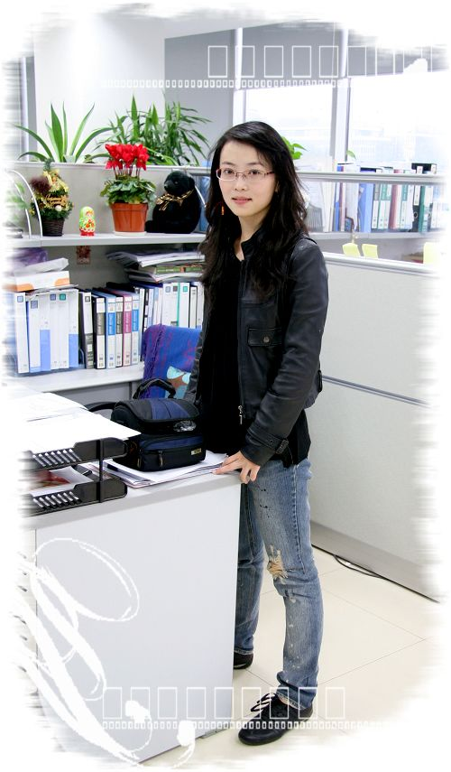

# 图.壹.张

---

## 评论（22）

**Jonathan** · 2007-10-29

不错！

**Gumi Jiang** · 2007-10-29

难得的才女！！！

**绿恐龙** · 2007-10-29

这个眼镜好看多了。。。真话。。  
我前天也是穿这种翻白的破洞裤子哈哈哈

**okdata** · 2007-10-30

我也有一条，不过是穿坏的。被我妈补了，哈哈哈  
眼镜不错，就是摄影包看着象保温饭盒袋:)

**daphnis** · 2007-10-30

你近视眼好像度数有点深嘛。。。

**大湖** · 2007-10-30

Disclaim; I’m not here to criticize anyone’s dress preference.

Generally speaking, people everywhere dress for an occasion properly. For example, you will dress differently when you are attending a wedding, vs. a funeral, go to church on Sunday vs. a night-out around town with friends. When people go to work for business, people should dress up like they mean to do business. Because each individual is part of the company and their image is part of the company’s image.

I have seen ladies wear high-heel shoes on the top of the “Yellow Mountain” instead of hiking boots, and construction worker in their western style suits instead of working cloth. But right or wrong, who has the rights to judge?

**雯子** · 2007-10-30

红色植物旁边哪个黑熊比较有意思哦!办公环境不错嘛.呵呵.喜欢脚上那双黑色的鞋子哦:)

**emmaemma** · 2007-10-30

lucky you! we don’t even have casual Friday…i hate my job;(

**Michael** · 2007-10-30

大湖:what do you wear to work everyday?

How’s your working going?

Could you make more money based on a nice suit? Or do you think that the spirit and thoughts under the suit is more important?

What’s the difference between the formal and leasure clothing?

Now the employers tend to creat a comfortable working friendly environment for the workers which can stimulate the enthusiasm, creativity, passion…? what do you think?

Some people call the suit “monkey’s cloth”. What do you think?

thanks

**Michael** · 2007-10-30

leisure

**emmaemma** · 2007-10-30

hey Michael, i can’t help but wanna say with the suits we are wearing everyday, are just following our company’s dress code on what’s appropriate for the workplace, in order to maintain a level of professionalism …hmm but Christina, a ripped jeans, i don’t know, but again, i personally think it rocks! ;)

**Christina** · 2007-10-30

回复：近视400多度，不戴眼镜不行，一直戴隐型眼镜对眼角膜不好。

**[afan](http://blog.wenxuecity.com/myblog.php?blogID=22490)** · 2007-10-30

nice  
but your face looks a bit pale…

**Michael** · 2007-10-30

Thanks for your comments emmaemma.  
your company’s dress code on what’s appropriate for the workplace, in order to maintain a level of professionalism .

who laid down the rules? your boss?   
You like it or your boss like it?   
what’s the criteria?

if people have called the casual clothing we have now suit in the past, what result result it could be?
any evidence shows that suits really have something to do with the professionalism?

**emmaemma** · 2007-10-30

let me keep this simple, Michael, sometimes we just have to do what we have to do. this is life. i don’t know how you live yours, but i definately don’t just get to do want i want, especially when you have a career ahead to pursuit, i do what i need or have to do.

:)

**mandy** · 2007-10-30

喜欢那些植物。红的是仙客来吗？我养了风信子，可惜开完花后就...

**Christina** · 2007-10-30

是仙客来:)

**Michael** · 2007-10-30

Mine’s not an exception. I do dress up when it comes to formal situations.

We live in a society. However we don’t always know the exact cause for one social phenomenon. We were programmed to do something without being told the reason. Actually a society influences its people by using ideology apparatus, religion, media, education…On the other hand they have military to make sure the standard is being followered. So the way we dress is not up to us. It’s up to the consensus among a group of people. If you are different, you will be pointed out immediately and maybe alienated. The panopticon model works perfectly here. It functions on every aspect of the society, not to say the business part. That’s where we learnt the “civilization” from.

**灰子** · 2007-10-30

很酷，这装扮

**[BENM](http://blog.sina.com.cn/BENM)** · 2007-10-30

cool, 似乎Christina要把办公桌一草一木一公仔都要搬上来，好PP的办公照，一定是太喜欢工作了吧，嘿嘿！我也是400多度，[前几天去了桂林玩，也到我的博上转转，分享一些图片，都是没处理过的，随便评论，呵呵！](http://blog.sina.com.cn/s/blog_4860086b01000b7e.html)

**Christina** · 2007-10-31

那么多鲜艳的东西没找到合适的地方放，扔了又可惜！还是喜欢素的~

**[lichuan](http://liulichuan.cn)** · 2007-11-04

桌面很整洁啊

