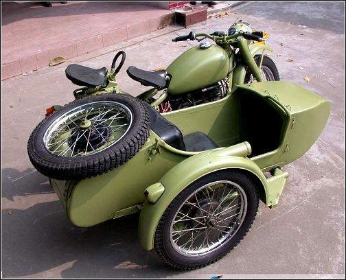
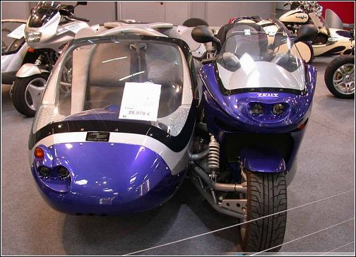
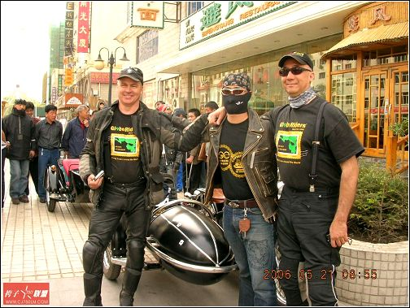
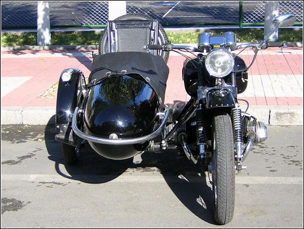
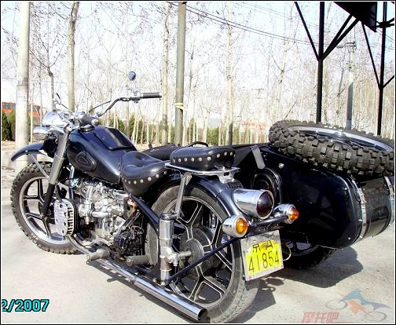
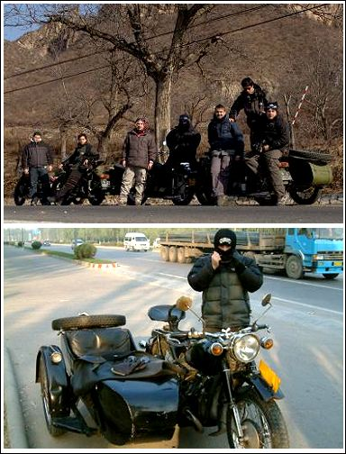

# 侉子.长江750

听朋友说北京上海有帮喜爱长江750三轮摩托车的车迷，我们管我们住的地方叫中原，南边的叫蛮子，北边的叫侉子，东边的叫夷，西边的叫戎。北京人就管这车叫“侉子”。这车时尚的说法是复古，复古其实就是中国人概念里的“土”（古老、原始、陈旧、过时的...）吧？所以这车叫侉子？  
  
长江750的原形是bmwr71摩托车。1939年，斯大林想为苏联红军装备机动性很强的摩托，他想到了一种750cc、对置双缸、带边车的摩托车，那就是当时德国的bmwr71。后来5辆bmw摩托车被“走私”到了苏联，这些车被解体、测绘……苏联人造出了乌拉尔（ural）m-72型摩托车。  
  
美国人的哈雷没有重样的，而京城挎子车迷的坐骑也各不相同。长江750还有很火的改装空间。北京人、包括在北京的外国人偏爱两种摩托车，一种是美国的哈利戴维森，一种就是这款中国的长江750型边三轮摩托车。许多年轻的摩托发烧友也逐渐从钟爱二轮转向三轮。但南京没见着玩这种车的。  
  
现在，它在中国摩托车中的地位，可以说相当于哈利在世界摩托车中的地位。长江750还出口到北美、欧洲和日本，一朋友公司差点出口侉子车，出厂价在USD2500.00。在日本，一辆长江750卖到100万日元。长江出口到欧洲被注册为“BlackStar”出售，价格不低。很多驻华的法国人回国时都会买一辆长江750，并且会要求国内的经销商将产品合格证或者发票的日期改写为196X年，据说这样的话，进口时尾气要求不严格。2001年，乌拉尔“侉子”拿到了“绿色环保标志”，在美国按常规摩托车销售。时至今日，网络上还有很多海外用户在寻找“长江750”。 国内商家承诺3周左右可运抵世界上大多数国家。国内不少车迷不断对它进行个性化的设计和改装，成立侉子联盟，长江750开起来有些粗糙、生硬，加速慢，刹车比较“肉”，挂挡发出较大的声响，悬挂的减振效果有限，但这并不妨碍人们喜欢它。  
  
有两个原因促使“侉子”成为北京车迷的宝贝。一个是由于长江酷似当年的BMWR72，所以很多怀旧的外国人兴高采烈地骑着它们在京城三里屯一带耍，而且边斗里坐着的姑娘都说有一种坐敞蓬汽车的感觉，在京的外国人还组成了一支“侉子”车队。另一个原因就是北京在对两轮摩托车限牌后的很长一段时间里，对“侉子”的牌照是放开的。   
  
   
   
   
   
  

---

## 评论（13）

**jiajialing** · 2007-10-31

想起了“大腕“。。。。

**Christina** · 2007-10-31

你回来弄一辆玩玩啊~~呵呵~~南京肯定也没限牌呢！

**[chickli](http://www.beijingcoffee.cn)** · 2007-10-31

我在紫金山上曾经看到一辆，三轮的，但不晓得是不是博主所指。  
http://www.beijingcoffee.net/photo/zjs01.jpg

**okdata** · 2007-10-31

Nice picture  
HARLEY-DAVIDSON is most man wanted, also girls. You can find this from his/her face. Find a 750 is relative easy here, you may get it from the fractory. Here is its forum:  
http://www.cj750.org  
below is cut from other’s poster  
提起长江750，东海750这些名称，会有一些历史的沧桑感. 长江750的发展沿革，一直可以追溯到上个世纪四十年代那场大战。  
许多摩友一提起“大排量摩托车”，脑子里自然而然出现的就是哈利、雅马哈、本田等外国车，很少有人注意到在我们国家默默服务了几十年的长江750（挎斗），挎斗[边三轮]这种大排量的摩托曾经是基层公安、边防，和军方摩托化部队中的主力机动工具之一。  
。也许有摩友会说，那是三轮，又跑不快，就算排量够大也不喜欢。那您试过把“挎斗”的边车拆掉以后开起来是什么感觉吗？你知道它的原型是哪个国家、什么厂商吗？  
对置双缸、轴传动、750ml排量的显著特点？您猜不出来吗？想到了吗......对啦！就是著名得不能再著名的BMW！  
宝马的摩托车已经被世界上近百个国家和地区指定为国宾护卫队专用车辆。我们的长江750的原型就是BMW R-71。  
R-71在二次世界大站中被宝马公司大量生产，广泛应用于德军的各兵种，抛开其它因素不谈，单从机车性能来看，R-71经过战争的考验，确实是称得上性能卓越的。  
二战结束，苏联开始仿照R-71生产俄版的偏三轮摩托车，同时又把技术转让给了我们。现在的俄罗斯早已不再生产这种“古董”级的车，我们的长江750可以称得上是“活化石”了。苏联的工程师在R-71的基础上加进了俄罗斯风格，比如高车把、大头灯上的小“帽檐”、圆型的边车等等，我们基本上照抄苏联。所以，长江750和R-71还是有些地方不同的。  
长江750虽然有很多缺点，但其性能事实上比大多数摩友想象的要好。有北京的摩托车爱好者曾经用拆掉边车（那时还没生产两轮750呢）的长江750与本田STEED铁马400等编队行驶，最高时速120，跑了两个小时不掉队！想不到吧？

德国BMW公司的R-67。在现有的资料中，R-71的图片大部分都是两轮的，三轮很少，倒是R-75见过很多偏三轮摩托车，不知何故。德军带全部装备（不含武器）R-71的大头灯、车把、后视镜等部分与其它车型有别。最明显的特征是：油箱上部有一长方型的工具箱盖。五、六十年代长江也生产过这种油箱，现已基本绝迹。

前苏联工程师仿制、修改过的俄版R-71增大了头灯直径，改动了边车样式，头灯加了电镀和前伸的“帽檐”等。我们认为苏联人的改装实在是画蛇添足，败笔多多。

目前正在生产的长江750。即中国版的BMW。几十年一成不变，也幸亏这样，我们才有了品味活化石的机会。现在40岁左右往上的人都知道，侧三轮是作为社会主义阵营国家的一项军事体育运动项目。在以前是很有生气的，可是因为奥运会没有这项目，国家白投资，没有回报，所以现在没有侧三越野比赛这一科目。  
同样，以前我军侧三的装备量极大，不但有通讯和侦察分队，还有成建制的战斗部队。所以，当时的训练发展水平一定很高，训练/维修/后勤保障也会很系统。我非常想搞到那时的训练教材。想象一下那时摩托部队的辉煌。我国的许多城市都已经看不到侧三了，这是国粹的车种！！！这车在欧美日本要卖到10多万人民币，相对于两轮来讲，还是很安全的。民用版本的话,不是专业的人士还不会偷，不容易被盗。速度不慢也不快。满载状态还可以在高速上跑95

宝马的三轮摩托车经历了二战残酷的战火考验。水冷发动机。BMW R71本来是不带边斗的，由一些专业厂生产。而且边斗也有好几种样式，长江750挎子的边斗实际上是一种军用边斗,俗称船型边斗。

在北京的外国人娱乐休闲时骑辆种摩托车，一种是美国的哈利戴维森，一种就是国产的长江750边三轮摩托车，北京人昵称为“侉子”。

BMW R71——侉子的祖宗  
有人说侉子的原形是BMW在二战时期的军用摩托车。其实二战时德国鬼子的挎子是R12、R75和迅达（ZUNDAPP）等750型摩托车，这些车跟我们现在的侉子不一样。经过大量的调查，发现跟侉子最相象的是BMW R71，R71的生产年代是1938-1941，而二战时纳粹德国几乎没有使用R71作为军用车。  
那么从BMW R71到现在的侉子是怎么一个过程呢？1939年，斯大林同志想为苏联红军装备机动性很强的车辆，他想到了一种750cc的、对置双缸的、带边车的摩托车。而这种摩托车刚好是当时BMW的R71。于是斯大林同志派人同希特勒商量引进的事。可是当时纳粹德国正忙着占领波兰。  
后来，5辆BMW摩托车被‘走私’到了苏联，这些车又被解体、测绘......后来苏联人造出了乌拉尔（URAL）T-72型摩托车。在后来的60多年里，这种被叫做乌拉尔（URAL）的BMW R71的复制品共生产了大约320万辆。  
20世纪50年代，在苏联“老大哥”的支援下，我国参照乌拉尔T-72生产造出了我国自己的长江750M1型摩托车，这就是我国生产的长江750摩托车的原形。我国生产的摩托车一开始没有品牌意识，几个工厂生产的车都打着“长江750”的商标，多年来一直装备部队做机要和通讯用车，也用做卫戍部队的巡逻车。改革开放以后，人们有了品牌意识，长江750变成了包括长江在内的长洪、长动、湘江、赣江和战友等多个品牌。车型也打破了多年一贯制的单调，发动机功率由原来的22马力，发展到24马力，30马力、32马力和最近用于出口的40马力水冷发动机。奇怪的是，大浪淘沙，在市场上最有生命力的居然是最原始的M1型。目前国内的几家车厂都处于停工状态，惟出口订单或军警订货能带来生机

东海SM750纯粹中国造 提起东海SM750摩托车，许多人会认为它并没有当年的长江750风光。后来经过各方面的了解，东海SM750不管是设计，还是发展史，都不是我最初想像得那么简单。  
长江750有2600个零件，而东海SM750有5000多个零件多一倍；现在东海SM750估计全国不超过10辆，北京4辆，河北3辆。

一般人把边三轮都只叫个“挎子”或者“边三轮”，而中国生产的几种750中，以东海SM750的经历最为“特殊”

1966年林彪要求上海摩托车制造厂（现在的上海易初摩托车制造厂）生产一批大功率的重型摩托车装备“上海工人民兵师”。1967年该厂具有丰富经验的工程师就拿出了设计图纸，1968年就出了样车，新的东海750功率达到32马力，速度120公里/小时。1970年以后，东海750成批生产。

到1971年，已生产了六七千辆，其中大部分被送往和我国友好的阿尔巴尼亚和越南，只有一少部分留在上海。到1984年，东海SM750已生产了两万辆，其中大部分装备各大军区的通讯部队。随着国产摩托车的发展， 也逐渐被列入淘汰者的行列。1985年，东海750停止生产整车，1986年停止生产配件，直到1992年最终被销毁模具。

这款车的三种设计非常出色，在当时的同类车型中很少见到，一是漂亮的大灯上除速度表、马达外还有电流表，第二个是有方向定位装置，当车需要走直线或者转一个固定的圈时，可以不动方向以达到省力效果，第三个是油门定位装置，在长距离驾驶当中，可以固定油门。

20世纪50年代，在苏联“老大哥”的支援下，我国参照乌拉尔T-72生产造出了我国自己的长江750M1型摩托车，这就是我国生产的长江750摩托车的原形。我国生产的摩托车一开始没有品牌意识，几个工厂生产的车都打着“长江750”的商标，多年来一直装备部队做机要和通讯用车，也用做卫戍部队的巡逻车。改革开放以后，人们有了品牌意识，长江750变成了包括长江在内的长洪、长动、湘江、赣江和战友等多个品牌。车型也打破了多年一贯制的单调，发动机功率由原来的22马力，发展到24马力，30马力、32马力和最近用于出口的40马力水冷发动机。奇怪的是，大浪淘沙，在市场上最有生命力的居然是最原始的M1型。目前国内的几家车厂都处于停工状态，惟出口订单或军警订货能带来生机。  
随着部队装备的更新换代，边三轮正逐渐淡出人们的视野，民用产品也只有一些摩托车爱好者和野外运动爱好者出于特殊的兴趣和爱好来收藏。

**[BENM](http://blog.sina.com.cn/BENM)** · 2007-10-31

在北京经常能看到这种车，以前还以为是二站的产物－一看到就想到两个鬼子在上面！哈！侉子这个词还是头次听到，我们这边都禁摩了，不过除了北京外好像在别的地方都没见到过。

**HANK** · 2007-11-01

呵呵，小时候和妈妈去爸爸的部队探亲，每次下了火车老爸就会开这个拉我们进山。后来上初中了，也曾经开过这个去乡下玩，同行的还有幸福250，小玉河.....。刚开的时候就像初骑三轮车一般。  
工作后，有一次去厦门出差，在一个单位的后院里，看到几十辆带红警灯的破长江排倒在一起，当时特想顺一辆，呵呵，可惜那单位是公安局，没敢。  
呵呵，CHRIS你在南京弄一辆吧，下次我和JIAJIA一起回去，一车正好拉仨，给你的OUTLAND开道，哈哈

**sunpower** · 2007-11-02

看到这个就想起小日本骑的边三轮~~

**Christina** · 2007-11-02

HANK，让你老爸找战友整一辆吧，呵呵~回来我们自己改装，你们在澳洲的时候我帮你们保管，准保你们放心，如何？

**绿恐龙** · 2007-11-02

一般军品迷都很喜欢这个。。

**HANK** · 2007-11-02

他老人家肯定是整不出来了。如果他能整个侉子出来，估计连坦克也可以整一辆出来了（他以前是开坦克的），呵呵，就像我在这边，但却不能给你整个袋鼠骑，哈哈。不过如果真想要，倒真的可以到县乡里转转，什么公安，派出所，武装部之类的，肯定能找到。

**[junwei](http://?)** · 2007-12-15

这东西废品收购站都没了,不过我想知道这是什么网站啊,都看不明白是什么意思,不是国人的吗?还是,我”复古”了?!要说这车,我到有个想法,那个上海轿车是不是也能成古董啊?

**panhuang** · 2007-12-26

我有一辆上海牌照(公牌)长江750,2006年9月份上牌,目前已行驶400公里,成色全新(黑色),可进上海市区,转让费6万元(含牌照)有意者请致电:13371952107潘

**750 fans** · 2008-08-27

长江750是双化油器, 东海750是单化油器, 有电动打火, 长江右手有小变速杆, 东海没有, 长江是传动杆, 东海是传动链, 东海的跨斗是圆头.东海的马力大,长江的汽缸一左一右横置,东海的两个汽缸是纵置,

