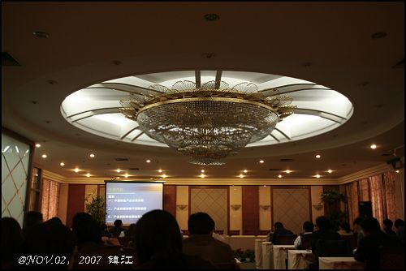

# 只为记录

周末依然是忙，感冒一天，第二天便好转了。  
公司要求每个星期一着正装上班，在镇江的会议上。不知道领导如何鉴定女士的正装？在时装日新月异的今天。  
  
   
  
授课的老师话题讲得即大又散，缺乏魅力的声音，没有自己的体会，也没有生动的案例，味同嚼蜡昏昏欲睡的创新讲座。期间和为人颇成功的老同事交谈，问她如何做到很少抱怨，她认为很多事情无法改变，抱怨无用，不如宽容接受。说到抱怨，我曾一度如此，现在却安静许多，她说这样可以活得轻松。智慧的从年轻时就有智慧在体内等待挖掘和成长，不智慧的近而凝固在面孔，永远的琐碎...小家子气。

---

## 评论（6）

**[afan](http://blog.wenxuecity.com/myblog.php?blogID=22490)** · 2007-11-05

一？你们公司领导听到我们的着装讨论了？

**大姜炖去** · 2007-11-05

智慧的从年轻时就有智慧在体内等待挖掘和成长，不智慧的近而凝固在面孔，永远的琐碎...小家子气。

经典

**Christina** · 2007-11-06

当时听到我也吃惊呢，在我们谈论穿衣话题之后没两天就宣布这个规定了。

**[阿帆](http://blog.wenxuecity.com/myblog.php?blogID=22490)** · 2007-11-06

估计你们领导也每晚看你的博克呢，哈哈

**雯子** · 2007-11-07

干脆公司统一订做制服得啦.不然,每个人对正装的理解不一样.还好只是星期一要求你们穿正装.

**Christina** · 2007-11-08

公司给员工定做了两套毛料正装，型太差，我都不知道扔哪儿了。

