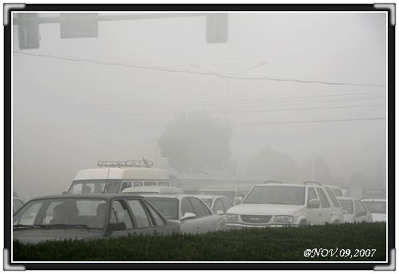
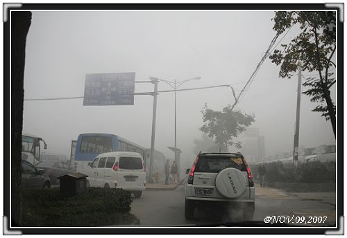

# 大雾

8:30出门。  
大雾，高架出口塞车，转从其它路口下，还是堵。  
大雾天气边开车边拍照很crazy，和前面那辆laibao相比却小巫见大巫，人家从慢车道转快车道，中间横一路牙，laibao骑上面轰了几十秒油门才过去，估计那时换了我也顾不了车咯，抢路要紧~  
  
   

---

## 评论（3）

**[afan](http://blog.wenxuecity.com/myblog.php?blogID=22490)** · 2007-11-09

very nice photo at top

**[BENM](http://blog.sina.com.cn/BENM)** · 2007-11-10

倒！开车还不忘拍照！

**农妇Adeline** · 2007-11-11

好像很久都没见过这样的大雾了。。。看着照片让我想起来那种凉沁沁的感觉，而且走在雾里会闻到一种特别的味道：有点灰尘有点草香。很难描述清楚的。

