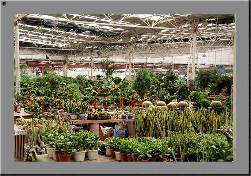
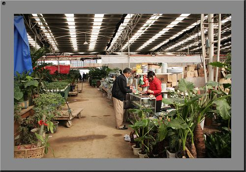
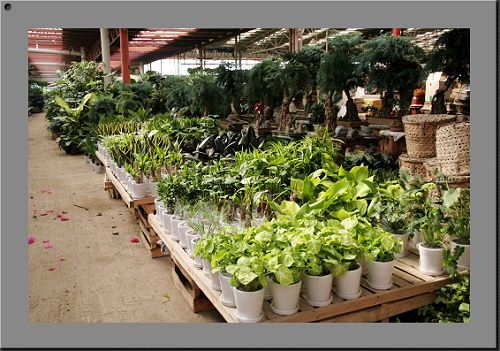
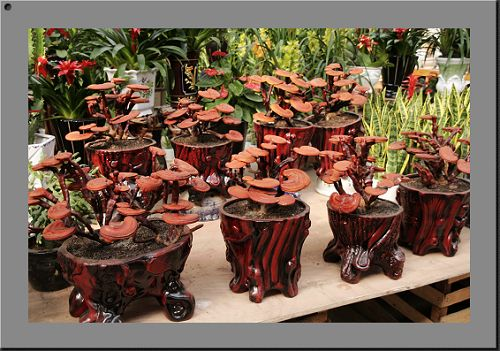
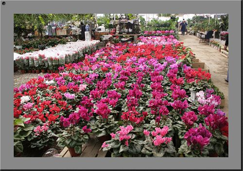

# 花卉园

越来越喜欢养植物，和爸爸去花卉园逛。  
   
爸爸在买盆景中用的小玩意儿.  
   
   
   

---

## 评论（3）

**[1](http://1)** · 2007-11-12

First? Yeah!

**Alex** · 2007-11-14

任何形式的生命的成长总是让人很投入.植物也一样!

**大姜炖去** · 2007-11-21

中间的是千年灵芝？

