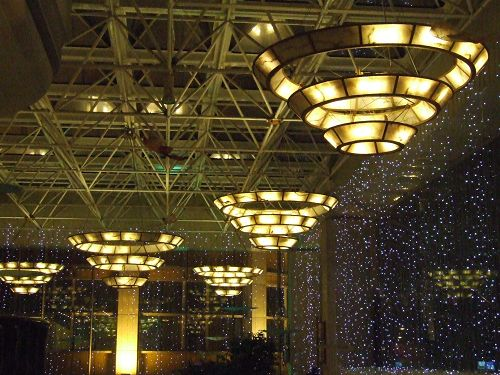
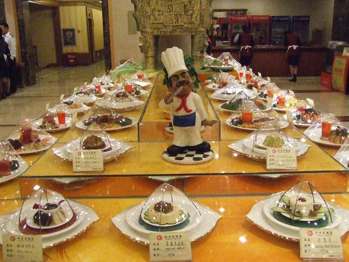
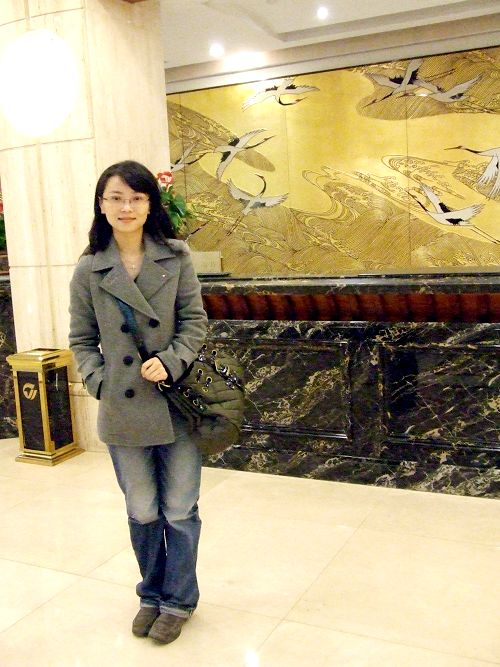

# 出差

乘一夜火车的记忆应该是12年前。  
这次出差到工厂，厂长的笑话多，另四个同事性格开朗，客人幽默，笑声不断。多些这样的出差，提高工作效率。有个情景要讲一下，客人吃饭时不经意打了个嗝，慌乱中说了sorry。周围好些人打嗝震天动地且逍遥大方，解释起来也许还是环境？！记得有个朋友说，她女友的BF是德国人，刚来中国看到很多人随地吐痰很是不解，过了一年这位德国人也开始随地吐痰了。当然，要是将随地吐痰和随便打嗝放在《泰塔尼克号》上那就是反现实叛逆的行为艺术，对吗？  
  
   
   

---

## 评论（4）

**[afan](http://blog.wenxuecity.com/myblog.php?blogID=22490)** · 2007-12-03

今年4月在西安大雁塔,见到一个不到两岁的小鬼妹,和我儿子差不多大, 和我儿子玩耍时,才到中国几个星期的小鬼妹居然往地上吐几次痰,真是让人大掉眼镜, 感叹环境的影响.

**[afan](http://blog.wenxuecity.com/myblog.php?blogID=22490)** · 2007-12-03

对了, share 一下 [Elton John 演唱会](http://bbs.tigtag.com/dispbbs.asp?boardID=3&ID=347354&page=1)

**EDWARD** · 2007-12-04

在球场上也是可以随地吐痰滴！呵呵

**绿恐龙** · 2007-12-05

嗯。。这张戴眼镜的美。。

