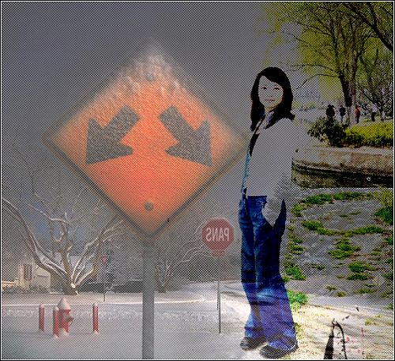

# 离喧哗很远，离自己很近。

抽了30张奖券，其中有28张是电影年票，2张储物盒，手气不错，周围人看着眼馋呢，哦也，28场电影，多么幸福的感觉，如果倒过来，28个储物盒~呵呵~  
  
立刻去电影院看了《投名状》，据说电影放映第二天，10元的盗版碟就在南京卖开了。第一次看老徐古装打扮有点不适应。70年代男生的梦中情人，活生生脸上脏了半场电影，说实话老徐这次的扮相真不怎么滋润，即使喜欢她还是有点失望，是不是考虑到她的博客人气导演选用她来演这个角色？都说《投名状》是男人的电影，看完之后我还是没融进剧情里，完全不在状态。记得有个知名主持人采访她，有关《一个陌生女人来信》里的女人如何悲哀，她说不觉得啊，就是觉得这个电影里面最可悲的是姜文演的那个男人从来没有真正爱过。而女主人公反而对自己最真实，想爱就爱，不想爱就不爱，而且是那种我爱你与你无关，与周围人无关。  
  
不晓得哪根筋蹩着，几年前的《人鱼小姐》在央视8套播映，从晚上10点开始一直到12：30结束，就这么每天晚上等着看，其实给妈妈买过《人鱼小姐》全套的DVD碟，不看碟子等电视台的看，一根筋也许就是这么解释的吧。妈妈总说我和雅俐英的性格象。芮莹和玛俊的恋情倒令人振奋和激动，周围人怎么想完全不是他们考虑的问题，即使被他人强烈的阻挠百般反对，仍然坚强的走到了一起。现实生活中玛俊的性格可能并不令人欣赏，然而这种唯唯诺诺的外表下却有着强于常人的毅志力。  
  
这一年就快过去了，到公司这么多年，还是第一年没有休完假期，白天大部分时间被工作霸占着，只有晚上是自由的。这一年我发现自己越来越不爱说话，有时和好朋友通个电话，开始常常一片空白不知道说什么。同时发现无视可怜无趣的嘴脸是如此轻松。  
  
这一年看到年轻的残忍，了解平静的幸福。  
这一年有点忙有点累。  
这一年离喧哗很远，离自己很近。  
  

---

## 评论（7）

**jiajialing** · 2007-12-21

好了，有电影看了:)

**okdata** · 2007-12-22

真羡慕楼主，晚上的时间属于自己。  
已有三年没有休假，每天回家累的什么都不想动  
回头看看也没做什么  
窗外飘过陈升的《风筝》,十多年了，依然心动。  
只是当初因音乐，而今为自己。  
回忆起过去对父母关心的无视，看着现在自己对孩子的牵挂

年轻的残忍源于世事浅薄，平静的幸福回归于激荡。  
离喧哗越远，距心灵愈近。  
苹果花开，清淡无华。

**[BENM](http://blog.sina.com.cn/BENM)** · 2007-12-23

“我爱你与你无关，与周围人无关”

好高的境界！也很喜欢老徐的电影，只是没时间去看，是古装片么？应该会是头次看到老徐的古装演绎！

我是白天晚上，周六日还有节假都被工作占着，跟楼上的一样

**雯子** · 2007-12-24

圣诞快乐 ！元旦快乐！ 新年快乐 ！

**angie** · 2007-12-24

“我爱你,但与你无关” 喜欢歌德这句话.  
这一年很快, 忙碌的时候其实每年都很快...  
圣诞快乐!

**[ibrand](http://www.ibrand.cn)** · 2007-12-24

和你有同样的感受！  
2003年的冬天，在广告公司，每天加班回家，把CCTV-8 海外剧场，11点开播的韩剧《孪生兄妹》当作每天送给自己最好的礼物，抽一根烟，或喝一杯牛奶，然后在凌晨1点满足的睡去。偶尔会打开窗回想一下几处剧情，第二天也会向女同事极力的推荐。那时候，经常会忘掉工作的辛苦。  
2004年冬天，准备来上海，临行前有一段闲适的日子，晚上同样的时间用2集《人鱼小姐》填满，竟然整整几十天的时间。  
《孪生兄妹》的碟一直找不到，《人鱼小姐》不敢想象能再看完。现在CCTV-8重播，偶尔会停下来，除了里面熟悉的故事和人物，经常怀念3年前第一次看时的那种喜悦。

**[sofiah](http://i.cn.yahoo.com/nyer@yahoo.cn)** · 2007-12-24

christina，你说的太好玩，真真就是么等着电视台的看，呵呵。还有楼上的，一看都是韩剧迷：P

