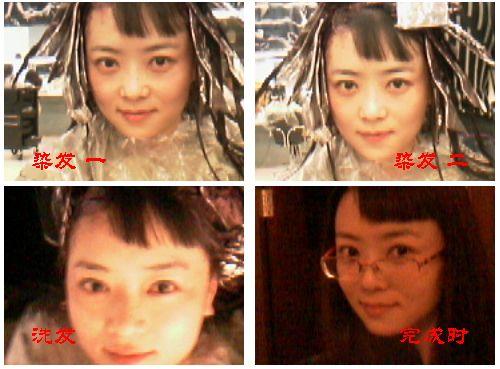
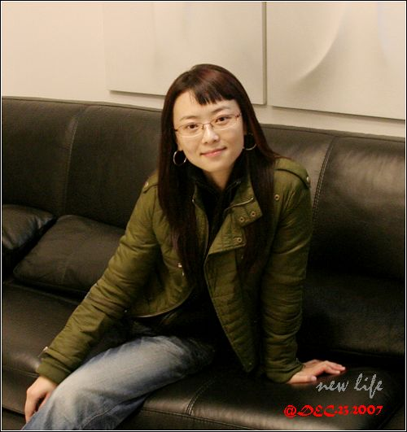

# 8.5个小时

我自己设计的刘海，以前曾这么剪过，回归一下~两种颜色的所谓创意染发~效果挺漂亮~  
  
周六晚上9：30到1：30，困得眼睛睁不开,连说打住吧。第二天下午从1：30左右到5：45总算结束了。用了8.5个小时弄看似简单的发型，痛苦的煎熬。据说有位女士，晚上11：30到店里烫发，一直到早晨5点才结束。  
  
造型师老大，这是[**造宇宙飞船**](http://photo.lifetea.org/v/Its+me/2007-dec/)吗？  
  

---

## 评论（21）

**angie** · 2007-12-24

以为烫了呢...头发盘起来更象陈逸飞画中的水乡女子了,哈哈

**nie** · 2007-12-24

应该烫卷

**Cindy** · 2007-12-24

显得比从前年轻许多，生活有时候需要改变。祝圣诞快乐！

**Christina** · 2007-12-24

卷了4年了~换换吧~

**emmaemma** · 2007-12-24

这么长时间，只是染发吗？   
节日快乐:)

**Christina** · 2007-12-24

还有把以前卷的头发拉直~

**[ibrand](http://www.ibrand.cn)** · 2007-12-24

对比前天的照片，变得简单而纯粹，像校园里恋爱中的学妹 ：）  
剥离掉工作的忙碌，好淡定的笑容，抿起一点点嘴角，变成我们这一代人回归简单的写照。希望我们的心都能像你的笑容一样年轻。  
看着看着连我也忍不住笑了，似乎回到年轻的从前。

**绿恐龙** · 2007-12-24

恩，麻辣女教师转型成了邻家学生妹，眼神多纯情奥。。

**okdata** · 2007-12-24

长发飘逸，不错；这时间，值  
内心阳光，好；正巧配着初冬  
不知又有多少人咬牙切齿了:)  
Merry Christmas!

**[农妇某人](http://adelinelv.spaces.live.com)** · 2007-12-25

染色染得很好，很自然阿。喜欢。  
可是那个刘海阿。。。我觉得还是以前的好，很随意很女人很知性。现在的这个好像挺僵硬的。

**[Sophie](http://www.flickr.com/photos/morena7)** · 2007-12-25

好看, 变了个人似的。象刚旅游完回来， 神清气爽的。Forever young, both outlook and inside!

**CAICAI** · 2007-12-25

阳光下拍几张吧，否则颜色好像不明显。

**luguo** · 2007-12-26

同志，您的头发戴歪了！

**雯子** · 2007-12-26

知性美女变成清纯学生。新发型好看这个留海比较有创意。蛮厉害哦，卷发卷了4年现今舍得拉直发啦。

**苏小小** · 2007-12-26

想不想听实话？  
真的不如之前好看。衬不出脸的模样，气质出不来。

**chenwei** · 2007-12-26

喝死我了

**James** · 2007-12-27

Hi Miss China, nice to meet you here,I’m from Philadelphia,US. where do you live in China? By the way,frankly, it seems that your taste is a little bit weird:)

**okdata** · 2007-12-27

It’s difficult to say decent or not because of the different culture environment. Anyway, the “weird” is not a bad taste:) But I was frightened by the four cell phone pictures:)

**okdata** · 2007-12-27

It’s difficult to say decent or not because of the different culture environment. Anyway, the “weird” is not a bad taste:) But I was frightened by the four cell phone pictures:)

**Christina** · 2007-12-28

....taste is a little bit weird:)  
关于taste，100个人有100种taste和观点，不强求理解接受，只求宽容即可，您说是吗？  
我住在南京。

**nie** · 2007-12-29

这是常识

