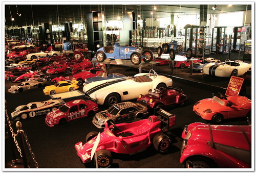
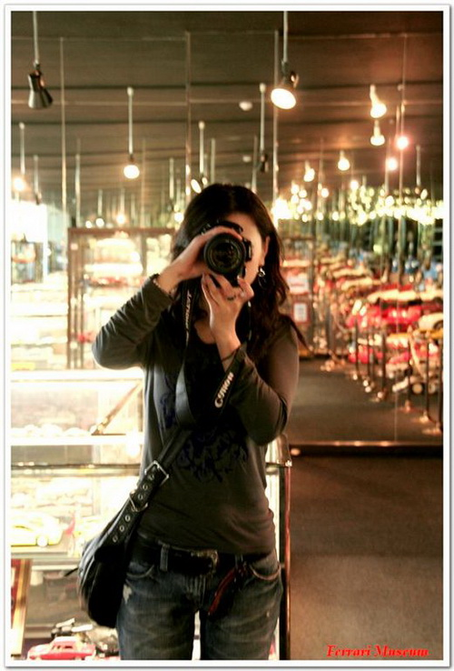

# Ferrari Museum@Japan

   
  
  
[**more pix here...**](http://photo.lifetea.org/v/travel/Japan/ferrari+museum/?g2_page=1)

---

## 评论（7）

**okdata** · 2008-01-01

哈哈，果然勤奋，就是照片小了一点。不过蛮诱人的。Happy New Year!

**[王老板](http://www.bullogger.com/blogs/wanderlust/)** · 2008-01-01

新年快乐~~~~

**[Alan](http://www.00353.org)** · 2008-01-01

有幸第一次造访，很安逸的地方．看了你的一些小小说明，原来你也是南京的哦．老乡．有空去我那里坐坐．如果可以的话，交换个链接．网站已经填写了．呵呵～～  
顺祝新年快乐

**yezi** · 2008-01-02

乍一看标题以为你去了日本，又。

**[稚](http://zhispace.spaces.live.com/)** · 2008-01-02

很喜欢你的风格与生活态度，谢谢一直在这里与我们分享  
祝新年快乐！

**绿恐龙** · 2008-01-02

日本？

**[moko](http://mokochen.blogbus.com)** · 2008-01-03

cool pictures. happy new year!

