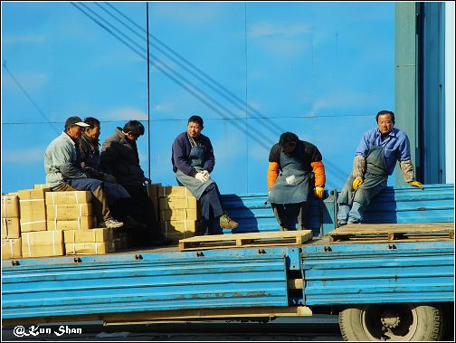
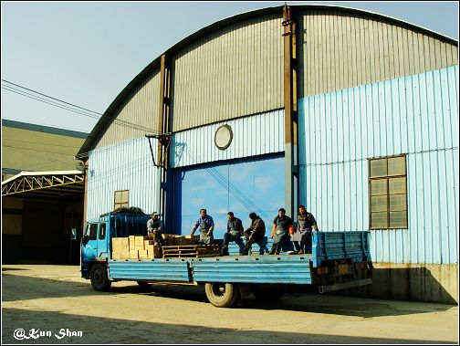
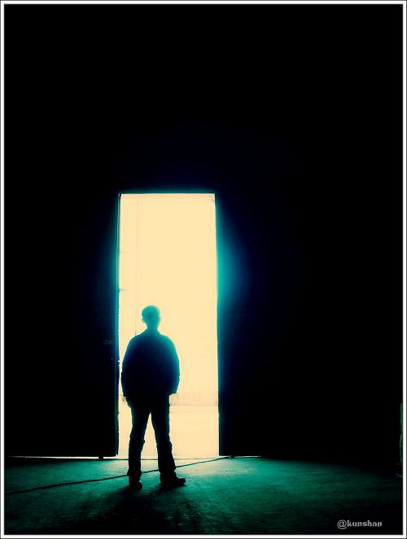
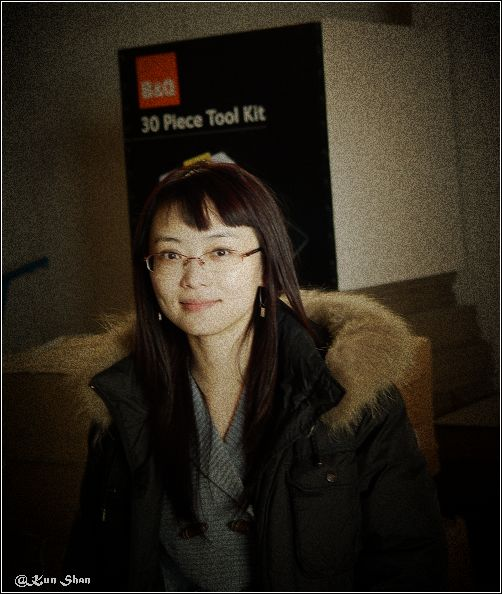

# 无题

   
   
   

---

## 评论（17）

**nie** · 2008-01-03

新年快乐  
这个人拍的跟我差不多

**jiajialing** · 2008-01-03

喜欢第三张

**[Numen](http://www.waiqi8.com)** · 2008-01-03

外企吧 http://www.waiqi8.com 讲述外企那点破事。。。

**Christina** · 2008-01-03

我也喜欢第三张，那人是我同事。  
我们是国企。您是乘机作广告吧？

**okdata** · 2008-01-03

喜欢那种旧旧的味道，尤其是第四张的大面效果，貌似粗糙的暗背景中显露细腻。如果不是后期PS的，那么曝光条件选得极好。很有早期CMOS感光头的感觉，真想知道350D的CMOS怎么表现出来的。因为CCD过于细腻，暗视野下也非常清晰。这点可在300～500万像素时代的尼康和东芝像机中发现。

**抱怨** · 2008-01-04

实在不喜欢主人老是贴自己的照片，一点新意都没有。  
那张脸能不能换一下？？？？或者换个表情，姐姐您不累吗？

**Christina** · 2008-01-04

姐姐我不累啊：）姐姐我就这表情，直到你看腻了“不来中国茶”为止：）继续努力哦~

**[moko](http://mokochen.blogbus.com)** · 2008-01-05

总是觉得国内的工人很可怜，跟国外完全不同，最低工资的制度可以保障最低生活水平，也让人和人之间更平等。  
有时在电视上看到国内的民工，常常觉得心痛，觉得他们像我的父亲和祖父一样。

**selina** · 2008-01-05

几年如一日的喜欢你.新年快乐:)

**Edward** · 2008-01-05

在昆山啊，一个我生活了十几年的地方，不过光看照片认不出来，呵呵。第一张不错，蓝天白云和休闲的男人。

**Christina** · 2008-01-05

蓝天白云和休闲的男人？晕倒~那是蓝色的大门和搬运工。

提及国内的农民工，他们这样也许还算稍微好一些的，还有更苦的，马上要过春节了，又是农民工讨要工钱的时候了。总之，农民工里也有混的好的，混的不好的就是干最简单基本的体力活。

这段时间我好象看着别人过的不好，心里就同情，最近我在想我同情别人，是不是也有其他人在同情我？

**HANK** · 2008-01-06

昨天刚看了日本NHK电视台拍的《激流中国-富人与穷人》，对比了中国的顶级富豪和最贫困的农民工的生活。有空找来看看吧。

**Edward** · 2008-01-06

哈哈，我眼神太差了，竟然没有看出来，不过这张照确实很有迷惑性。中国的农民工是很值得同情，无论是社会地位和财富都很低，等哪天这些人富裕了，中国才算是强大了。

**David** · 2008-01-07

所谓“中国在能够输出价值观之前，不会成为一个大国”在奥运年不合时宜的引用一下。自诩的忠孝礼义蜕变为道貌岸然之前，只能说钱是什么，钱是王八蛋。

**Christina** · 2008-01-08

钱是王八蛋?你和钱过不去啊?  
敬佩!

**四海为家** · 2008-01-09

世界上很多人付出很多却没有得到回报，其实在那里都有一些很聪明但很不走运的人，但总是生不逢时，BAD LUCKY，我很佩服他们的乐观和勇气。楼主有点无病呻吟，你真的已经是很LUCKY的人，你应该感恩而不是抱怨。

**Christina** · 2008-01-09

我最近有抱怨什么吗？lucky的生活难道就没有负面情绪了？每个人烦恼的事情也不一样吧？不过还是感谢您的忠告，珍惜生活就好，所以我一直还是比较积极的活着~

